# La economía de Milei en datos

**Qué pasó con la inflación, el salario real, la actividad, la inversión, las cuentas públicas, el dólar, los bonos y las acciones desde el 10 de diciembre de 2023.** Todo con datos oficiales, al último dato disponible (octubre de 2026).

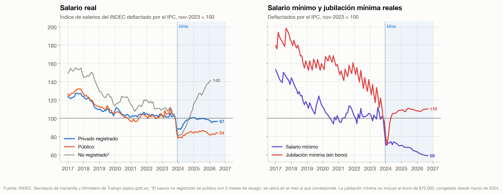

## Resumen

| | Al asumir | Último dato |
|---|---:|---:|
| Inflación mensual | 25,5% (dic-23) | 1,9% (sep-26) |
| Inflación interanual | 289% (pico, abr-24) | 33% (sep-26) |
| Salario real privado registrado | 100 (nov-23) | 97 (jul-26) |
| Salario real público | 100 | 84 |
| Salario mínimo real | 100 | 59 (sep-26), el más bajo de la serie |
| PBI | 2023: −1,9% | 2024: −1,4% · 2025: +4,5% · S1-26: +2,2% |
| Inversión (IBIF) | 2023: −2,5% | 2024: −17,5% · 2025: +16,2% · S1-26: −11,5% |
| Resultado primario | −2,7% del PBI (2023) | +1,8% (2024) · +1,4% (2025) · +1,3% (12m a ago-26) |
| Resultado financiero | −4,3% del PBI (2023) | +0,3% (2024) · +0,2% (2025) · 0,0% (12m a ago-26) |
| Gasto primario real | 2023 = 100 | 74 (2025) |
| Riesgo país | 1.920 pb | mínimo 402 (10/7/26) · 787 (30/10/26) |
| ADRs argentinos (USD) | 100 | 179 (pico 292 en ene-25) · S&P 500: 170 |
| Bonos GD30/GD35/GD41 (retorno total USD) | 100 | 258 / 238 / 226 |
| Brecha cambiaria | 150% | 8% |
| Reservas brutas | US$ 21,2 mil M | US$ 50,6 mil M |
| Pobreza | 41,7% (S2-23) | 52,9% (S1-24) · 28,2% (S2-25) · 32,3% (S1-26) |
| Desocupación | 5,7% (T4-23) | 7,9% (T2-26) |

**El balance en una línea:** el programa ganó la estabilización (inflación, superávit fiscal, fin de la brecha, riesgo país, reservas, pobreza contra 2023), pero el salario público, el salario mínimo, la inversión y el empleo quedaron abajo, y en 2026 aparecen señales de desgaste: la inflación se estancó en torno a 2% mensual, la actividad y la inversión caen, la pobreza y el desempleo suben y el riesgo país se duplicó desde julio.

## 1. Inflación: de 25% a 2% mensual, y ahí se frenó

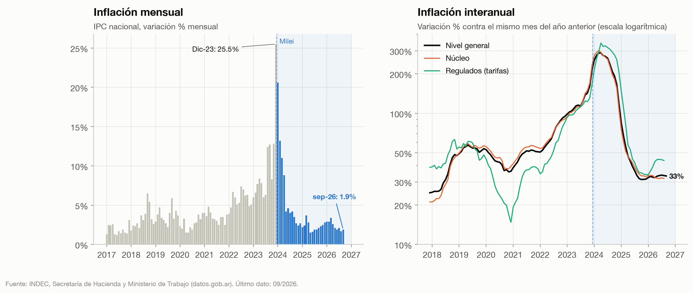

- La inflación mensual bajó de 25,5% en diciembre de 2023 (el mes de la devaluación) a 1,9% en septiembre de 2026. La interanual tocó 289% en abril de 2024.
- La desinflación se cortó a mediados de 2025: desde entonces la interanual quedó en 31% a 33% y la mensual entre 1,5% y 3%.
- Los precios regulados (tarifas, transporte, combustibles) subieron 52% más que la inflación núcleo desde noviembre de 2023: la corrección de precios relativos que se postergó en 2022 y 2023.

## 2. Salario real: el privado volvió, el público y el mínimo no


- En diciembre de 2023 y enero de 2024 el salario real cayó 12% en el sector privado registrado y 22% en el público.
- El privado registrado se recuperó hasta 101 en enero de 2025 y volvió a bajar: está en 97, un 3% debajo de noviembre de 2023. El público, en 84.
- El salario mínimo perdió 41% y está en el nivel más bajo de la serie. La jubilación mínima sin bono quedó 10% arriba por la indexación mensual desde abril de 2024, pero el bono de $70.000 está congelado desde marzo de 2024: con el bono incluido, el haber total queda por debajo de noviembre de 2023.
- El salario no registrado subió 42%, desde un piso muy bajo. Es la serie más volátil del INDEC, y se publica con 5 meses de rezago: acá está ubicada en el mes al que corresponde.
- Mirado desde 2017, la caída viene de antes: el privado registrado sigue 22% debajo del promedio de 2017, el público 35% y el mínimo 59%.

## 3. Actividad: recesión en 2024, rebote en 2025, freno en 2026

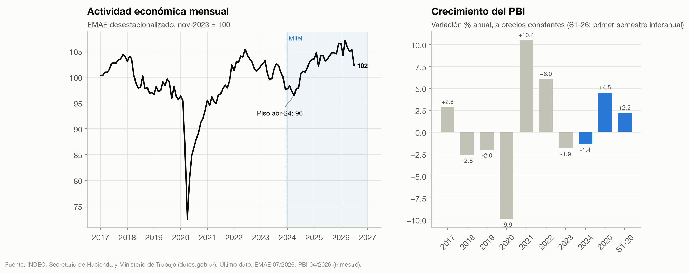

- El PBI cayó 1,4% en 2024 y creció 4,5% en 2025. En el primer semestre de 2026 creció 2,2% interanual.
- El EMAE tocó su piso en abril de 2024 (96, con noviembre de 2023 = 100), llegó a 107 en marzo de 2026 y en julio de 2026 bajó a 102.

## 4. Inversión: el punto débil

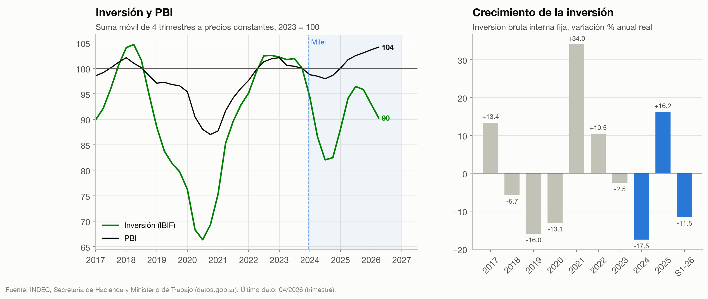

- La inversión cayó 17,5% en 2024, rebotó 16,2% en 2025 y vuelve a caer en 2026 (−11,5% en el primer semestre).
- El PBI está 4% arriba de 2023; la inversión, 10% abajo. La tasa de inversión a precios constantes bajó de 20,8% a 18,1% del PBI.

## 5. Equilibrio fiscal: primer superávit financiero de la serie

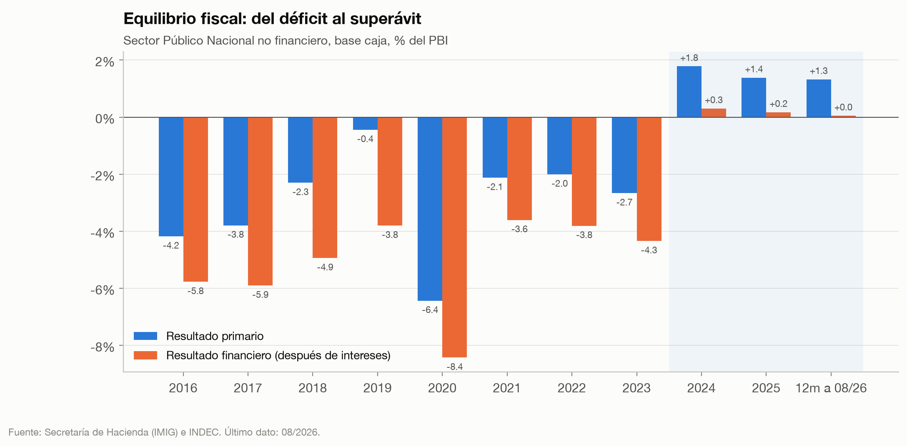

- El resultado primario pasó de −2,7% del PBI en 2023 a +1,8% en 2024 y +1,4% en 2025. El financiero, después de intereses, pasó de −4,3% a +0,3% y +0,2%. Ningún año desde 2016 había tenido superávit.
- En los últimos 12 meses a agosto de 2026 el superávit primario es 1,3% del PBI y el financiero, cero: el margen se está achicando.

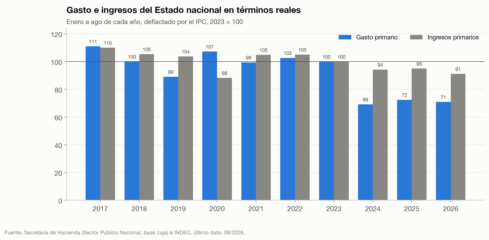

- El ajuste fue por el gasto: el gasto primario real de 2025 está 26% debajo de 2023, mientras que los ingresos cayeron 6%. En 2026 los ingresos siguen bajando (91 entre enero y agosto, contra 100 en 2023).

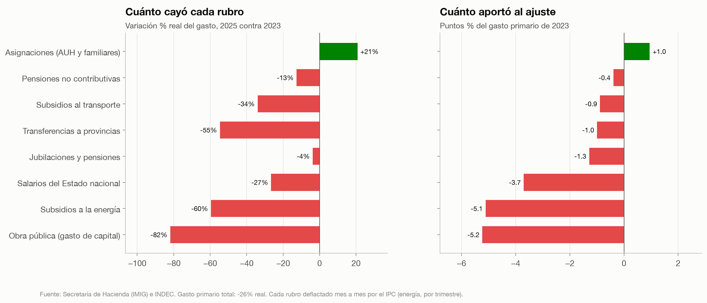

- La obra pública (−82%) y los subsidios a la energía (−60%) explican cada uno unos 5 puntos del recorte. Les siguen los salarios del Estado (−27%, 3,7 puntos).
- Las jubilaciones cayeron 4% real contra 2023 y aportaron 1,3 puntos. Las asignaciones (AUH y familiares) fueron el único rubro que subió: +21%.

## 6. Mercados: bonos y acciones

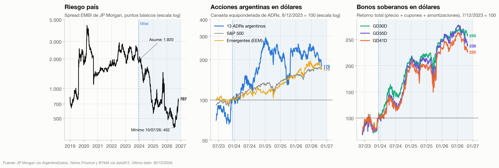

- El riesgo país bajó de 1.920 puntos al asumir a 402 el 10 de julio de 2026, y desde entonces casi se duplicó: 787 el 30 de octubre.
- Los bonos en dólares rindieron entre 126% y 158% en total desde la asunción, con cupones y amortizaciones incluidos.
- Las acciones argentinas (13 ADRs) llegaron a casi triplicarse en enero de 2025. Hoy están 79% arriba de la asunción, apenas por encima del S&P 500 (+70%) en el mismo período. Qué explica la caída desde julio de 2026 se analiza en el repo [riesgo-politico-latam](https://github.com/babottomas561-cell/riesgo-politico-latam).

## 7. Dólar y reservas

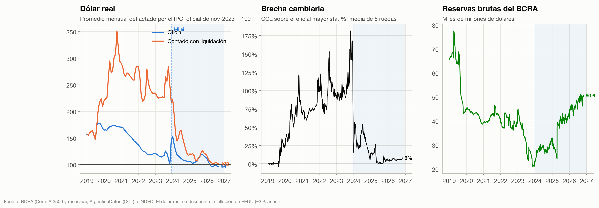

- La brecha cambiaria pasó de 150% a 8%.
- La devaluación de diciembre de 2023 llevó el dólar oficial real a 153. Hoy está en 96, por debajo de noviembre de 2023: la apreciación real borró la devaluación. El cálculo no descuenta la inflación de EEUU, que reduce algo esa apreciación.
- Las reservas brutas subieron de US$ 21 mil millones a US$ 51 mil millones. El salto de abril de 2025 es el desembolso del FMI.

## 8. Pobreza y empleo

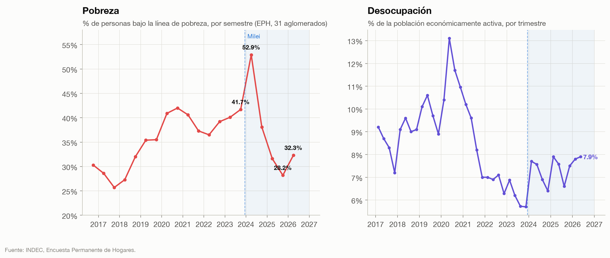

- La pobreza saltó de 41,7% a 52,9% en el primer semestre de 2024, bajó a 28,2% en el segundo de 2025, el nivel más bajo desde 2018, y volvió a subir a 32,3% en el primer semestre de 2026.
- La desocupación subió de 5,7% a 7,9%.

## Cómo leer estos números

- **La base importa.** Contra noviembre de 2023, la caída de diciembre y enero cuenta como del gobierno actual. Contra diciembre de 2023, el salario privado registrado daría una suba, porque diciembre ya tenía la devaluación adentro. Ninguna base es neutral: noviembre es la que no esconde el shock inicial.
- **Parte de la herencia estaba reprimida.** En noviembre de 2023 había tarifas y dólar oficial congelados y una brecha de 150%. La corrección de esos precios explica buena parte del salto inicial de la inflación y de la caída del salario, y es difícil separar cuánto fue decisión propia y cuánto inevitable.
- **El IPC usa una canasta de 2004.** Pondera poco los servicios y las tarifas, que fueron lo que más subió. Con una canasta actual, la inflación de 2024 y 2025 daría algo más alta y el salario real algo más bajo.
- **Superávit fiscal no es lo mismo que deuda baja.** El resultado es base caja: los intereses capitalizados de las Lecaps se pagan al vencimiento junto con el capital y no entran como intereses, así que el superávit financiero es algo más chico de lo que muestra la serie.
- **Los datos de 2026 son parciales.** Actividad e inversión llegan a julio y al segundo trimestre, el fiscal a agosto, la pobreza al primer semestre.

## Datos y método

| Tema | Serie | Fuente |
|---|---|---|
| Precios | IPC nacional, núcleo y regulados (dic-2016 = 100) | INDEC vía [datos.gob.ar](https://datos.gob.ar); el último mes, vía ArgentinaDatos |
| Salarios | Índice de salarios (privado registrado, público, no registrado), salario mínimo, haber mínimo | INDEC, Ministerio de Trabajo, ANSES |
| Actividad | EMAE desestacionalizado, PBI e inversión bruta interna fija a precios de 2004 | INDEC |
| Fiscal | Sector Público Nacional no financiero, base caja (IMIG) | Secretaría de Hacienda |
| Mercados | Riesgo país (EMBI), 13 ADRs, S&P 500, EEM, Globales GD30/GD35/GD41 | JP Morgan vía ArgentinaDatos, Yahoo Finance, BYMA vía data912 |
| Dólar | Oficial (Com. A 3500), CCL, reservas brutas | BCRA, ArgentinaDatos |
| Social | Pobreza (EPH, 31 aglomerados) y desocupación | INDEC |

- **Base de comparación:** noviembre de 2023, el último mes completo del gobierno anterior. Así la caída de diciembre de 2023 y enero de 2024 entra en la cuenta del gobierno actual.
- **Real** quiere decir deflactado mes a mes por el IPC nacional.
- **PBI anual:** el INDEC publica cada trimestre a tasa anual, así que el año es el promedio de los cuatro trimestres. Sumarlos daría un PBI cuatro veces más grande y un déficit cuatro veces más chico.
- **Bonos:** retorno total con cupones y amortizaciones, para que la amortización del GD30 no parezca una pérdida.
- **Pobreza:** cifras de los comunicados semestrales del INDEC (el de S1-26 se publicó el 24/9/2026).
- Todos los datos quedan congelados en `data/`: el resultado es reproducible sin conexión. Borrar un CSV fuerza la descarga.

```bash
uv sync
uv run python estudio/run.py
```

## Anexo: análisis descriptivo completo

Lo que sigue es el capítulo de análisis descriptivo entero: ficha, estadística descriptiva, tabla de frecuencias, histograma, boxplot y serie de tiempo de cada variable por gobierno (Macri, Fernández, Milei), análisis bivariado y las pruebas que preparan el modelo econométrico. Lo escribe el script a partir de `estudio/descriptivo/plantilla.md`; no editar a mano entre las marcas. También queda como documento aparte en [`estudio/descriptivo/ANALISIS_DESCRIPTIVO.md`](estudio/descriptivo/ANALISIS_DESCRIPTIVO.md).

```bash
uv run python estudio/descriptivo/descriptivo.py
```

<!-- descriptivo:inicio -->

## Capítulo 2. Análisis descriptivo de las variables

**La economía argentina bajo tres gobiernos: Macri (2015-2019), Fernández (2019-2023) y Milei (desde diciembre de 2023)**

> Este documento se genera con `uv run python estudio/descriptivo/descriptivo.py` a partir de `estudio/descriptivo/plantilla.md`, y el mismo script lo copia al final del `README.md`. Las tablas y los números entre llaves de la plantilla los calcula el script con los datos congelados en `data/` (último dato: inflación de sep-26, actividad de julio de 2026, cuentas nacionales del segundo trimestre de 2026, cuentas fiscales de agosto de 2026, EPH del primer trimestre de 2026 y mercados al 30/10/2026). El texto interpretativo se escribió sobre esos datos: si se actualizan, las tablas y las figuras cambian solas, pero conviene releer el texto.

### 2.1 Objetivo, organización y criterios

Este capítulo describe, una por una, las variables con las que el estudio evalúa el desempeño económico del gobierno de Javier Milei, y las compara con los dos gobiernos anteriores. No estima ningún modelo causal: su objetivo es conocer los datos antes de modelarlos, es decir, saber qué forma tiene cada distribución, cuánto cambia de un gobierno a otro, qué valores extremos la dominan, cómo se relacionan las variables entre sí y qué propiedades estadísticas (estacionariedad, autocorrelación, estacionalidad, quiebres) van a condicionar el modelo econométrico del capítulo siguiente.

El capítulo se organiza así. La sección 2.2 resume en una tabla todas las variables, su fuente y su frecuencia. La sección 2.3 muestra las series largas para tener una primera imagen de los diez años. La sección 2.4, el núcleo del capítulo, trata cada variable por separado con el mismo esquema: una **ficha** (qué es y cómo se mide, fuente, por qué se eligió y cuáles son sus limitaciones), una **figura de cuatro paneles** (serie de tiempo con los gobiernos sombreados, histograma superpuesto por gobierno, diagrama de caja y barras de media y mediana), la **tabla de estadística descriptiva**, la **tabla de distribución de frecuencias** y una **interpretación** con el contexto económico de cada período. La sección 2.5 compara los gobiernos con todas las variables a la vez, la 2.6 presenta el análisis bivariado (correlaciones y diagramas de dispersión), la 2.7 las pruebas que preparan el modelo y la 2.8 las limitaciones.

**Criterios comunes a todo el capítulo**

- **Períodos de gobierno.** Macri asumió el 10/12/2015, Fernández el 10/12/2019 y Milei el 10/12/2023. Cada observación se asigna al gobierno que estaba en el cargo en el **punto medio** del período que describe. Así, diciembre de 2023 es de Milei (asumió el día 10 y el mes incluye la devaluación del 13), pero el cuarto trimestre de 2023 y el segundo semestre de 2023 son de Fernández.
- **Muestra.** La mayoría de las series oficiales de datos.gob.ar que usa el estudio arrancan en enero de 2016. El IPC del INDEC se volvió a publicar en mayo de 2016 (después de la emergencia estadística declarada en enero de ese año), así que la inflación del gobierno de Macri empieza en mayo de 2016 y faltan sus primeros cinco meses, que incluyeron la salida del cepo de diciembre de 2015. **Las estadísticas de Macri son de un período incompleto y probablemente subestiman la inflación y la caída salarial de su primer año.**
- **Deflactor.** Las variables "reales" se deflactan mes a mes por el IPC nacional del INDEC (diciembre de 2016 = 100), extendido hacia atrás hasta abril de 2016 con las variaciones del IPC-GBA. La base de los índices reales es noviembre de 2023 = 100, el último mes completo del gobierno anterior.
- **Qué serie se describe.** Cuando una variable tiene tendencia (un índice de salario real, el nivel de reservas), su media por gobierno depende sobre todo de dónde empezó cada período, y su histograma mezcla niveles de años distintos. Por eso, para esas variables, la figura muestra el nivel en el tiempo pero el histograma, el boxplot y la tabla de frecuencias describen su **tasa de variación** (mensual o interanual), que es la que tiene una distribución comparable entre gobiernos. La tabla descriptiva del nivel se agrega aparte.
- **Estadísticos.** N, media, mediana, desvío estándar, mínimo, primer y tercer cuartil (Q1, Q3), máximo, coeficiente de variación, asimetría y curtosis. Se usan los estimadores muestrales corregidos de pandas. La curtosis es *en exceso*: 0 corresponde a una distribución normal y valores positivos indican colas más pesadas que la normal. El coeficiente de variación (CV = desvío / media × 100) solo se informa cuando la variable es estrictamente positiva: en tasas que cambian de signo la media puede estar cerca de cero y el CV se vuelve arbitrariamente grande y no tiene interpretación.
- **Tablas de frecuencias.** Los intervalos son **comunes a los tres gobiernos**, para que las frecuencias relativas se puedan comparar fila por fila, y son cerrados a izquierda y abiertos a derecha, [a; b). El número de intervalos sigue la regla de Sturges, k = 1 + 3,322 · log₁₀ N, con N el total de observaciones de los tres gobiernos, y el ancho se redondea a un valor "limpio" (1, 2, 2,5 o 5 por una potencia de 10). Como casi todas las series tienen colas pesadas, los intervalos cubren el rango entre los percentiles 2,5 y 97,5 y lo que queda afuera se agrupa en dos **clases abiertas** en los extremos ("menos de a", "b o más"); si no, un único mes extremo, como diciembre de 2023, obligaría a usar intervalos tan anchos que toda la distribución caería en uno o dos. Para cada gobierno se informan la frecuencia absoluta (fa), la relativa (fr, %) y la relativa acumulada (Fr, %). La inflación mensual es la única variable con intervalos de distinto ancho, elegidos a mano (ver 2.4.1).
- **Lectura de las figuras.** En las series de tiempo el fondo marca el gobierno (amarillo Macri, verde Fernández, azul Milei) y las líneas punteadas numeradas, los eventos: 1 PASO de 2019, 2 vuelta del cepo, 3 cuarentena, 4 legislativas de 2021, 5 balotaje de 2023, 6 devaluación de diciembre de 2023, 7 salida del cepo, 8 elección en la provincia de Buenos Aires y 9 legislativas de 2025. Los histogramas están superpuestos (contorno de cada gobierno) y en porcentaje de las observaciones de cada uno, de modo que gobiernos con distinto N se comparan bien. En los boxplots la caja va de Q1 a Q3, la línea es la mediana, los bigotes llegan hasta 1,5 rangos intercuartiles y los puntos son atípicos; cuando un único valor extremo aplastaría las cajas, el eje se recorta y los valores fuera de escala se informan al pie.

### 2.2 Variables del estudio

| Dimensión | Variable | Fuente | Id / origen | Frecuencia | Unidad | Período |
|:---|:---|:---|:---|:---|:---|:---|
| Precios | Inflación mensual | INDEC (IPC) | ArgentinaDatos `finanzas/indices/inflacion` | Mensual | % mensual | may-16 a sep-26 |
| Precios | Nivel del IPC, núcleo y regulados | INDEC | `148.3_INIVELNAL_DICI_M_26`, `148.3_INUCLEONAL_DICI_M_19`, `148.3_IREGULANAL_DICI_M_22` | Mensual | Índice dic-16 = 100 | dic-16 a sep-26 |
| Ingresos | Salario privado registrado | INDEC (índice de salarios) | `149.1_SOR_PRIADO_OCTU_0_25` | Mensual | Índice oct-16 = 100, deflactado | abr-16 a jul-26 |
| Ingresos | Salario público | INDEC | `149.1_SOR_PUBICO_OCTU_0_14` | Mensual | Ídem | abr-16 a jul-26 |
| Ingresos | Salario no registrado | INDEC | `149.1_SOR_PRIADO_OCTU_0_28` (corrido −5 meses) | Mensual | Ídem | may-16 a feb-26 |
| Ingresos | Salario mínimo, vital y móvil | Ministerio de Trabajo | `57.1_SMVMM_0_M_34` | Mensual | $ por mes, deflactado | abr-16 a sep-26 |
| Ingresos | Salario en blanco y en negro, tasa de no registro | INDEC, microdatos de la EPH (cálculo propio) | `data/eph_salarios.csv` (`P21`, `PP07H`, `PONDIIO`) | Trimestral | $ por mes; % | T1-17 a T1-26 |
| Actividad | EMAE desestacionalizado | INDEC | `143.3_NO_PR_2004_A_31` | Mensual | Índice 2004 = 100 | ene-16 a jul-26 |
| Actividad | PBI, consumo privado y público, inversión, exportaciones, importaciones | INDEC (cuentas nacionales) | `4.2_OGP_2004_T_17`, `4.2_MGCP_2004_T_25`, `4.2_DGCP_2004_T_30`, `4.2_DGIT_2004_T_25`, `4.2_DGE_2004_T_26`, `4.2_OGI_2004_T_25` | Trimestral | Millones de $ de 2004, tasa anual | T1-16 a T2-26 |
| Actividad | PBI y componentes nominales | INDEC | `4.4_OGP_2004_T_17`, `4.4_DGCP_2004_T_27`, `4.4_DGCP_2004_T_30`, `4.4_DGI_2004_T_19`, `4.4_OGI_2004_T_25`, `4.4_DGT_2004_T_20`, `4.4_DE_2004_T_24`, `4.4_VE_2004_T_21` | Trimestral | Millones de $ corrientes, tasa anual | T1-16 a T2-26 |
| Actividad | Valor agregado por sector (13 sectores) | INDEC | `11.2_ISOT_2004_T_39`, `11.2_VMASD_2004_T_23`, `11.2_VMATC_2004_T_12`, etc. (ver `SECTORES` en el script) | Trimestral | Millones de $ de 2004 | T1-16 a T2-26 |
| Fiscal | Resultado primario | Secretaría de Hacienda (IMIG) | `452.3_RESULTADO_RIO_0_M_18_54` | Mensual | Millones de $ | ene-16 a ago-26 |
| Fiscal | Intereses de la deuda | Hacienda | `452.3_INTERESES_TOS_0_M_15_62` | Mensual | Millones de $ | ene-16 a ago-26 |
| Fiscal | Ingresos primarios | Hacienda | `379.9_ING_PRIMAR017__36_12` | Mensual | Millones de $ | ene-16 a ago-26 |
| Fiscal | Gasto primario | Hacienda | `379.9_ING_PRIMAR017__36_12` − `379.9_SUPERAVIT_017__23_94` | Mensual | Millones de $ | ene-16 a ago-26 |
| Fiscal | Jubilaciones y pensiones | Hacienda | `452.2_JUBILACIONVAS_0_T_36_18` | Mensual | Millones de $ | ene-16 a ago-26 |
| Fiscal | Gasto por rubro | Hacienda | ids `452.2_*` y `452.3_CAPITAL_*` (ver `estudio/run.py`, `FISCAL`) | Mensual | Millones de $ | ene-16 a ago-26 |
| Fiscal | Subsidios a la energía | Hacienda | `452.2_ENERGIAGIA_0_T_7_79` | Trimestral | Millones de $ | T1-16 a T2-26 |
| Cambio | Dólar oficial mayorista | BCRA (Com. A 3500) | API BCRA v4, variable 5 | Diaria | $ por US$ | dic-15 a oct-26 |
| Cambio | Contado con liquidación | ArgentinaDatos | `cotizaciones/dolares/contadoconliqui` | Diaria | $ por US$ | 2016 a oct-26 |
| Cambio | Reservas brutas | BCRA | API BCRA v4, variable 1 | Diaria | Millones de US$ | 2016 a oct-26 |
| Mercados | Riesgo país | JP Morgan (EMBI) vía ArgentinaDatos | `finanzas/indices/riesgo-pais` | Diaria | Puntos básicos | dic-15 a oct-26 |
| Mercados | Acciones (13 ADRs) | Yahoo Finance | GGAL, BMA, BBAR, SUPV, YPF, PAM, TGS, CEPU, EDN, TEO, CRESY, LOMA, IRS | Diaria | US$, ajustado | ene-19 a oct-26 |
| Mercados | Bonos soberanos | BYMA vía data912 | GD30D, GD35D, GD41D | Diaria | US$ MEP por 100 VN | oct-21 a oct-26 |
| Social | Pobreza | INDEC (EPH, 31 aglomerados) | Comunicados semestrales | Semestral | % de personas | S2-16 a S1-26 |
| Social | Desocupación | INDEC (EPH) | `42.3_EPH_PUNTUATAL_0_M_30` | Trimestral | % de la PEA | T2-16 a T2-26 |

Todas las series de datos.gob.ar se descargan con `load_series` (`src/quantkit/data.py`), pidiendo por separado las mensuales y las trimestrales: si se mezclan frecuencias en una misma consulta, la API agrega en silencio todas las series a la frecuencia más baja. El PBI trimestral del INDEC está **a tasa anual**: el PBI de un año es el promedio de sus cuatro trimestres, no la suma, y los flujos fiscales de 12 meses se dividen por ese promedio.

### 2.3 Panorama: las series largas

Antes de tratar cada variable conviene mirarlas juntas en el tiempo, porque buena parte de lo que después aparece en las tablas (asimetrías, colas pesadas, cambios de media) se explica por unos pocos episodios que se ven a simple vista.

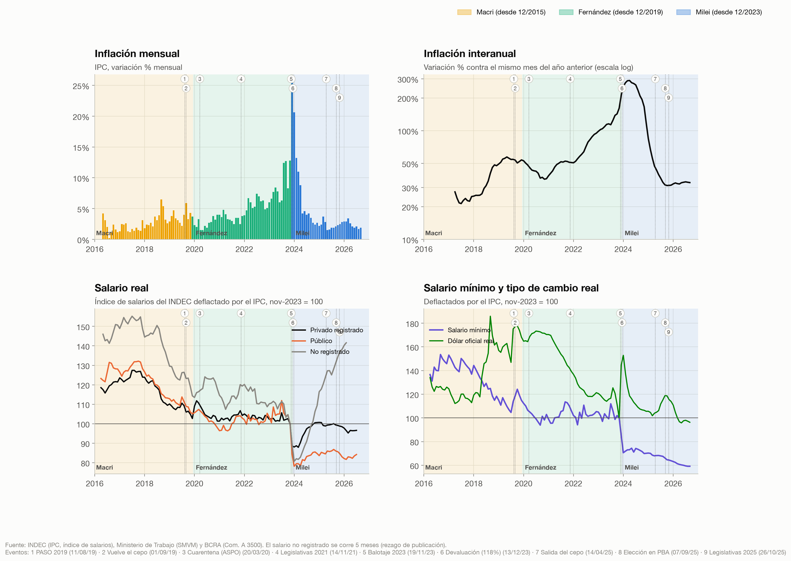

**Figura 2.1.** La inflación mensual tiene tres tramos nítidos: un nivel de 1% a 4% con Macri (con saltos en 2018 y después de las PASO de 2019), una aceleración casi continua con Fernández hasta 12,8% en octubre-noviembre de 2023, y con Milei un pico de 25,5% en diciembre de 2023 seguido de una desinflación muy rápida que se detiene en torno a 2% mensual desde mediados de 2025. La interanual, en escala logarítmica, muestra lo mismo sin el ruido mensual: 289% en abril de 2024 y alrededor de 31-33% desde entonces. Los salarios reales del panel inferior cuentan otra historia: la caída es de larga data (el privado registrado venía de 120-127 en 2017), con un escalón abrupto en diciembre de 2023 que el sector privado recuperó a lo largo de 2024 y el sector público no. El salario no registrado es la serie más volátil y la única que con Milei supera su nivel de 2023. El salario mínimo real cae en cada gobierno y se desploma en el actual; el tipo de cambio real salta con la devaluación y vuelve a la zona de 100 en 2025-2026: la apreciación real borró la devaluación.

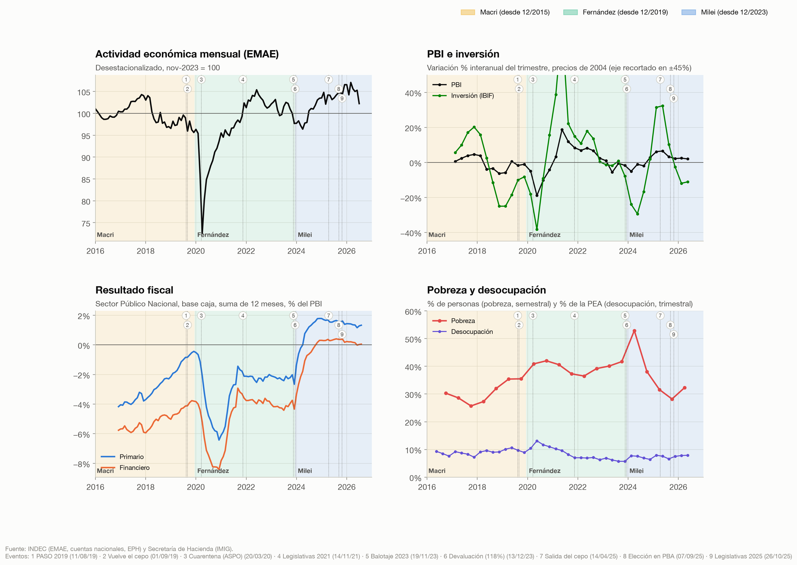

**Figura 2.2.** La actividad mensual (EMAE) no tiene tendencia de largo plazo: oscila alrededor de 100 durante diez años, con la caída de la cuarentena (marzo-abril de 2020) como único valor extremo. La inversión amplifica los ciclos del PBI: cae y sube entre dos y cuatro veces más que el producto en cada episodio. El resultado fiscal es la serie con el cambio de nivel más claro de todo el estudio: del rango −2% a −6% del PBI a un superávit primario de 1% a 2% sostenido desde 2024. La pobreza tiene un pico en el primer semestre de 2024 y cae a mínimos de la serie en el segundo de 2025; la desocupación se mueve en un rango más estrecho.

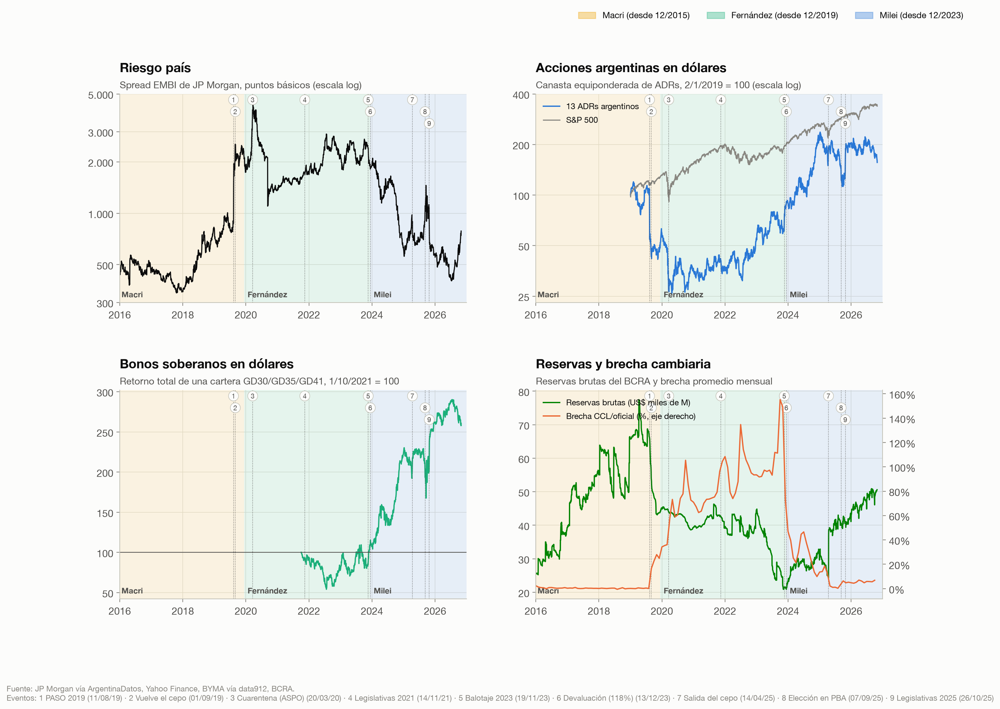

**Figura 2.3.** Las variables de mercado reaccionan a los eventos políticos con más claridad que las macroeconómicas: el riesgo país salta con las PASO de 2019 (evento 1) y vuelve a subir antes de la elección de Buenos Aires de septiembre de 2025 (evento 8); la canasta de ADRs pierde la mitad de su valor en un día después de esas PASO y casi se triplica entre la asunción de Milei y enero de 2025. La brecha cambiaria, cero mientras no hay cepo, llega a 150% en 2023 y se cierra con la salida del cepo (evento 7), el mismo mes del salto de reservas por el desembolso del FMI.

### 2.4 Análisis por variable

#### 2.4.1 Precios

##### Inflación mensual

*Qué es y cómo se mide.* La variación porcentual del nivel general del Índice de Precios al Consumidor (IPC) del INDEC respecto del mes anterior. El IPC mide el costo de una canasta fija de bienes y servicios de consumo de los hogares de las seis regiones del país (GBA, Pampeana, Noreste, Noroeste, Cuyo y Patagonia), con ponderaciones de la Encuesta Nacional de Gasto de los Hogares 2004/05. Los precios se relevan en comercios durante todo el mes, así que la variación mensual compara promedios de mes contra promedios de mes.

*Fuente y período.* INDEC, vía ArgentinaDatos (`finanzas/indices/inflacion`), mayo de 2016 a sep-26. Mensual, en % mensual.

*Por qué se eligió.* La estabilización de precios fue el objetivo central y explícito del programa económico de Milei y es la variable que condiciona a todas las demás: el poder de compra del salario, el tipo de cambio real y el valor real del gasto público dependen de ella. La frecuencia mensual da además la mayor cantidad de observaciones del estudio para comparar gobiernos.

*Limitaciones.* La canasta tiene más de veinte años y pondera poco los servicios y las tarifas, que fueron los precios que más subieron desde 2024: con ponderaciones actuales la inflación de 2024-2025 sería algo mayor. Entre enero y abril de 2016 no hay IPC del INDEC (ArgentinaDatos usa ahí el IPC de CABA, que este capítulo descarta), de modo que faltan los primeros meses de Macri.

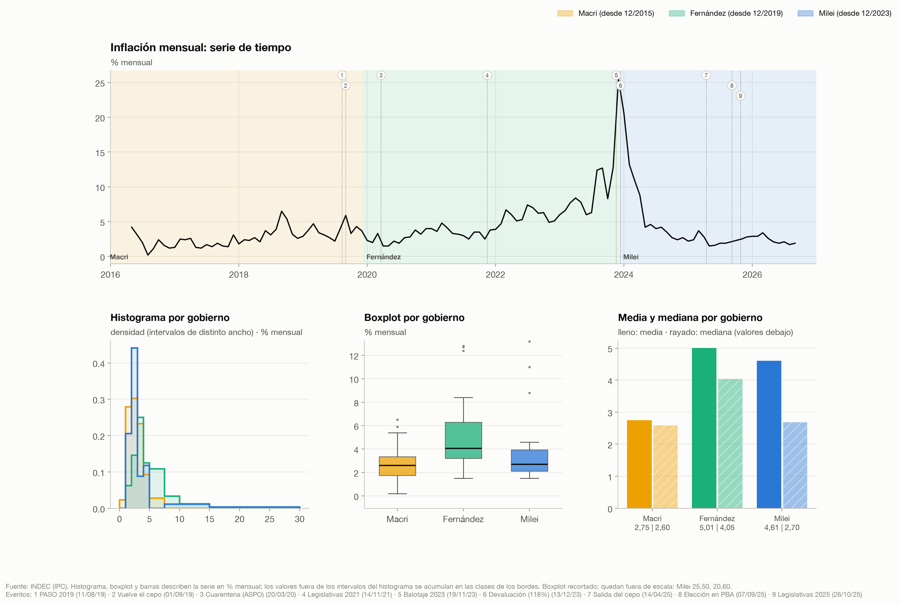

**Figura 2.4. Inflación mensual por gobierno: serie, histograma, boxplot y media contra mediana.**

**Tabla 2.1. Estadística descriptiva de la inflación mensual (%)**

| Gobierno | Período | N | Media | Mediana | Desvío | Mín | Q1 | Q3 | Máx | CV (%) | Asimetría | Curtosis |
|:---|---:|---:|---:|---:|---:|---:|---:|---:|---:|---:|---:|---:|
| Macri | may-16 a nov-19 | 43 | 2,75 | 2,60 | 1,34 | 0,20 | 1,75 | 3,35 | 6,50 | 48,69 | 0,80 | 0,74 |
| Fernández | dic-19 a nov-23 | 48 | 5,01 | 4,05 | 2,72 | 1,50 | 3,20 | 6,30 | 12,80 | 54,35 | 1,32 | 1,84 |
| Milei | dic-23 a sep-26 | 34 | 4,61 | 2,70 | 5,37 | 1,50 | 2,10 | 3,92 | 25,50 | 116,68 | 2,88 | 8,22 |
| Toda la muestra | may-16 a sep-26 | 125 | 4,12 | 3,10 | 3,48 | 0,20 | 2,20 | 4,70 | 25,50 | 84,50 | 3,32 | 14,84 |

**Tabla 2.2. Distribución de frecuencias de la inflación mensual (%)**

| Intervalo | Macri fa | Macri fr % | Macri Fr acum. % | Fernández fa | Fernández fr % | Fernández Fr acum. % | Milei fa | Milei fr % | Milei Fr acum. % |
|:---|---:|---:|---:|---:|---:|---:|---:|---:|---:|
| [0,0; 1,0) | 1 | 2,3 | 2,3 | 0 | 0,0 | 0,0 | 0 | 0,0 | 0,0 |
| [1,0; 2,0) | 12 | 27,9 | 30,2 | 3 | 6,2 | 6,2 | 7 | 20,6 | 20,6 |
| [2,0; 3,0) | 13 | 30,2 | 60,5 | 7 | 14,6 | 20,8 | 15 | 44,1 | 64,7 |
| [3,0; 4,0) | 10 | 23,3 | 83,7 | 12 | 25,0 | 45,8 | 3 | 8,8 | 73,5 |
| [4,0; 5,0) | 4 | 9,3 | 93,0 | 6 | 12,5 | 58,3 | 4 | 11,8 | 85,3 |
| [5,0; 7,5) | 3 | 7,0 | 100,0 | 13 | 27,1 | 85,4 | 0 | 0,0 | 85,3 |
| [7,5; 10,0) | 0 | 0,0 | 100,0 | 4 | 8,3 | 93,8 | 1 | 2,9 | 88,2 |
| [10,0; 15,0) | 0 | 0,0 | 100,0 | 3 | 6,2 | 100,0 | 2 | 5,9 | 94,1 |
| [15,0; 30,0) | 0 | 0,0 | 100,0 | 0 | 0,0 | 100,0 | 2 | 5,9 | 100,0 |
| **Total** | 43 | 100,0 |  | 48 | 100,0 |  | 34 | 100,0 |  |

Los intervalos de esta tabla no son los de Sturges, que con 125 meses daría 8 intervalos de igual ancho: como la cola de Milei recorre un rango diez veces mayor que el cuerpo de la distribución, todo el gobierno de Macri caería en uno o dos. Se usan intervalos de 1 punto hasta 5% y luego de 2,5, 2,5, 5 y 15 puntos, y por eso el histograma de la figura grafica la **densidad** (frecuencia relativa dividida por el ancho del intervalo): así el área de cada barra, y no su altura, es proporcional a la cantidad de meses.

La media de la inflación mensual con Milei (4,61%) es casi igual a la de Fernández (5,01%), pero la comparación de medias es engañosa: la **mediana** de Milei (2,70%) está mucho más cerca de la de Macri (2,60%) que de la de Fernández (4,05%). La diferencia entre media y mediana, la asimetría de 2,88 y la curtosis de 8,22 dicen lo mismo: la distribución de Milei es una masa de meses de 1,5% a 4% más una cola de muy pocos meses extremos (diciembre de 2023 a marzo de 2024). Es el caso típico en el que la mediana describe mejor el "mes típico" que la media, y el panel de barras de la figura lo muestra: Milei es el único gobierno en el que la media casi duplica a la mediana.

La tabla de frecuencias permite leer la forma de cada distribución sin pasar por los momentos. La clase modal de Macri y de Milei es la misma, [2,0; 3,0), pero con pesos muy distintos: 30,2% de los meses de Macri y 44,1% de los de Milei. La de Fernández es [5,0; 7,5), con 27,1%. Con Macri el 30% de los meses tuvo una inflación menor a 2%; con Fernández, el 6%; con Milei, el 21%. En el otro extremo, los meses con 5% o más fueron 7% del total con Macri, 42% con Fernández y 15% con Milei. La distribución de Fernández es la más corrida a la derecha y la más dispersa en el cuerpo (su caja va de 3,20% a 6,30%); la de Milei es la más concentrada en el centro (rango intercuartil de 2,10% a 3,92%) y, a la vez, la única con valores por encima de 15%.

El contexto económico explica esas formas. Con Macri, la inflación bajó en 2017 bajo un esquema de metas de inflación y volvió a subir con las crisis cambiarias de 2018 y de agosto de 2019; nunca superó el 6,5% mensual. Con Fernández, la combinación de emisión para financiar el déficit (en especial en 2020), controles de precios y cepo cambiario con brecha creciente produjo una aceleración casi monótona: cada año la inflación mensual típica fue más alta que el anterior, hasta 12,8% en noviembre de 2023, después de la devaluación posterior a las PASO de ese año. Con Milei, la devaluación del 13 de diciembre de 2023 (de 366 a 800 pesos por dólar) y la liberación de precios regulados llevaron la inflación a 25,5% en diciembre; desde ahí bajó en forma muy rápida, con un tipo de cambio que se movió al 2% mensual (crawling peg), superávit fiscal y fin del financiamiento monetario al Tesoro. Desde mediados de 2025 la desinflación se estanca entre 1,5% y 3% mensual.

Para toda la muestra la curtosis de 14,84 indica colas mucho más pesadas que una normal, y el CV de Milei (116,68%) duplica el de los gobiernos anteriores: es el período con la inflación menos estable, aunque esa inestabilidad se concentra en los primeros cuatro meses. Para el modelo, esto implica errores no normales y la necesidad de tratar explícitamente los meses de la devaluación (sección 2.7).

##### Inflación interanual

*Qué es y cómo se mide.* La variación porcentual del IPC nacional contra el mismo mes del año anterior. Se calcula con el índice en nivel extendido hacia atrás con el IPC-GBA, por eso arranca en abril de 2017.

*Fuente y período.* INDEC (`148.3_INIVELNAL_DICI_M_26`), abril de 2017 a sep-26. Mensual, en %.

*Por qué se eligió.* Es la medida de inflación que se usa en el debate público, en los contratos y en las paritarias, y la que elimina la estacionalidad sin necesidad de desestacionalizar.

*Limitaciones.* Cada dato contiene doce meses: la interanual "arrastra" la inflación del gobierno anterior durante el primer año del siguiente y sus observaciones consecutivas comparten once de esos doce meses, de modo que están fuertemente autocorrelacionadas y la cantidad efectiva de información es mucho menor que N.

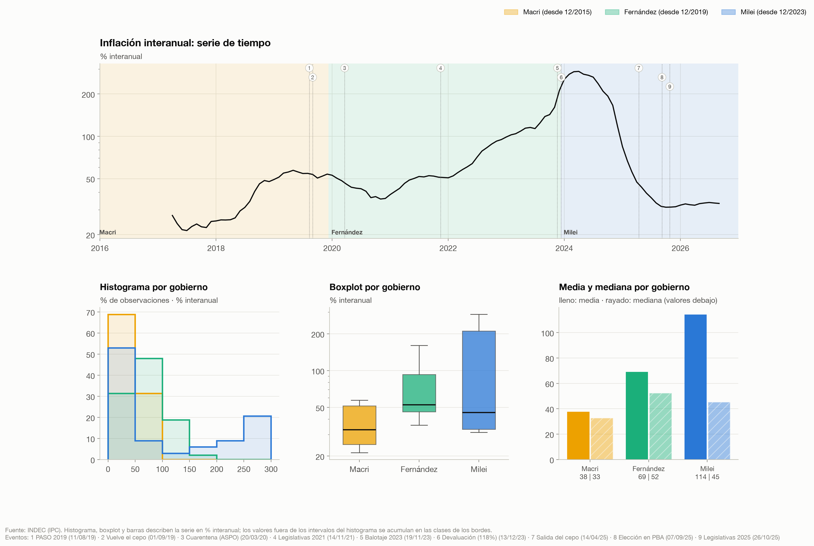

**Figura 2.5. Inflación interanual por gobierno.**

**Tabla 2.3. Estadística descriptiva de la inflación interanual (%)**

| Gobierno | Período | N | Media | Mediana | Desvío | Mín | Q1 | Q3 | Máx | CV (%) | Asimetría | Curtosis |
|:---|---:|---:|---:|---:|---:|---:|---:|---:|---:|---:|---:|---:|
| Macri | abr-17 a nov-19 | 32 | 37,7 | 32,8 | 13,7 | 21,4 | 25,0 | 51,5 | 57,3 | 36,4 | 0,17 | -1,84 |
| Fernández | dic-19 a nov-23 | 48 | 69,1 | 52,4 | 32,6 | 35,8 | 46,1 | 93,0 | 160,9 | 47,3 | 1,13 | 0,27 |
| Milei | dic-23 a sep-26 | 34 | 114,2 | 45,4 | 102,0 | 31,3 | 33,2 | 210,8 | 289,4 | 89,2 | 0,72 | -1,31 |
| Toda la muestra | abr-17 a sep-26 | 114 | 73,7 | 50,4 | 66,4 | 21,4 | 33,6 | 81,9 | 289,4 | 90,0 | 2,06 | 3,41 |

**Tabla 2.4. Distribución de frecuencias de la inflación interanual (%)**

| Intervalo | Macri fa | Macri fr % | Macri Fr acum. % | Fernández fa | Fernández fr % | Fernández Fr acum. % | Milei fa | Milei fr % | Milei Fr acum. % |
|:---|---:|---:|---:|---:|---:|---:|---:|---:|---:|
| [0; 50) | 22 | 68,8 | 68,8 | 15 | 31,2 | 31,2 | 18 | 52,9 | 52,9 |
| [50; 100) | 10 | 31,2 | 100,0 | 23 | 47,9 | 79,2 | 3 | 8,8 | 61,8 |
| [100; 150) | 0 | 0,0 | 100,0 | 9 | 18,8 | 97,9 | 1 | 2,9 | 64,7 |
| [150; 200) | 0 | 0,0 | 100,0 | 1 | 2,1 | 100,0 | 2 | 5,9 | 70,6 |
| [200; 250) | 0 | 0,0 | 100,0 | 0 | 0,0 | 100,0 | 3 | 8,8 | 79,4 |
| [250; 300) | 0 | 0,0 | 100,0 | 0 | 0,0 | 100,0 | 7 | 20,6 | 100,0 |
| **Total** | 32 | 100,0 |  | 48 | 100,0 |  | 34 | 100,0 |  |

La media de Milei (114,2%) es la más alta de los tres gobiernos, el doble de la de Fernández (69,1%) y el triple de la de Macri (37,7%). Es el efecto del arrastre: los primeros once meses de Milei acumulan la inflación de 2023 y la de la devaluación, y la interanual llega a su máximo de la serie (289,4%) en abril de 2024, cuatro meses después de que la mensual ya había empezado a bajar. La mediana (45,4%) es menor que la de Fernández (52,4%), y la tabla de frecuencias muestra la bimodalidad: el 52,9% de los meses de Milei están en la clase más baja, [0; 50), y casi un tercio (diciembre de 2023 a septiembre de 2024) por encima de 200%, con muy pocos meses en el medio.

La curtosis negativa de Macri (-1,84) y de Milei (-1,31) indica distribuciones "achatadas" o bimodales: en ambos períodos la inflación interanual pasó por dos niveles distintos (con Macri, alrededor de 25% en 2017 y alrededor de 50% en 2019; con Milei, más de 200% en 2024 y 31-33% desde 2025). En una serie con tendencia, la media es un mal resumen y el boxplot lo muestra con claridad: la caja de Milei es la más alta y la más larga, aunque el gobierno termina con la inflación interanual más baja de la década (31,3% en octubre de 2025).

Económicamente, la interanual es la variable que el público "siente", y explica por qué la percepción de la desinflación llegó con rezago: en abril de 2024 la mensual ya estaba en 8,8%, pero los precios eran casi cuatro veces los de un año antes. Para el modelo, la interanual no es una buena variable dependiente (sus errores están solapados por construcción); conviene modelar la mensual y reconstruir la interanual.

##### Inflación núcleo

*Qué es y cómo se mide.* La variación mensual del IPC núcleo del INDEC, que excluye los bienes y servicios con comportamiento estacional (frutas, verduras, ropa, turismo) y los regulados (tarifas, combustibles, transporte, prepagas, cigarrillos, educación formal). Representa el 70% de la canasta.

*Fuente y período.* INDEC (`148.3_INUCLEONAL_DICI_M_19`), enero de 2017 a agosto de 2026. Mensual, en % mensual.

*Por qué se eligió.* Separa la inflación "de fondo", que responde a la demanda, a las expectativas y al tipo de cambio, de los cambios de precios que decide el Estado. Es la que miran los bancos centrales para evaluar si una desinflación es genuina.

*Limitaciones.* Sigue usando las ponderaciones de 2004/05. No es una medida de "inflación subyacente" en sentido estadístico (no recorta extremos), sino una clasificación fija de productos.

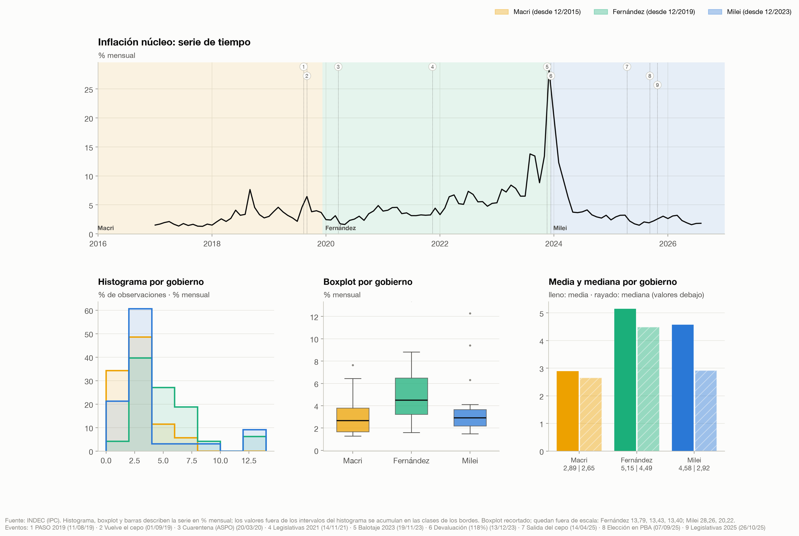

**Figura 2.6. Inflación núcleo por gobierno.**

**Tabla 2.5. Estadística descriptiva de la inflación núcleo (% mensual)**

| Gobierno | Período | N | Media | Mediana | Desvío | Mín | Q1 | Q3 | Máx | CV (%) | Asimetría | Curtosis |
|:---|---:|---:|---:|---:|---:|---:|---:|---:|---:|---:|---:|---:|
| Macri | ene-17 a nov-19 | 35 | 2,89 | 2,65 | 1,47 | 1,28 | 1,68 | 3,79 | 7,64 | 50,91 | 1,36 | 2,24 |
| Fernández | dic-19 a nov-23 | 48 | 5,15 | 4,49 | 2,84 | 1,61 | 3,24 | 6,49 | 13,79 | 55,08 | 1,61 | 2,80 |
| Milei | dic-23 a ago-26 | 33 | 4,58 | 2,92 | 5,61 | 1,48 | 2,20 | 3,65 | 28,26 | 122,64 | 3,27 | 11,09 |
| Toda la muestra | ene-17 a ago-26 | 116 | 4,31 | 3,23 | 3,69 | 1,28 | 2,31 | 4,67 | 28,26 | 85,72 | 3,62 | 17,78 |

**Tabla 2.6. Distribución de frecuencias de la inflación núcleo (% mensual)**

| Intervalo | Macri fa | Macri fr % | Macri Fr acum. % | Fernández fa | Fernández fr % | Fernández Fr acum. % | Milei fa | Milei fr % | Milei Fr acum. % |
|:---|---:|---:|---:|---:|---:|---:|---:|---:|---:|
| [0; 2) | 12 | 34,3 | 34,3 | 2 | 4,2 | 4,2 | 7 | 21,2 | 21,2 |
| [2; 4) | 17 | 48,6 | 82,9 | 19 | 39,6 | 43,8 | 20 | 60,6 | 81,8 |
| [4; 6) | 4 | 11,4 | 94,3 | 13 | 27,1 | 70,8 | 1 | 3,0 | 84,8 |
| [6; 8) | 2 | 5,7 | 100,0 | 9 | 18,8 | 89,6 | 1 | 3,0 | 87,9 |
| [8; 10) | 0 | 0,0 | 100,0 | 2 | 4,2 | 93,8 | 1 | 3,0 | 90,9 |
| [10; 12) | 0 | 0,0 | 100,0 | 0 | 0,0 | 93,8 | 0 | 0,0 | 90,9 |
| [12; 14) | 0 | 0,0 | 100,0 | 3 | 6,2 | 100,0 | 1 | 3,0 | 93,9 |
| 14 o más | 0 | 0,0 | 100,0 | 0 | 0,0 | 100,0 | 2 | 6,1 | 100,0 |
| **Total** | 35 | 100,0 |  | 48 | 100,0 |  | 33 | 100,0 |  |

La núcleo reproduce casi exactamente la forma de la inflación general: medias de 2,89%, 5,15% y 4,58%, medianas de 2,65%, 4,49% y 2,92%. Con Milei la asimetría (3,27) y la curtosis (11,09) son todavía mayores que en la general, porque el salto de diciembre de 2023 fue más grande en la núcleo (28,3%) que en el nivel general: los bienes con precio de mercado, muchos de ellos transables, reaccionaron de inmediato a la devaluación, mientras que parte de los regulados se ajustó en los meses siguientes.

La tabla de frecuencias muestra que la clase modal es la misma para los tres gobiernos, [2; 4), pero que concentra el 60,6% de los meses de Milei contra el 48,6% de Macri y el 39,6% de Fernández. Es la señal más clara de que, salvo el shock inicial, la inflación de fondo con Milei volvió a valores parecidos a los de 2017: su mínimo (1,48% en julio de 2025) es apenas superior al de Macri (1,28%).

La diferencia con la inflación general está en el tiempo: la núcleo bajó primero y más rápido, porque respondió a la estabilización del tipo de cambio y a la contracción de la demanda de 2024, mientras que la general quedó más alta por la recomposición de tarifas. Esa brecha entre ambas es justamente la variable siguiente.

##### Inflación de precios regulados

*Qué es y cómo se mide.* La variación mensual del componente "regulados" del IPC: bienes y servicios cuyos precios fija o autoriza el Estado (electricidad, gas, agua, combustibles, transporte público, prepagas, telefonía, educación formal, cigarrillos). En la serie de tiempo de la figura se muestra el **precio relativo** regulados / núcleo (noviembre de 2023 = 100), que indica si las tarifas subieron más o menos que el resto de la economía.

*Fuente y período.* INDEC (`148.3_IREGULANAL_DICI_M_22`), enero de 2017 a agosto de 2026. Mensual.

*Por qué se eligió.* Es la variable de política más directa del IPC: mide la "corrección de precios relativos" que el gobierno de Milei planteó como condición de la estabilización y que es la contracara de la baja de subsidios del capítulo fiscal.

*Limitaciones.* El peso de los regulados en el IPC es de alrededor del 20% con ponderaciones de 2004: probablemente subestima el peso actual de las tarifas en el gasto de los hogares.

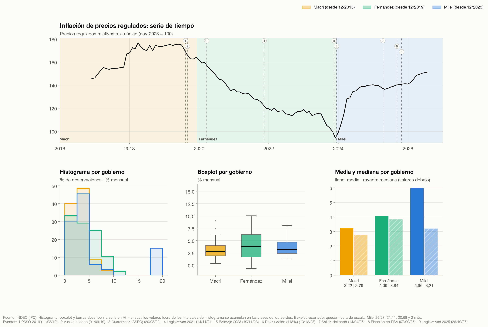

**Figura 2.7. Inflación de regulados por gobierno; arriba, precio relativo regulados / núcleo.**

**Tabla 2.7. Estadística descriptiva de la inflación de regulados (% mensual)**

| Gobierno | Período | N | Media | Mediana | Desvío | Mín | Q1 | Q3 | Máx | CV (%) | Asimetría | Curtosis |
|:---|---:|---:|---:|---:|---:|---:|---:|---:|---:|---:|---:|---:|
| Macri | ene-17 a nov-19 | 35 | 3,22 | 2,79 | 1,85 | 0,36 | 1,92 | 4,05 | 9,08 | 57,51 | 1,23 | 2,03 |
| Fernández | dic-19 a nov-23 | 48 | 4,09 | 3,84 | 2,74 | -0,66 | 1,66 | 6,25 | 10,06 | – | 0,29 | -0,89 |
| Milei | dic-23 a ago-26 | 33 | 5,96 | 3,21 | 6,69 | 1,31 | 2,40 | 4,68 | 26,57 | 112,21 | 2,04 | 2,91 |
| Toda la muestra | ene-17 a ago-26 | 116 | 4,36 | 3,28 | 4,21 | -0,66 | 2,12 | 5,09 | 26,57 | – | 2,98 | 10,83 |

**Tabla 2.8. Estadística descriptiva del precio relativo regulados / núcleo (nov-2023 = 100)**

| Gobierno | Período | N | Media | Mediana | Desvío | Mín | Q1 | Q3 | Máx | CV (%) | Asimetría | Curtosis |
|:---|---:|---:|---:|---:|---:|---:|---:|---:|---:|---:|---:|---:|
| Macri | dic-16 a nov-19 | 36 | 165,37 | 169,88 | 9,87 | 145,77 | 155,12 | 174,19 | 176,77 | 5,97 | -0,59 | -1,18 |
| Fernández | dic-19 a nov-23 | 48 | 128,10 | 121,74 | 16,49 | 100,00 | 116,01 | 136,99 | 164,07 | 12,87 | 0,64 | -0,48 |
| Milei | dic-23 a ago-26 | 33 | 135,96 | 139,53 | 13,54 | 94,09 | 136,41 | 140,96 | 151,51 | 9,96 | -1,90 | 3,49 |
| Toda la muestra | dic-16 a ago-26 | 117 | 141,79 | 140,35 | 21,21 | 94,09 | 126,01 | 155,57 | 176,77 | 14,96 | -0,07 | -0,87 |

**Tabla 2.9. Distribución de frecuencias de la inflación de regulados (% mensual)**

| Intervalo | Macri fa | Macri fr % | Macri Fr acum. % | Fernández fa | Fernández fr % | Fernández Fr acum. % | Milei fa | Milei fr % | Milei Fr acum. % |
|:---|---:|---:|---:|---:|---:|---:|---:|---:|---:|
| menos de 0,0 | 0 | 0,0 | 0,0 | 2 | 4,2 | 4,2 | 0 | 0,0 | 0,0 |
| [0,0; 2,5) | 14 | 40,0 | 40,0 | 14 | 29,2 | 33,3 | 10 | 30,3 | 30,3 |
| [2,5; 5,0) | 17 | 48,6 | 88,6 | 14 | 29,2 | 62,5 | 15 | 45,5 | 75,8 |
| [5,0; 7,5) | 3 | 8,6 | 97,1 | 12 | 25,0 | 87,5 | 2 | 6,1 | 81,8 |
| [7,5; 10,0) | 1 | 2,9 | 100,0 | 5 | 10,4 | 97,9 | 1 | 3,0 | 84,8 |
| [10,0; 12,5) | 0 | 0,0 | 100,0 | 1 | 2,1 | 100,0 | 0 | 0,0 | 84,8 |
| [12,5; 15,0) | 0 | 0,0 | 100,0 | 0 | 0,0 | 100,0 | 0 | 0,0 | 84,8 |
| [15,0; 17,5) | 0 | 0,0 | 100,0 | 0 | 0,0 | 100,0 | 0 | 0,0 | 84,8 |
| [17,5; 20,0) | 0 | 0,0 | 100,0 | 0 | 0,0 | 100,0 | 2 | 6,1 | 90,9 |
| 20,0 o más | 0 | 0,0 | 100,0 | 0 | 0,0 | 100,0 | 3 | 9,1 | 100,0 |
| **Total** | 35 | 100,0 |  | 48 | 100,0 |  | 33 | 100,0 |  |

La serie del precio relativo es, probablemente, el gráfico que mejor resume la política de precios de cada gobierno. Con Macri los regulados se encarecen fuerte respecto de la núcleo (el "tarifazo" de 2016-2018): el relativo sube de 146 a 177 y su media en el período es 165,37. Con Fernández ocurre lo contrario: las tarifas se congelan o se ajustan por debajo de la inflación y el relativo cae de 164 a 100, su mínimo. Con Milei se revierte de nuevo: pasa de 94 en diciembre de 2023 a 151,51 en agosto de 2026, una suba de 60% en términos reales en menos de tres años.

En las tasas mensuales, eso se ve como una media de regulados con Milei (5,96%) mucho más alta que su mediana (3,21%), con un máximo de 26,57% en enero de 2024 (un mes después del pico de la núcleo: las tarifas se ajustaron con rezago). Fernández tiene el único mes con regulados negativos (abril de 2020, en plena cuarentena) y la única curtosis negativa (-0,89), señal de una distribución plana: los regulados se movían por decisiones discretas, sin un valor "típico". La clase modal de Fernández es [0,0; 2,5), la más baja de los tres.

La lectura económica es que una parte de la inflación de 2024 fue el pago de precios reprimidos durante el gobierno anterior, y que esa corrección siguió hasta 2026 con aumentos mensuales de regulados mayores que los de la núcleo en la mayoría de los meses. Para el análisis distributivo es un dato central: los hogares de ingresos bajos gastan una proporción mayor en tarifas y transporte, de modo que su inflación efectiva fue más alta que la del promedio.

#### 2.4.2 Ingresos

Las cuatro series de salario de esta sección son índices, con tendencia, así que la figura muestra el nivel real (noviembre de 2023 = 100) y el histograma, el boxplot y la tabla de frecuencias describen la **variación mensual del salario real**, en %. La tabla descriptiva del nivel se agrega a continuación de la de variaciones.

##### Salario real privado registrado

*Qué es y cómo se mide.* El Índice de Salarios del INDEC para el sector privado registrado: asalariados con aportes a la seguridad social, a partir de los registros del SIPA. El índice sigue la remuneración de **puestos de trabajo fijos** (no el salario promedio de los que están ocupados en cada momento), así que no se mueve por cambios de composición del empleo. Se deflacta mes a mes por el IPC nacional.

*Fuente y período.* INDEC (`149.1_SOR_PRIADO_OCTU_0_25`), abril de 2016 a julio de 2026. Mensual, índice octubre de 2016 = 100, reexpresado en términos reales con base noviembre de 2023 = 100.

*Por qué se eligió.* Es el salario de referencia de la economía formal, fijado en paritarias. Mide el costo distributivo de la estabilización para el núcleo del mercado de trabajo: la devaluación de diciembre de 2023 y la aceleración inflacionaria posterior se trasladan primero a salarios.

*Limitaciones.* Mide salarios de convenio y de puestos fijos: no capta horas extra, bonos por fuera del convenio ni la pérdida de puestos. El IPC con ponderaciones viejas subestima el aumento de las tarifas, de modo que el salario real de 2024-2026 podría ser algo más bajo que el que muestra la serie.

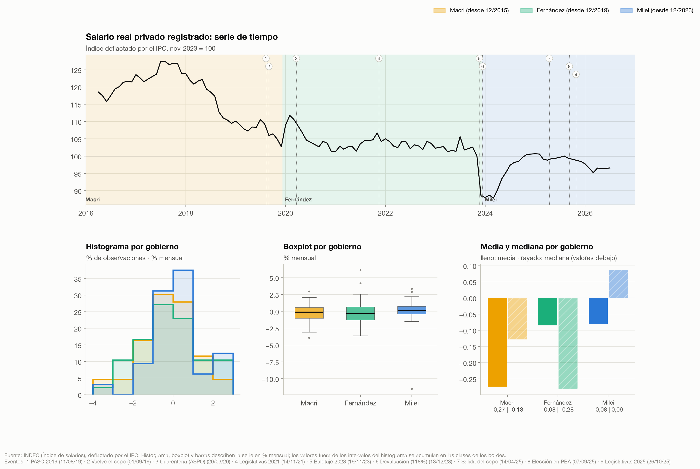

**Figura 2.8. Salario real privado registrado: nivel (arriba) y distribución de su variación mensual por gobierno.**

**Tabla 2.10. Estadística descriptiva de la variación mensual del salario real privado registrado (%)**

| Gobierno | Período | N | Media | Mediana | Desvío | Mín | Q1 | Q3 | Máx | CV (%) | Asimetría | Curtosis |
|:---|---:|---:|---:|---:|---:|---:|---:|---:|---:|---:|---:|---:|
| Macri | may-16 a nov-19 | 43 | -0,27 | -0,13 | 1,35 | -3,93 | -1,00 | 0,57 | 2,97 | – | -0,20 | 0,65 |
| Fernández | dic-19 a nov-23 | 48 | -0,08 | -0,28 | 1,77 | -3,65 | -1,26 | 0,66 | 6,15 | – | 1,06 | 2,45 |
| Milei | dic-23 a jul-26 | 32 | -0,08 | 0,09 | 2,37 | -11,50 | -0,38 | 0,76 | 3,36 | – | -3,62 | 18,09 |
| Toda la muestra | may-16 a jul-26 | 123 | -0,15 | -0,09 | 1,81 | -11,50 | -0,95 | 0,63 | 6,15 | – | -1,57 | 12,75 |

**Tabla 2.11. Estadística descriptiva del nivel del salario real privado registrado (nov-2023 = 100)**

| Gobierno | Período | N | Media | Mediana | Desvío | Mín | Q1 | Q3 | Máx | CV (%) | Asimetría | Curtosis |
|:---|---:|---:|---:|---:|---:|---:|---:|---:|---:|---:|---:|---:|
| Macri | abr-16 a nov-19 | 44 | 117,4 | 119,4 | 6,9 | 104,9 | 110,4 | 122,4 | 127,4 | 5,9 | -0,35 | -1,26 |
| Fernández | dic-19 a nov-23 | 48 | 103,8 | 103,1 | 2,4 | 100,0 | 102,3 | 104,4 | 111,8 | 2,3 | 1,62 | 2,99 |
| Milei | dic-23 a jul-26 | 32 | 96,7 | 98,3 | 3,9 | 87,9 | 96,1 | 99,4 | 100,7 | 4,1 | -1,31 | 0,59 |
| Toda la muestra | abr-16 a jul-26 | 124 | 106,8 | 104,1 | 9,6 | 87,9 | 100,6 | 111,3 | 127,4 | 9,0 | 0,56 | -0,45 |

**Tabla 2.12. Distribución de frecuencias de la variación mensual del salario real privado registrado (%)**

| Intervalo | Macri fa | Macri fr % | Macri Fr acum. % | Fernández fa | Fernández fr % | Fernández Fr acum. % | Milei fa | Milei fr % | Milei Fr acum. % |
|:---|---:|---:|---:|---:|---:|---:|---:|---:|---:|
| menos de -4 | 0 | 0,0 | 0,0 | 0 | 0,0 | 0,0 | 1 | 3,1 | 3,1 |
| [-4; -3) | 2 | 4,7 | 4,7 | 1 | 2,1 | 2,1 | 0 | 0,0 | 3,1 |
| [-3; -2) | 2 | 4,7 | 9,3 | 5 | 10,4 | 12,5 | 0 | 0,0 | 3,1 |
| [-2; -1) | 7 | 16,3 | 25,6 | 8 | 16,7 | 29,2 | 3 | 9,4 | 12,5 |
| [-1; 0) | 13 | 30,2 | 55,8 | 13 | 27,1 | 56,2 | 10 | 31,2 | 43,8 |
| [0; 1) | 12 | 27,9 | 83,7 | 11 | 22,9 | 79,2 | 12 | 37,5 | 81,2 |
| [1; 2) | 5 | 11,6 | 95,3 | 5 | 10,4 | 89,6 | 2 | 6,2 | 87,5 |
| [2; 3) | 2 | 4,7 | 100,0 | 3 | 6,2 | 95,8 | 3 | 9,4 | 96,9 |
| 3 o más | 0 | 0,0 | 100,0 | 2 | 4,2 | 100,0 | 1 | 3,1 | 100,0 |
| **Total** | 43 | 100,0 |  | 48 | 100,0 |  | 32 | 100,0 |  |

En niveles, cada gobierno tuvo un salario real privado más bajo que el anterior: 117,4 con Macri, 103,8 con Fernández y 96,7 con Milei. La serie de la figura muestra que esa caída no es un escalón por gobierno sino una tendencia larga con dos crisis: el máximo es de agosto de 2017 (127,4), la caída más importante ocurre en 2018 y 2019 con las dos devaluaciones de Macri, el período de Fernández es una meseta con leve deterioro (de 111,8 en febrero de 2020 a 100 en noviembre de 2023), y el de Milei arranca con el piso de la serie (87,9 en marzo de 2024), recupera hasta 100,7 en enero de 2025 y desde ahí vuelve a bajar levemente, hasta 96,6 en julio de 2026.

En variaciones mensuales, la media de los tres gobiernos es negativa o casi cero (-0,27%, -0,08% y -0,08%). Lo que distingue a Milei es la forma: asimetría de -3,62 y curtosis de 18,09, las más extremas de los salarios, por un único mes de caída (−11,5% en diciembre de 2023) seguido de muchos meses de recuperación. Su mediana (0,09%) es la única positiva y la tabla de frecuencias lo confirma: la clase modal de Milei es [0; 1) (37,5% de los meses), mientras que la de Macri y la de Fernández es [-1; 0). Desde febrero de 2024, el salario privado le ganó a la inflación en 18 de 30 meses.

Es un patrón de **"shock y recomposición"**, distinto de la erosión gradual de los dos gobiernos anteriores. La explicación económica es la indexación de las paritarias: en 2024 los convenios se renegociaban cada uno a tres meses con cláusulas de revisión, y cuando la inflación mensual bajó de 25% a 4% en cuatro meses, los aumentos pactados sobre la inflación pasada quedaron por encima de la inflación presente. Desde 2025, con la inflación estabilizada y el gobierno presionando para que las paritarias no superen un tope de alrededor de 1% a 2% mensual, la recuperación se detuvo. El resultado neto es que el salario privado registrado de mediados de 2026 está casi en el mismo nivel que en noviembre de 2023 y unos 20 puntos debajo del máximo de 2017.

##### Salario real público

*Qué es y cómo se mide.* El Índice de Salarios del INDEC para el sector público (nacional, provincial y municipal), deflactado por el IPC. Igual que el privado, sigue puestos fijos.

*Fuente y período.* INDEC (`149.1_SOR_PUBICO_OCTU_0_14`), abril de 2016 a julio de 2026. Mensual.

*Por qué se eligió.* Es un precio que fija el propio Estado como empleador, y por eso mide una decisión de política fiscal: una parte del ajuste del gasto pasa por la masa salarial pública.

*Limitaciones.* Mezcla jurisdicciones: el salario nacional, que decide el gobierno de Milei, pesa menos que el de las provincias, que tienen sus propias paritarias. No distingue entre sectores (docentes, salud, administración).

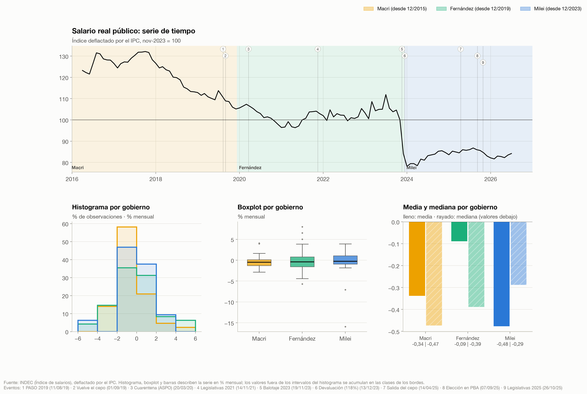

**Figura 2.9. Salario real público: nivel y distribución de su variación mensual por gobierno.**

**Tabla 2.13. Estadística descriptiva de la variación mensual del salario real público (%)**

| Gobierno | Período | N | Media | Mediana | Desvío | Mín | Q1 | Q3 | Máx | CV (%) | Asimetría | Curtosis |
|:---|---:|---:|---:|---:|---:|---:|---:|---:|---:|---:|---:|---:|
| Macri | may-16 a nov-19 | 43 | -0,34 | -0,47 | 1,61 | -2,85 | -1,30 | 0,12 | 4,09 | – | 1,18 | 1,82 |
| Fernández | dic-19 a nov-23 | 48 | -0,09 | -0,39 | 2,56 | -5,72 | -1,54 | 0,79 | 8,02 | – | 0,90 | 2,04 |
| Milei | dic-23 a jul-26 | 32 | -0,48 | -0,29 | 3,36 | -15,92 | -0,93 | 1,05 | 3,92 | – | -3,43 | 14,89 |
| Toda la muestra | may-16 a jul-26 | 123 | -0,28 | -0,37 | 2,51 | -15,92 | -1,26 | 0,76 | 8,02 | – | -1,56 | 12,81 |

**Tabla 2.14. Estadística descriptiva del nivel del salario real público (nov-2023 = 100)**

| Gobierno | Período | N | Media | Mediana | Desvío | Mín | Q1 | Q3 | Máx | CV (%) | Asimetría | Curtosis |
|:---|---:|---:|---:|---:|---:|---:|---:|---:|---:|---:|---:|---:|
| Macri | abr-16 a nov-19 | 44 | 121,4 | 123,4 | 8,0 | 106,0 | 113,3 | 128,1 | 132,1 | 6,6 | -0,35 | -1,29 |
| Fernández | dic-19 a nov-23 | 48 | 102,4 | 102,6 | 3,3 | 96,3 | 100,4 | 104,8 | 111,9 | 3,2 | 0,18 | 0,28 |
| Milei | dic-23 a jul-26 | 32 | 83,4 | 83,7 | 2,3 | 78,1 | 82,2 | 85,3 | 86,8 | 2,7 | -0,83 | 0,07 |
| Toda la muestra | abr-16 a jul-26 | 124 | 104,3 | 103,8 | 15,7 | 78,1 | 86,6 | 114,0 | 132,1 | 15,1 | 0,11 | -0,99 |

**Tabla 2.15. Distribución de frecuencias de la variación mensual del salario real público (%)**

| Intervalo | Macri fa | Macri fr % | Macri Fr acum. % | Fernández fa | Fernández fr % | Fernández Fr acum. % | Milei fa | Milei fr % | Milei Fr acum. % |
|:---|---:|---:|---:|---:|---:|---:|---:|---:|---:|
| menos de -6 | 0 | 0,0 | 0,0 | 0 | 0,0 | 0,0 | 2 | 6,2 | 6,2 |
| [-6; -4) | 0 | 0,0 | 0,0 | 2 | 4,2 | 4,2 | 0 | 0,0 | 6,2 |
| [-4; -2) | 6 | 14,0 | 14,0 | 7 | 14,6 | 18,8 | 0 | 0,0 | 6,2 |
| [-2; 0) | 25 | 58,1 | 72,1 | 17 | 35,4 | 54,2 | 15 | 46,9 | 53,1 |
| [0; 2) | 9 | 20,9 | 93,0 | 15 | 31,2 | 85,4 | 12 | 37,5 | 90,6 |
| [2; 4) | 2 | 4,7 | 97,7 | 4 | 8,3 | 93,7 | 3 | 9,4 | 100,0 |
| [4; 6) | 1 | 2,3 | 100,0 | 1 | 2,1 | 95,8 | 0 | 0,0 | 100,0 |
| 6 o más | 0 | 0,0 | 100,0 | 2 | 4,2 | 100,0 | 0 | 0,0 | 100,0 |
| **Total** | 43 | 100,0 |  | 48 | 100,0 |  | 32 | 100,0 |  |

El salario público tuvo el mismo shock inicial que el privado, pero más grande (−15,9% en diciembre de 2023, el mínimo de toda la serie) y sin la recuperación posterior. Su nivel promedio con Milei (83,4) es el más bajo de la serie, casi 20 puntos debajo del de Fernández (102,4) y casi 40 debajo del de Macri (121,4). El desvío del nivel con Milei (2,3) es el menor de los tres gobiernos y el CV (2,7%) también: el salario público quedó **estable en un nivel bajo**, entre 78,1 y 86,8.

La distribución de las variaciones mensuales tiene la misma clase modal en los tres gobiernos ([-2; 0)), con el 46,9% de los meses de Milei, y la diferencia la hace el primer mes: la media de Milei (-0,48%) es la más negativa por el −15,9% de diciembre de 2023, y la mediana (-0,29%) es parecida a la de los otros gobiernos. Desde febrero de 2024 el salario público le ganó a la inflación en la mitad de los meses (15 de 30), pero por márgenes chicos que no alcanzaron para recuperar el escalón.

La comparación con el privado es la evidencia más directa de que la política salarial del sector público fue una herramienta del ajuste fiscal y del ancla antiinflacionaria: el Estado nacional otorgó aumentos por debajo de la inflación en 2024 y las provincias, con menos transferencias de la Nación, hicieron lo mismo. Es también la variable donde la "herencia" pesa menos: el salario público de noviembre de 2023 ya estaba unos 30 puntos debajo del de 2017, y con Milei bajó otros 16.

##### Salario real no registrado

*Qué es y cómo se mide.* El Índice de Salarios del INDEC para el sector privado no registrado (asalariados sin aportes), que se construye con datos de la Encuesta Permanente de Hogares. Se deflacta por el IPC.

*Fuente y período.* INDEC (`149.1_SOR_PRIADO_OCTU_0_28`), mayo de 2016 a febrero de 2026. Mensual.

*Por qué se eligió.* Más de un tercio de los asalariados no está registrado (ver la tasa de no registro más abajo). Es el ingreso laboral de los hogares más pobres y el que se ajusta sin paritarias ni decretos, por oferta y demanda.

*Limitaciones.* El INDEC lo publica con **cinco meses de rezago**: el dato de cada mes describe salarios de cinco meses antes, por lo que acá se corre −5 meses para ubicarlo en el mes que corresponde (por eso termina en febrero de 2026). Surge de una muestra chica de la EPH, es mucho más volátil que los otros índices y conviene leer sus movimientos en promedios de varios meses.

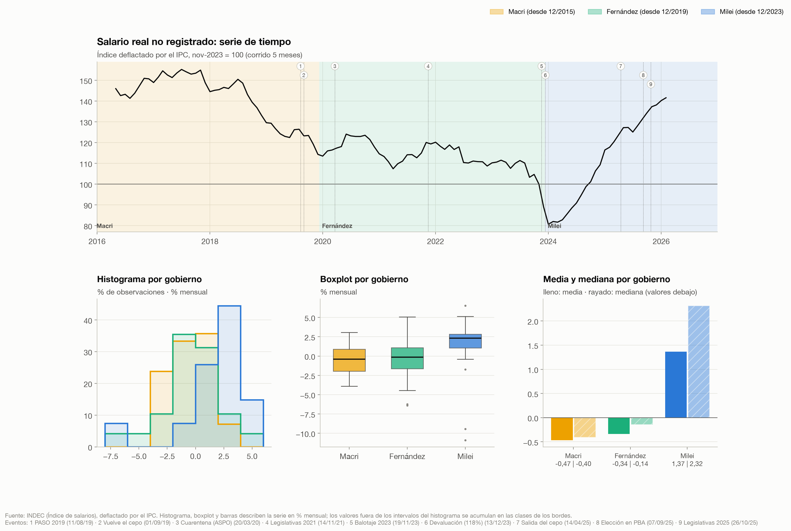

**Figura 2.10. Salario real no registrado: nivel y distribución de su variación mensual por gobierno.**

**Tabla 2.16. Estadística descriptiva de la variación mensual del salario real no registrado (%)**

| Gobierno | Período | N | Media | Mediana | Desvío | Mín | Q1 | Q3 | Máx | CV (%) | Asimetría | Curtosis |
|:---|---:|---:|---:|---:|---:|---:|---:|---:|---:|---:|---:|---:|
| Macri | jun-16 a nov-19 | 42 | -0,47 | -0,40 | 1,82 | -3,90 | -1,95 | 0,90 | 3,07 | – | -0,04 | -0,84 |
| Fernández | dic-19 a nov-23 | 48 | -0,34 | -0,14 | 2,33 | -6,39 | -1,65 | 1,10 | 5,07 | – | -0,42 | 0,83 |
| Milei | dic-23 a feb-26 | 27 | 1,37 | 2,32 | 3,73 | -10,89 | 1,05 | 2,83 | 6,54 | – | -2,30 | 5,99 |
| Toda la muestra | jun-16 a feb-26 | 117 | 0,01 | 0,22 | 2,66 | -10,89 | -1,34 | 1,76 | 6,54 | – | -0,96 | 2,87 |

**Tabla 2.17. Estadística descriptiva del nivel del salario real no registrado (nov-2023 = 100)**

| Gobierno | Período | N | Media | Mediana | Desvío | Mín | Q1 | Q3 | Máx | CV (%) | Asimetría | Curtosis |
|:---|---:|---:|---:|---:|---:|---:|---:|---:|---:|---:|---:|---:|
| Macri | may-16 a nov-19 | 43 | 141,8 | 145,5 | 11,2 | 119,2 | 131,3 | 150,8 | 155,2 | 7,9 | -0,70 | -0,95 |
| Fernández | dic-19 a nov-23 | 48 | 114,1 | 113,8 | 5,5 | 100,0 | 110,5 | 118,0 | 124,1 | 4,8 | -0,10 | -0,16 |
| Milei | dic-23 a feb-26 | 27 | 111,1 | 116,4 | 21,0 | 80,7 | 90,0 | 127,7 | 141,6 | 18,9 | -0,11 | -1,52 |
| Toda la muestra | may-16 a feb-26 | 118 | 123,5 | 120,9 | 18,7 | 80,7 | 110,9 | 141,0 | 155,2 | 15,2 | -0,09 | -0,51 |

**Tabla 2.18. Distribución de frecuencias de la variación mensual del salario real no registrado (%)**

| Intervalo | Macri fa | Macri fr % | Macri Fr acum. % | Fernández fa | Fernández fr % | Fernández Fr acum. % | Milei fa | Milei fr % | Milei Fr acum. % |
|:---|---:|---:|---:|---:|---:|---:|---:|---:|---:|
| menos de -8 | 0 | 0,0 | 0,0 | 0 | 0,0 | 0,0 | 2 | 7,4 | 7,4 |
| [-8; -6) | 0 | 0,0 | 0,0 | 2 | 4,2 | 4,2 | 0 | 0,0 | 7,4 |
| [-6; -4) | 0 | 0,0 | 0,0 | 2 | 4,2 | 8,3 | 0 | 0,0 | 7,4 |
| [-4; -2) | 10 | 23,8 | 23,8 | 5 | 10,4 | 18,8 | 0 | 0,0 | 7,4 |
| [-2; 0) | 14 | 33,3 | 57,1 | 17 | 35,4 | 54,2 | 2 | 7,4 | 14,8 |
| [0; 2) | 15 | 35,7 | 92,9 | 15 | 31,2 | 85,4 | 7 | 25,9 | 40,7 |
| [2; 4) | 3 | 7,1 | 100,0 | 5 | 10,4 | 95,8 | 12 | 44,4 | 85,2 |
| [4; 6) | 0 | 0,0 | 100,0 | 2 | 4,2 | 100,0 | 3 | 11,1 | 96,3 |
| 6 o más | 0 | 0,0 | 100,0 | 0 | 0,0 | 100,0 | 1 | 3,7 | 100,0 |
| **Total** | 42 | 100,0 |  | 48 | 100,0 |  | 27 | 100,0 |  |

El salario no registrado es la excepción del capítulo: con Milei su variación mensual media es positiva (1,37% por mes, mediana 2,32%), contra caídas promedio en los dos gobiernos anteriores (-0,47% y -0,34%). La tabla de frecuencias muestra un corrimiento de toda la distribución: la clase modal de Milei es [2; 4) (44,4% de los meses), dos clases por encima de la de Fernández ([-2; 0)), y desde febrero de 2024 el salario informal le ganó a la inflación en 23 de 25 meses.

En niveles, recorre todo el camino de 80,7 (enero de 2024) a 141,6 (febrero de 2026) dentro del mismo gobierno, por eso su CV en niveles (18,9%) es el mayor de todos los salarios y su desvío (21,0) cuadruplica el de Fernández. Termina el período por encima del nivel de 2019, aunque todavía debajo del máximo de 2017.

La lectura económica es que el salario informal, sin paritarias que lo protejan, es el que más cae cuando la inflación se acelera y el que más rápido se recompone cuando se frena, porque se fija en cada changa o trabajo y no por contratos de varios meses. A eso se sumó la recuperación de la actividad desde mediados de 2024, concentrada en servicios con alta informalidad. La serie es de muestra chica y pide cautela con cada dato aislado, pero su dirección coincide con la de la EPH (más abajo), que es una fuente independiente.

##### Salario mínimo real

*Qué es y cómo se mide.* El monto mensual del salario mínimo, vital y móvil (SMVM) para una jornada completa, fijado por el Consejo del Salario o, sin acuerdo, por decreto. Se deflacta por el IPC.

*Fuente y período.* Ministerio de Trabajo (`57.1_SMVMM_0_M_34`), abril de 2016 a septiembre de 2026. Mensual, nov-2023 = 100.

*Por qué se eligió.* Es un precio que fija directamente el gobierno y funciona como referencia para el salario informal más bajo, para planes sociales y para algunas prestaciones. Mide una decisión de política, no un resultado de mercado.

*Limitaciones.* Pocos asalariados registrados cobran exactamente el mínimo, así que su efecto sobre el salario efectivo es indirecto. Como se ajusta por escalones, su variación mensual tiene muchos ceros y por eso acá se describe el **nivel** real, no la variación.

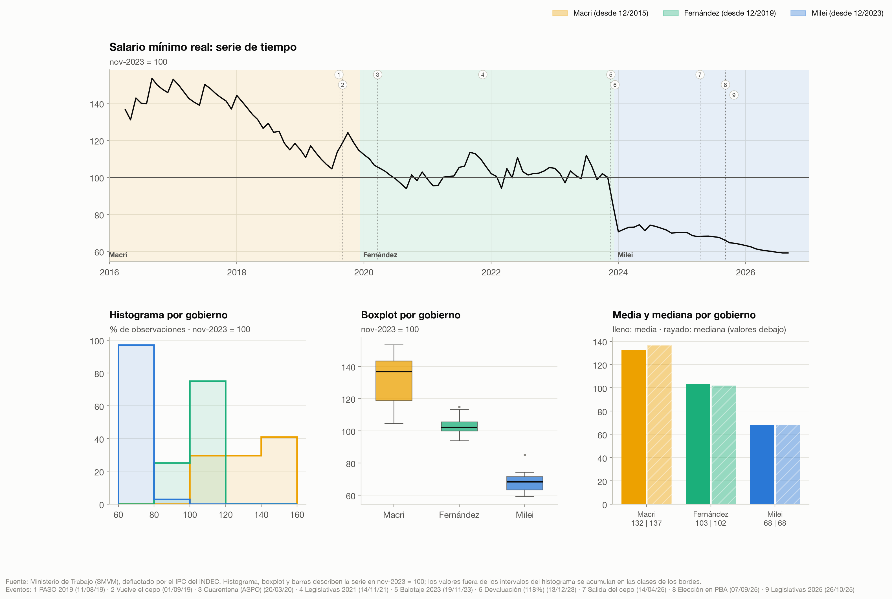

**Figura 2.11. Salario mínimo real por gobierno (nivel, nov-2023 = 100).**

**Tabla 2.19. Estadística descriptiva del salario mínimo real (nov-2023 = 100)**

| Gobierno | Período | N | Media | Mediana | Desvío | Mín | Q1 | Q3 | Máx | CV (%) | Asimetría | Curtosis |
|:---|---:|---:|---:|---:|---:|---:|---:|---:|---:|---:|---:|---:|
| Macri | abr-16 a nov-19 | 44 | 132,3 | 136,8 | 14,2 | 104,6 | 118,7 | 143,5 | 153,5 | 10,7 | -0,34 | -1,19 |
| Fernández | dic-19 a nov-23 | 48 | 103,0 | 102,1 | 5,1 | 93,9 | 99,9 | 105,5 | 114,8 | 5,0 | 0,52 | -0,14 |
| Milei | dic-23 a sep-26 | 34 | 67,8 | 68,2 | 5,7 | 59,2 | 63,3 | 71,5 | 85,2 | 8,5 | 0,49 | 0,96 |
| Toda la muestra | abr-16 a sep-26 | 126 | 103,8 | 103,4 | 27,0 | 59,2 | 74,3 | 119,0 | 153,5 | 26,0 | 0,01 | -0,92 |

**Tabla 2.20. Distribución de frecuencias del salario mínimo real (nov-2023 = 100)**

| Intervalo | Macri fa | Macri fr % | Macri Fr acum. % | Fernández fa | Fernández fr % | Fernández Fr acum. % | Milei fa | Milei fr % | Milei Fr acum. % |
|:---|---:|---:|---:|---:|---:|---:|---:|---:|---:|
| menos de 60 | 0 | 0,0 | 0,0 | 0 | 0,0 | 0,0 | 4 | 11,8 | 11,8 |
| [60; 80) | 0 | 0,0 | 0,0 | 0 | 0,0 | 0,0 | 29 | 85,3 | 97,1 |
| [80; 100) | 0 | 0,0 | 0,0 | 12 | 25,0 | 25,0 | 1 | 2,9 | 100,0 |
| [100; 120) | 13 | 29,5 | 29,5 | 36 | 75,0 | 100,0 | 0 | 0,0 | 100,0 |
| [120; 140) | 13 | 29,5 | 59,1 | 0 | 0,0 | 100,0 | 0 | 0,0 | 100,0 |
| [140; 160) | 18 | 40,9 | 100,0 | 0 | 0,0 | 100,0 | 0 | 0,0 | 100,0 |
| **Total** | 44 | 100,0 |  | 48 | 100,0 |  | 34 | 100,0 |  |

El salario mínimo real promedio con Milei (67,8) es la mitad del de Macri (132,3) y dos tercios del de Fernández (103,0). La tabla de frecuencias es la más contundente del capítulo: las tres distribuciones casi no se superponen. El 40,9% de los meses de Macri está en [140; 160); el 75,0% de los de Fernández en [100; 120); y el 85,3% de los de Milei en [60; 80). El boxplot muestra tres cajas escalonadas, sin solapamiento entre ellas.

A diferencia de los salarios de mercado, el mínimo no se recuperó después del shock de diciembre de 2023: pasó de 100 a 70,6 en dos meses (diciembre y enero) y desde ahí cae de manera casi monótona hasta su mínimo de la serie (59,2) en el último dato. Desde mediados de 2024 se ajusta casi todos los meses, pero siempre por debajo de la inflación. La asimetría positiva de Milei (0,49) la produce el primer mes (85,2 en diciembre de 2023), que todavía tenía el nivel heredado.

El salario mínimo es, junto con el público, la variable de ingreso que el gobierno controla directamente, y las dos muestran el mismo comportamiento: ajuste por debajo de la inflación como parte del ancla nominal. La diferencia es que el mínimo venía cayendo desde 2016 en todos los gobiernos: en diez años perdió más del 60% de su poder de compra (de 153,5 en septiembre de 2016 a 59,2).

##### Salario nominal contra salario real

El salario real es un cociente: lo que se cobra en pesos (salario nominal) dividido por lo que cuestan las cosas (IPC). Mirar el numerador por separado muestra *cómo* se llegó a cada resultado real: si el salario real cae porque los aumentos fueron chicos o porque la inflación fue grande. La relación exacta es

  (1 + variación real) = (1 + variación nominal) / (1 + inflación),

y por eso con inflación alta las dos tasas pueden ser enormes y el resultado real, chico: un aumento nominal de 300% puede ser una pérdida real si la inflación fue de 330%. Las series nominales son los mismos índices de las secciones anteriores sin deflactar, en la misma ventana de tiempo.

**Tabla 2.21. Variación mensual del salario nominal privado registrado (%)**

| Gobierno | Período | N | Media | Mediana | Desvío | Mín | Q1 | Q3 | Máx | CV (%) | Asimetría | Curtosis |
|:---|---:|---:|---:|---:|---:|---:|---:|---:|---:|---:|---:|---:|
| Macri | may-16 a nov-19 | 43 | 2,45 | 2,45 | 1,03 | 0,75 | 1,62 | 3,36 | 4,75 | 42,10 | 0,29 | -0,87 |
| Fernández | dic-19 a nov-23 | 48 | 4,91 | 4,69 | 2,88 | -0,24 | 3,17 | 6,87 | 13,23 | – | 0,48 | 0,41 |
| Milei | dic-23 a jul-26 | 32 | 4,62 | 2,42 | 4,36 | 1,37 | 2,12 | 5,35 | 19,99 | 94,34 | 2,07 | 4,25 |
| Toda la muestra | may-16 a jul-26 | 123 | 3,98 | 3,28 | 3,11 | -0,24 | 1,98 | 5,05 | 19,99 | – | 2,07 | 6,08 |

**Tabla 2.22. Variación mensual del salario nominal público (%)**

| Gobierno | Período | N | Media | Mediana | Desvío | Mín | Q1 | Q3 | Máx | CV (%) | Asimetría | Curtosis |
|:---|---:|---:|---:|---:|---:|---:|---:|---:|---:|---:|---:|---:|
| Macri | may-16 a nov-19 | 43 | 2,39 | 2,43 | 1,47 | 0,30 | 1,32 | 2,99 | 6,23 | 61,49 | 0,83 | 0,57 |
| Fernández | dic-19 a nov-23 | 48 | 4,91 | 3,87 | 3,44 | 0,52 | 2,70 | 6,63 | 16,31 | 70,15 | 1,30 | 1,80 |
| Milei | dic-23 a jul-26 | 32 | 4,15 | 3,12 | 3,40 | 0,93 | 1,87 | 4,75 | 15,11 | 82,13 | 1,78 | 3,02 |
| Toda la muestra | may-16 a jul-26 | 123 | 3,83 | 2,91 | 3,08 | 0,30 | 1,79 | 4,62 | 16,31 | 80,38 | 1,78 | 3,57 |

**Tabla 2.23. Variación mensual del salario nominal no registrado (%)**

| Gobierno | Período | N | Media | Mediana | Desvío | Mín | Q1 | Q3 | Máx | CV (%) | Asimetría | Curtosis |
|:---|---:|---:|---:|---:|---:|---:|---:|---:|---:|---:|---:|---:|
| Macri | jun-16 a nov-19 | 42 | 2,22 | 2,51 | 1,69 | -1,20 | 1,07 | 3,40 | 5,34 | – | -0,15 | -0,48 |
| Fernández | dic-19 a nov-23 | 48 | 4,63 | 4,47 | 2,73 | -0,50 | 2,44 | 7,02 | 11,24 | – | 0,23 | -0,70 |
| Milei | dic-23 a feb-26 | 27 | 6,48 | 5,73 | 3,25 | 0,14 | 4,40 | 8,36 | 15,08 | 50,06 | 0,58 | 0,70 |
| Toda la muestra | jun-16 a feb-26 | 117 | 4,19 | 3,73 | 3,01 | -1,20 | 2,16 | 5,84 | 15,08 | – | 0,74 | 0,65 |

**Tabla 2.24. Variación mensual del salario mínimo nominal (%)**

| Gobierno | Período | N | Media | Mediana | Desvío | Mín | Q1 | Q3 | Máx | CV (%) | Asimetría | Curtosis |
|:---|---:|---:|---:|---:|---:|---:|---:|---:|---:|---:|---:|---:|
| Macri | may-16 a nov-19 | 43 | 2,49 | 0,00 | 4,28 | 0,00 | 0,00 | 5,44 | 13,00 | – | 1,35 | 0,24 |
| Fernández | dic-19 a nov-23 | 48 | 4,73 | 3,54 | 5,37 | 0,00 | 0,00 | 7,00 | 19,90 | – | 1,19 | 0,82 |
| Milei | dic-23 a sep-26 | 34 | 2,94 | 1,78 | 3,57 | 0,00 | 1,32 | 2,41 | 15,38 | – | 2,23 | 4,76 |
| Toda la muestra | may-16 a sep-26 | 125 | 3,47 | 1,50 | 4,64 | 0,00 | 0,00 | 6,00 | 19,90 | – | 1,47 | 1,55 |

Los aumentos nominales mensuales siguen de cerca a la inflación de cada gobierno: el salario privado registrado subió en promedio 2,45% por mes con Macri, 4,91% con Fernández y 4,62% con Milei, contra una inflación media de 2,75%, 5,01% y 4,61%. Con Milei la media y la mediana (2,42%) se separan mucho, igual que en la inflación: los aumentos nominales más grandes de toda la serie (hasta 19,99% en un mes) llegaron en los meses posteriores a la devaluación, para recomponer lo perdido, y después se desaceleraron junto con los precios. El salario no registrado es el único con aumentos nominales mensuales mayores con Milei (6,48%) que con Fernández (4,63%), aun con menos inflación: es la contracara nominal de su recuperación real. El salario mínimo tiene una distribución particular: su mediana es baja (0% con Macri) porque se ajustaba por decreto pocas veces al año y la mayoría de los meses no cambiaba.

**Tabla 2.25. Descomposición de la variación de cada salario: nominal, inflación y real**

| Salario | Gobierno | Desde | Hasta | Nominal acum. (%) | Inflación acum. (%) | Real acum. (%) | Nominal anual (%) | Inflación anual (%) | Real anual (%) |
|:---|---:|---:|---:|---:|---:|---:|---:|---:|---:|
| Privado registrado * | Macri | abr-16 | nov-19 | 182,6 | 219,3 | -11,5 | 33,6 | 38,3 | -3,3 |
| Privado registrado | Fernández | nov-19 | nov-23 | 882,3 | 930,7 | -4,7 | 77,0 | 79,2 | -1,2 |
| Privado registrado | Milei | nov-23 | jul-26 | 314,2 | 328,8 | -3,4 | 70,5 | 72,7 | -1,3 |
| Público * | Macri | abr-16 | nov-19 | 174,6 | 219,3 | -14,0 | 32,6 | 38,3 | -4,1 |
| Público | Fernández | nov-19 | nov-23 | 872,5 | 930,7 | -5,6 | 76,6 | 79,2 | -1,4 |
| Público | Milei | nov-23 | jul-26 | 261,0 | 328,8 | -15,8 | 61,9 | 72,7 | -6,3 |
| No registrado * | Macri | may-16 | nov-19 | 150,2 | 206,4 | -18,3 | 29,9 | 37,7 | -5,6 |
| No registrado | Fernández | nov-19 | nov-23 | 764,7 | 930,7 | -16,1 | 71,5 | 79,2 | -4,3 |
| No registrado | Milei | nov-23 | feb-26 | 438,7 | 280,5 | 41,6 | 111,1 | 80,9 | 16,7 |
| Salario mínimo * | Macri | abr-16 | nov-19 | 178,5 | 219,3 | -12,8 | 33,1 | 38,3 | -3,7 |
| Salario mínimo | Fernández | nov-19 | nov-23 | 765,2 | 930,7 | -16,1 | 71,5 | 79,2 | -4,3 |
| Salario mínimo | Milei | nov-23 | sep-26 | 162,9 | 344,2 | -40,8 | 40,6 | 69,3 | -16,9 |

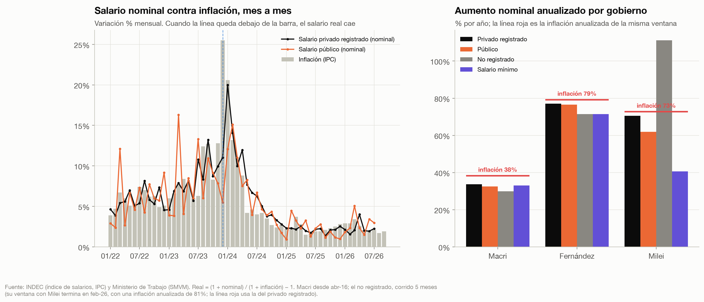

**Figura 2.12.** El panel izquierdo compara mes a mes los aumentos nominales con la inflación desde 2022: cuando la línea del salario queda debajo de la barra de inflación, el salario real cae ese mes. En diciembre de 2023 la brecha es máxima: precios +25,5% contra aumentos de 11,0% en el privado registrado y 5,5% en el público. Desde febrero de 2024 la relación se invierte y el salario privado supera a la inflación en 18 de los 30 meses siguientes, lo que explica su recuperación real a lo largo de 2024. El público también le gana a la inflación en la mitad de esos meses, pero por márgenes más chicos, y nunca recupera el escalón inicial. El panel derecho resume cada gobierno en términos anualizados. Con Fernández los cuatro salarios subieron entre 71% y 77% nominal por año contra una inflación de 79%: perdieron poco por año pero de manera constante. Con Milei la dispersión entre salarios es mucho mayor: con una inflación de alrededor de 70-80% anual en la ventana de cada serie, el privado registrado subió 70,5% nominal por año (real -1,3%), el público 61,9% (real -6,3%), el no registrado 111,1% (real +16,7%) y el mínimo solo 40,6% (real -16,9%). Que el salario mínimo y el público, los dos que fija o negocia directamente el Estado, sean los que más quedaron atrás de la inflación es consistente con que la política salarial del sector público fue parte del ancla antiinflacionaria y del ajuste fiscal. La lección metodológica es que en una economía con inflación de tres dígitos una suba nominal "récord" no dice nada por sí sola: hay que compararla siempre con la inflación de la misma ventana.

##### Salario en blanco contra salario en negro (EPH)

*Qué es y cómo se mide.* A partir de los microdatos de la Encuesta Permanente de Hogares, el ingreso de la ocupación principal (`P21`) de los asalariados que declaran ingreso, separados en registrados y no registrados según si les hacen descuentos jubilatorios (`PP07H`), y expandidos con el ponderador de ingresos (`PONDIIO`). La variable es el cociente entre el ingreso medio de los no registrados y el de los registrados, × 100: **cuántos pesos cobra un asalariado en negro por cada $100 que cobra uno en blanco**.

*Fuente y período.* INDEC, microdatos de la EPH (cálculo propio, resumen trimestral en `data/eph_salarios.csv`), primer trimestre de 2017 al primer trimestre de 2026. Trimestral, en %.

*Por qué se eligió.* Es una medida independiente del Índice de Salarios para la brecha entre el empleo formal y el informal, con la misma pregunta de la misma encuesta para los dos grupos. Al ser un cociente, no necesita deflactor.

*Limitaciones.* Es un cociente de ingresos mensuales, no por hora: los no registrados trabajan menos horas (alrededor de 33 por semana contra 39 de los registrados). Mezcla cambios de salario con cambios de composición (quién está en cada grupo). La EPH subdeclara ingresos, sobre todo en los extremos.

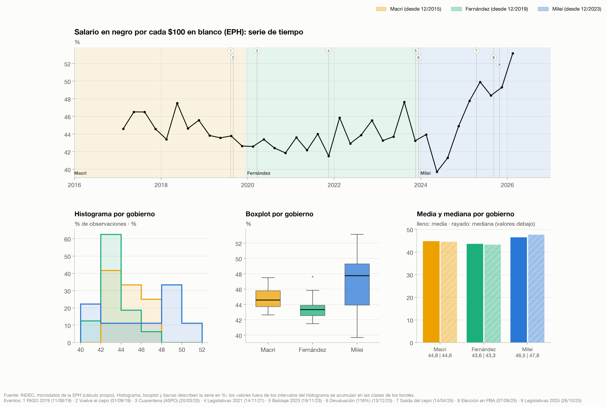

**Figura 2.13. Salario medio de los asalariados no registrados por cada $100 de los registrados (EPH).**

**Tabla 2.26. Estadística descriptiva del salario en negro por cada $100 en blanco (%)**

| Gobierno | Período | N | Media | Mediana | Desvío | Mín | Q1 | Q3 | Máx | CV (%) | Asimetría | Curtosis |
|:---|---:|---:|---:|---:|---:|---:|---:|---:|---:|---:|---:|---:|
| Macri | T1-17 a T4-19 | 12 | 44,8 | 44,6 | 1,5 | 42,6 | 43,7 | 45,8 | 47,5 | 3,3 | 0,56 | -0,60 |
| Fernández | T1-20 a T4-23 | 16 | 43,6 | 43,3 | 1,6 | 41,5 | 42,5 | 43,9 | 47,6 | 3,6 | 1,21 | 1,58 |
| Milei | T1-24 a T1-26 | 9 | 46,5 | 47,8 | 4,3 | 39,7 | 43,9 | 49,3 | 53,2 | 9,4 | -0,20 | -0,76 |
| Toda la muestra | T1-17 a T1-26 | 37 | 44,7 | 43,9 | 2,7 | 39,7 | 43,2 | 45,9 | 53,2 | 6,0 | 1,08 | 1,64 |

**Tabla 2.27. Distribución de frecuencias del salario en negro por cada $100 en blanco (%)**

| Intervalo | Macri fa | Macri fr % | Macri Fr acum. % | Fernández fa | Fernández fr % | Fernández Fr acum. % | Milei fa | Milei fr % | Milei Fr acum. % |
|:---|---:|---:|---:|---:|---:|---:|---:|---:|---:|
| menos de 40 | 0 | 0,0 | 0,0 | 0 | 0,0 | 0,0 | 1 | 11,1 | 11,1 |
| [40; 42) | 0 | 0,0 | 0,0 | 2 | 12,5 | 12,5 | 1 | 11,1 | 22,2 |
| [42; 44) | 5 | 41,7 | 41,7 | 10 | 62,5 | 75,0 | 1 | 11,1 | 33,3 |
| [44; 46) | 4 | 33,3 | 75,0 | 3 | 18,8 | 93,8 | 1 | 11,1 | 44,4 |
| [46; 48) | 3 | 25,0 | 100,0 | 1 | 6,2 | 100,0 | 1 | 11,1 | 55,6 |
| [48; 50) | 0 | 0,0 | 100,0 | 0 | 0,0 | 100,0 | 3 | 33,3 | 88,9 |
| [50; 52) | 0 | 0,0 | 100,0 | 0 | 0,0 | 100,0 | 0 | 0,0 | 88,9 |
| 52 o más | 0 | 0,0 | 100,0 | 0 | 0,0 | 100,0 | 1 | 11,1 | 100,0 |
| **Total** | 12 | 100,0 |  | 16 | 100,0 |  | 9 | 100,0 |  |

Durante ocho años el cociente se movió en un rango estrecho, de 41,5 a 47,6: en promedio, un asalariado en negro cobró 44,8 pesos por cada 100 de uno en blanco con Macri y 43,6 con Fernández. Con Milei la media sube a 46,5 y, sobre todo, la serie recorre un rango mucho mayor: cae a 39,7 en el segundo trimestre de 2024, el mínimo de la serie, y sube sin pausa hasta 53,2 en el primer trimestre de 2026, el máximo. El CV de Milei (9,4%) casi triplica el de los gobiernos anteriores.

La tabla de frecuencias lo muestra como un desplazamiento: la clase modal de Fernández es [42; 44) (62,5% de los trimestres) y la de Milei [48; 50); el último dato de Milei, 53,2, es el primero de toda la serie por encima de 50. Con solo nueve trimestres, la media y la curtosis de Milei son inestables, pero la dirección es inequívoca.

La forma en V coincide con la del índice de salarios no registrados, aunque viene de otra fuente: el salario en negro cayó más que el en blanco con el shock de la devaluación (no tenía paritaria que lo actualizara) y después creció mucho más rápido. En términos reales, el ingreso medio de los no registrados de la EPH está en el primer trimestre de 2026 alrededor de 26% por encima del cuarto trimestre de 2023, y el de los registrados, 2% por encima. Una parte puede ser efecto composición (si los informales peor pagos dejaron de trabajar o pasaron a cuentapropistas, el promedio sube), pero la brecha condicional, que controla por sexo, edad, educación, región y horas, también se achicó: de alrededor de −40% en 2017 a alrededor de −33% en 2026.

##### Tasa de asalariados no registrados (EPH)

*Qué es y cómo se mide.* El porcentaje de los asalariados que no tienen descuento jubilatorio, según la EPH, expandido con el ponderador de ingresos.

*Fuente y período.* INDEC, microdatos de la EPH (cálculo propio), T1-2017 a T1-2026. Trimestral, en % de los asalariados.

*Por qué se eligió.* Completa la lectura de la variable anterior: si el salario informal mejora pero la informalidad crece, la mejora tiene otro significado. Es también un indicador de calidad del empleo que la tasa de desocupación no capta.

*Limitaciones.* Solo cubre asalariados: los monotributistas y cuentapropistas, que crecieron en el período, no entran. En 2020 la cuarentena produjo una caída artificial (los informales perdieron el empleo, no se formalizaron).

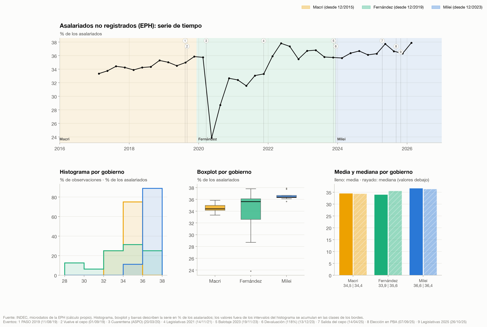

**Figura 2.14. Asalariados no registrados como % del total de asalariados (EPH).**

**Tabla 2.28. Estadística descriptiva de la tasa de asalariados no registrados (%)**

| Gobierno | Período | N | Media | Mediana | Desvío | Mín | Q1 | Q3 | Máx | CV (%) | Asimetría | Curtosis |
|:---|---:|---:|---:|---:|---:|---:|---:|---:|---:|---:|---:|---:|
| Macri | T1-17 a T4-19 | 12 | 34,5 | 34,4 | 0,7 | 33,3 | 34,2 | 35,0 | 35,9 | 2,0 | 0,36 | 0,03 |
| Fernández | T1-20 a T4-23 | 16 | 33,9 | 35,6 | 3,6 | 23,8 | 32,6 | 36,1 | 37,8 | 10,7 | -1,60 | 2,91 |
| Milei | T1-24 a T1-26 | 9 | 36,6 | 36,4 | 0,7 | 35,7 | 36,3 | 36,7 | 37,9 | 2,0 | 0,87 | 0,04 |
| Toda la muestra | T1-17 a T1-26 | 37 | 34,8 | 35,5 | 2,6 | 23,8 | 33,9 | 36,3 | 37,9 | 7,6 | -2,29 | 7,57 |

**Tabla 2.29. Distribución de frecuencias de la tasa de asalariados no registrados (%)**

| Intervalo | Macri fa | Macri fr % | Macri Fr acum. % | Fernández fa | Fernández fr % | Fernández Fr acum. % | Milei fa | Milei fr % | Milei Fr acum. % |
|:---|---:|---:|---:|---:|---:|---:|---:|---:|---:|
| menos de 28 | 0 | 0,0 | 0,0 | 1 | 6,2 | 6,2 | 0 | 0,0 | 0,0 |
| [28; 30) | 0 | 0,0 | 0,0 | 1 | 6,2 | 12,5 | 0 | 0,0 | 0,0 |
| [30; 32) | 0 | 0,0 | 0,0 | 1 | 6,2 | 18,8 | 0 | 0,0 | 0,0 |
| [32; 34) | 3 | 25,0 | 25,0 | 4 | 25,0 | 43,8 | 0 | 0,0 | 0,0 |
| [34; 36) | 9 | 75,0 | 100,0 | 5 | 31,2 | 75,0 | 1 | 11,1 | 11,1 |
| [36; 38) | 0 | 0,0 | 100,0 | 4 | 25,0 | 100,0 | 8 | 88,9 | 100,0 |
| **Total** | 12 | 100,0 |  | 16 | 100,0 |  | 9 | 100,0 |  |

La tasa de no registro con Milei es la más alta de los tres gobiernos: media de 36,6%, contra 34,5% con Macri y 33,9% con Fernández, y el 88,9% de sus trimestres en la clase [36; 38). El máximo de la serie (37,9%) es el último dato, el primer trimestre de 2026.

La distribución de Fernández es la más asimétrica (-1,60) por la cuarentena: en el segundo trimestre de 2020 la tasa cayó a 23,8%, no porque los informales se formalizaran sino porque fueron los primeros en perder el trabajo; a medida que volvieron, la tasa subió a 37-38% en 2022. Con Milei se mantiene en ese nivel alto y con poca dispersión (desvío de 0,7 puntos).

Leída junto con la anterior, la conclusión es que con Milei el salario informal mejoró en relación con el formal, pero dentro de un mercado de trabajo en el que más de un tercio de los asalariados sigue sin registrar y la proporción no bajó. La mejora del ingreso informal no vino de una formalización.

#### 2.4.3 Actividad e inversión

##### Actividad económica mensual (EMAE)

*Qué es y cómo se mide.* El Estimador Mensual de Actividad Económica del INDEC aproxima mes a mes la evolución del PBI a precios de 2004, a partir de indicadores sectoriales. Se usa la serie desestacionalizada, reexpresada con noviembre de 2023 = 100; el histograma y la tabla de frecuencias describen su variación mensual (%).

*Fuente y período.* INDEC (`143.3_NO_PR_2004_A_31`), enero de 2016 a julio de 2026. Mensual.

*Por qué se eligió.* Es la única medida de actividad mensual, lo que da suficientes observaciones para comparar tres gobiernos y fechar con precisión el piso de la recesión de 2024 y la desaceleración de 2026.

*Limitaciones.* Se revisa con cada publicación; la desestacionalización del INDEC puede trasladar parte de los shocks (por ejemplo, la cuarentena de 2020) a los meses vecinos, y el último dato es el más provisorio.

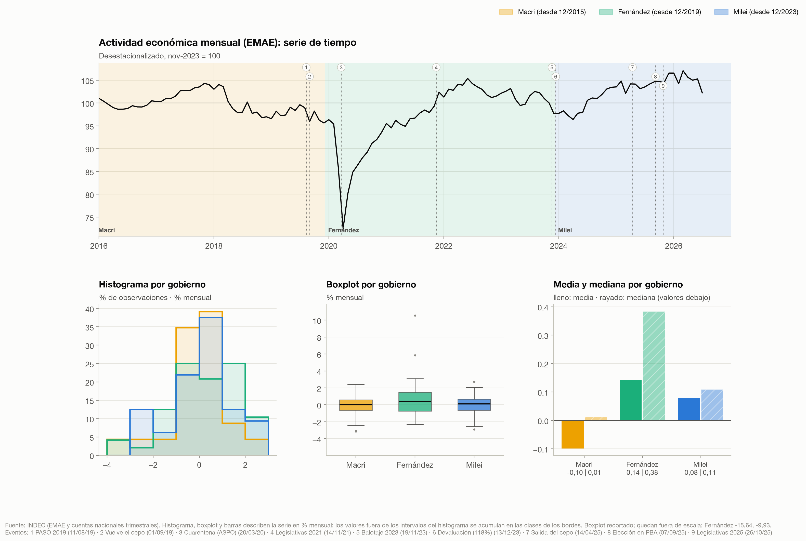

**Figura 2.15. EMAE desestacionalizado (nivel) y distribución de su variación mensual por gobierno.**

**Tabla 2.30. Estadística descriptiva de la variación mensual del EMAE (%)**

| Gobierno | Período | N | Media | Mediana | Desvío | Mín | Q1 | Q3 | Máx | CV (%) | Asimetría | Curtosis |
|:---|---:|---:|---:|---:|---:|---:|---:|---:|---:|---:|---:|---:|
| Macri | feb-16 a nov-19 | 46 | -0,10 | 0,01 | 1,18 | -3,16 | -0,67 | 0,57 | 2,38 | – | -0,48 | 0,98 |
| Fernández | dic-19 a nov-23 | 48 | 0,14 | 0,38 | 3,45 | -15,64 | -0,74 | 1,49 | 10,55 | – | -1,94 | 11,35 |
| Milei | dic-23 a jul-26 | 32 | 0,08 | 0,11 | 1,40 | -2,90 | -0,66 | 0,68 | 2,73 | – | -0,25 | 0,09 |
| Toda la muestra | feb-16 a jul-26 | 126 | 0,04 | 0,08 | 2,34 | -15,64 | -0,67 | 0,94 | 10,55 | – | -2,22 | 20,63 |

**Tabla 2.31. Estadística descriptiva del nivel del EMAE (nov-2023 = 100)**

| Gobierno | Período | N | Media | Mediana | Desvío | Mín | Q1 | Q3 | Máx | CV (%) | Asimetría | Curtosis |
|:---|---:|---:|---:|---:|---:|---:|---:|---:|---:|---:|---:|---:|
| Macri | ene-16 a nov-19 | 47 | 99,8 | 99,4 | 2,3 | 95,9 | 98,2 | 101,0 | 104,3 | 2,3 | 0,43 | -0,71 |
| Fernández | dic-19 a nov-23 | 48 | 97,2 | 99,4 | 6,9 | 72,5 | 95,2 | 102,3 | 105,4 | 7,1 | -1,57 | 2,80 |
| Milei | dic-23 a jul-26 | 32 | 102,5 | 103,5 | 3,1 | 96,4 | 100,9 | 104,7 | 107,1 | 3,0 | -0,63 | -0,76 |
| Toda la muestra | ene-16 a jul-26 | 127 | 99,5 | 100,3 | 5,1 | 72,5 | 97,8 | 103,0 | 107,1 | 5,1 | -2,14 | 7,36 |

**Tabla 2.32. Distribución de frecuencias de la variación mensual del EMAE (%)**

| Intervalo | Macri fa | Macri fr % | Macri Fr acum. % | Fernández fa | Fernández fr % | Fernández Fr acum. % | Milei fa | Milei fr % | Milei Fr acum. % |
|:---|---:|---:|---:|---:|---:|---:|---:|---:|---:|
| menos de -4 | 0 | 0,0 | 0,0 | 2 | 4,2 | 4,2 | 0 | 0,0 | 0,0 |
| [-4; -3) | 2 | 4,3 | 4,3 | 0 | 0,0 | 4,2 | 0 | 0,0 | 0,0 |
| [-3; -2) | 2 | 4,3 | 8,7 | 1 | 2,1 | 6,2 | 4 | 12,5 | 12,5 |
| [-2; -1) | 2 | 4,3 | 13,0 | 6 | 12,5 | 18,8 | 2 | 6,2 | 18,8 |
| [-1; 0) | 16 | 34,8 | 47,8 | 12 | 25,0 | 43,8 | 7 | 21,9 | 40,6 |
| [0; 1) | 18 | 39,1 | 87,0 | 10 | 20,8 | 64,6 | 12 | 37,5 | 78,1 |
| [1; 2) | 4 | 8,7 | 95,7 | 12 | 25,0 | 89,6 | 4 | 12,5 | 90,6 |
| [2; 3) | 2 | 4,3 | 100,0 | 2 | 4,2 | 93,8 | 3 | 9,4 | 100,0 |
| 3 o más | 0 | 0,0 | 100,0 | 3 | 6,2 | 100,0 | 0 | 0,0 | 100,0 |
| **Total** | 46 | 100,0 |  | 48 | 100,0 |  | 32 | 100,0 |  |

El hecho más llamativo del EMAE es que **en diez años casi no se movió**: el nivel medio es 99,8 con Macri, 97,2 con Fernández y 102,5 con Milei, y salvo la cuarentena la serie siempre estuvo entre 95 y 107. La variación mensual promedio es prácticamente cero en los tres casos (-0,10%, 0,14% y 0,08%). Es el estancamiento de largo plazo de la economía argentina, que precede a los tres gobiernos.

Lo que cambia entre gobiernos es la volatilidad. La de Fernández está dominada por la cuarentena: −15,6% en abril de 2020 y +10,6% en mayo, con una curtosis de 11,35 y una asimetría de -1,94. Sin esos meses, la actividad con Milei es tan volátil como con Macri: desvíos de 1,40 y 1,18 puntos, la misma clase modal ([0; 1), con el 37,5% de los meses de Milei) y una distribución casi normal (curtosis de 0,09).

En niveles, el período de Milei tiene una forma de "pozo y rebote": el EMAE cae hasta 96,4 en abril de 2024 por el efecto combinado de la devaluación, la caída del salario real y el recorte del gasto, se recupera hasta el máximo de la serie (107,1) en marzo de 2026 y vuelve a caer en los últimos meses (−2,9% en julio de 2026, el peor mes de todo el gobierno, peor incluso que diciembre de 2023). El nivel medio más alto de Milei se explica sobre todo por el rebote de 2025 y por el aporte de sectores como el agro, la minería y la energía, que se ven más abajo.

##### PBI real

*Qué es y cómo se mide.* El producto interno bruto trimestral a precios de 2004 de las cuentas nacionales del INDEC, sin desestacionalizar. Se usa la variación interanual del trimestre, que elimina la estacionalidad comparando cada trimestre con el mismo del año anterior.

*Fuente y período.* INDEC (`4.2_OGP_2004_T_17`), primer trimestre de 2017 (primera variación interanual) al segundo trimestre de 2026. Trimestral, en % interanual.

*Por qué se eligió.* Es la medida estándar del desempeño agregado y la base de las comparaciones internacionales y del crecimiento por habitante del capítulo 1.

*Limitaciones.* El INDEC publica cada trimestre **a tasa anual**. Con 10 trimestres de Milei, cualquier diferencia de medias tiene muy poca potencia estadística. Los ponderadores de 2004 están desactualizados.

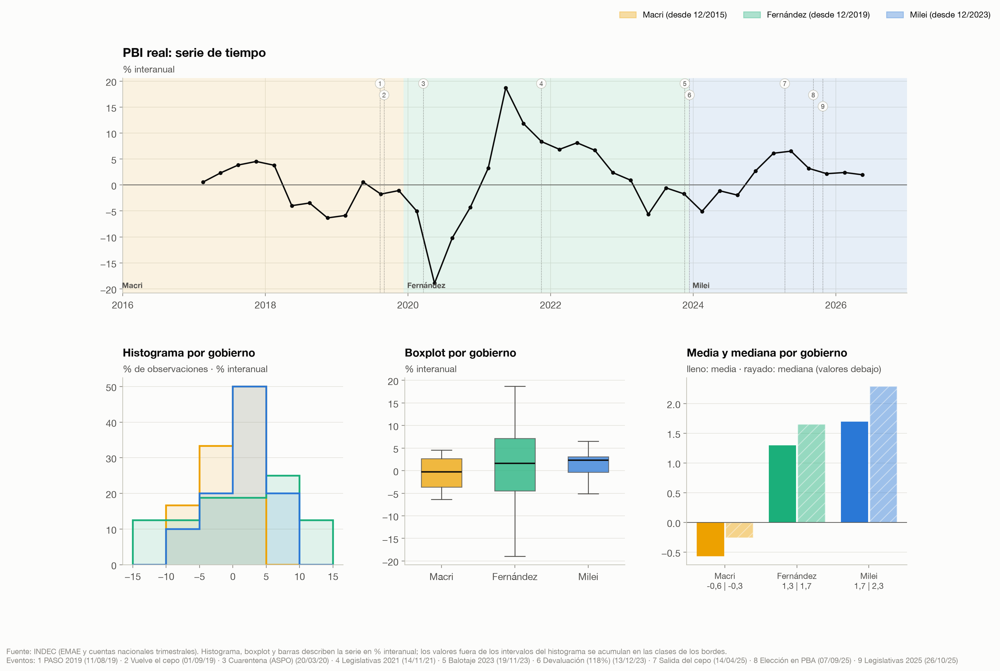

**Figura 2.16. PBI real: variación interanual del trimestre por gobierno.**

**Tabla 2.33. Estadística descriptiva del crecimiento interanual del PBI (%)**

| Gobierno | Período | N | Media | Mediana | Desvío | Mín | Q1 | Q3 | Máx | CV (%) | Asimetría | Curtosis |
|:---|---:|---:|---:|---:|---:|---:|---:|---:|---:|---:|---:|---:|
| Macri | T1-17 a T4-19 | 12 | -0,6 | -0,3 | 3,8 | -6,3 | -3,6 | 2,7 | 4,5 | – | -0,15 | -1,31 |
| Fernández | T1-20 a T4-23 | 16 | 1,3 | 1,7 | 9,1 | -18,9 | -4,5 | 7,2 | 18,7 | – | -0,31 | 0,61 |
| Milei | T1-24 a T2-26 | 10 | 1,7 | 2,3 | 3,6 | -5,1 | -0,3 | 3,1 | 6,5 | – | -0,55 | 0,12 |
| Toda la muestra | T1-17 a T2-26 | 38 | 0,8 | 1,4 | 6,5 | -18,9 | -3,1 | 3,8 | 18,7 | – | -0,20 | 2,23 |

**Tabla 2.34. Distribución de frecuencias del crecimiento interanual del PBI (%)**

| Intervalo | Macri fa | Macri fr % | Macri Fr acum. % | Fernández fa | Fernández fr % | Fernández Fr acum. % | Milei fa | Milei fr % | Milei Fr acum. % |
|:---|---:|---:|---:|---:|---:|---:|---:|---:|---:|
| menos de -15 | 0 | 0,0 | 0,0 | 1 | 6,2 | 6,2 | 0 | 0,0 | 0,0 |
| [-15; -10) | 0 | 0,0 | 0,0 | 1 | 6,2 | 12,5 | 0 | 0,0 | 0,0 |
| [-10; -5) | 2 | 16,7 | 16,7 | 2 | 12,5 | 25,0 | 1 | 10,0 | 10,0 |
| [-5; 0) | 4 | 33,3 | 50,0 | 3 | 18,8 | 43,8 | 2 | 20,0 | 30,0 |
| [0; 5) | 6 | 50,0 | 100,0 | 3 | 18,8 | 62,5 | 5 | 50,0 | 80,0 |
| [5; 10) | 0 | 0,0 | 100,0 | 4 | 25,0 | 87,5 | 2 | 20,0 | 100,0 |
| [10; 15) | 0 | 0,0 | 100,0 | 1 | 6,2 | 93,8 | 0 | 0,0 | 100,0 |
| 15 o más | 0 | 0,0 | 100,0 | 1 | 6,2 | 100,0 | 0 | 0,0 | 100,0 |
| **Total** | 12 | 100,0 |  | 16 | 100,0 |  | 10 | 100,0 |  |

La media del crecimiento interanual con Milei (1,7%) es la más alta de los tres gobiernos, seguida por la de Fernández (1,3%) y la de Macri (-0,6%). Pero con 10 trimestres y un desvío de 3,6 puntos, el error estándar de la media de Milei es de más de un punto, y la diferencia con Fernández no es estadísticamente distinguible. La tabla de frecuencias muestra que Macri y Milei comparten la clase modal, [0; 5), con la mitad de sus trimestres, mientras que Fernández tiene la distribución más dispersa (desvío de 9,1) por la caída de 18,9% del segundo trimestre de 2020 y el rebote de 18,7% un año después: dos valores que, en la media, se cancelan casi exactamente.

El perfil de Milei es el de una recesión corta y una recuperación: −5,1% en el primer trimestre de 2024, el piso, y luego cuatro trimestres de crecimiento alto, con un máximo de 6,5% en el segundo trimestre de 2025, en buena parte por comparación con una base muy baja. Desde fines de 2025 el crecimiento se estabiliza en torno a 2%. La mediana de Milei (2,3%) es más alta que su media, porque el período empieza con tres trimestres negativos que tiran el promedio hacia abajo.

En perspectiva, el crecimiento interanual promedio de toda la muestra (0,8%) no alcanza a cubrir el crecimiento de la población (alrededor de 1% anual), de modo que el producto por habitante cayó en la década: es la contracara trimestral del estancamiento que se veía en el EMAE.

##### Inversión bruta interna fija

*Qué es y cómo se mide.* La inversión en construcción, maquinaria y equipo y material de transporte, a precios de 2004, de las cuentas nacionales trimestrales. Se usa la variación interanual del trimestre.

*Fuente y período.* INDEC (`4.2_DGIT_2004_T_25`), T1-2017 a T2-2026. Trimestral, % interanual.

*Por qué se eligió.* Es el componente que anticipa el crecimiento futuro y el más sensible a la confianza en el programa económico y a la estabilidad de las reglas.

*Limitaciones.* Muy volátil y con fuerte peso de la maquinaria importada, cuyo precio relativo depende del tipo de cambio. A precios de 2004 sobrestima el peso de los bienes de capital importados.

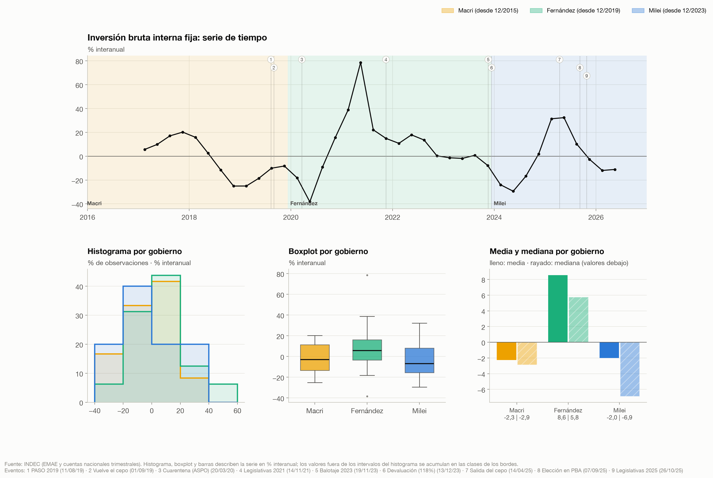

**Figura 2.17. Inversión: variación interanual del trimestre por gobierno.**

**Tabla 2.35. Estadística descriptiva del crecimiento interanual de la inversión (%)**

| Gobierno | Período | N | Media | Mediana | Desvío | Mín | Q1 | Q3 | Máx | CV (%) | Asimetría | Curtosis |
|:---|---:|---:|---:|---:|---:|---:|---:|---:|---:|---:|---:|---:|
| Macri | T1-17 a T4-19 | 12 | -2,3 | -2,9 | 16,3 | -25,1 | -13,3 | 11,4 | 20,2 | – | -0,06 | -1,47 |
| Fernández | T1-20 a T4-23 | 16 | 8,6 | 5,8 | 25,9 | -38,3 | -3,3 | 16,2 | 78,6 | – | 1,06 | 3,08 |
| Milei | T1-24 a T2-26 | 10 | -2,0 | -6,9 | 21,3 | -29,4 | -15,6 | 8,2 | 32,4 | – | 0,62 | -0,63 |
| Toda la muestra | T1-17 a T2-26 | 38 | 2,4 | 0,5 | 22,1 | -38,3 | -11,4 | 15,5 | 78,6 | – | 0,99 | 2,52 |

**Tabla 2.36. Distribución de frecuencias del crecimiento interanual de la inversión (%)**

| Intervalo | Macri fa | Macri fr % | Macri Fr acum. % | Fernández fa | Fernández fr % | Fernández Fr acum. % | Milei fa | Milei fr % | Milei Fr acum. % |
|:---|---:|---:|---:|---:|---:|---:|---:|---:|---:|
| [-40; -20) | 2 | 16,7 | 16,7 | 1 | 6,2 | 6,2 | 2 | 20,0 | 20,0 |
| [-20; 0) | 4 | 33,3 | 50,0 | 5 | 31,2 | 37,5 | 4 | 40,0 | 60,0 |
| [0; 20) | 5 | 41,7 | 91,7 | 7 | 43,8 | 81,2 | 2 | 20,0 | 80,0 |
| [20; 40) | 1 | 8,3 | 100,0 | 2 | 12,5 | 93,8 | 2 | 20,0 | 100,0 |
| [40; 60) | 0 | 0,0 | 100,0 | 0 | 0,0 | 93,8 | 0 | 0,0 | 100,0 |
| 60 o más | 0 | 0,0 | 100,0 | 1 | 6,2 | 100,0 | 0 | 0,0 | 100,0 |
| **Total** | 12 | 100,0 |  | 16 | 100,0 |  | 10 | 100,0 |  |

La inversión es entre tres y seis veces más volátil que el PBI en todos los gobiernos (desvíos de 16,3, 25,9 y 21,3 puntos, contra 3,8, 9,1 y 3,6 del PBI). Es el patrón clásico del "acelerador": las empresas ajustan la inversión mucho más que la producción ante cambios en la demanda esperada, y en una economía con crisis recurrentes ese ajuste es extremo.

Con Milei, la media (-2,0%) es parecida a la de Macri (-2,3%) y la mediana (-6,9%) es la más baja de los tres gobiernos; su clase modal es [-20; 0), con el 40,0% de los trimestres, una clase por debajo de la de los otros dos gobiernos ([0; 20)). El perfil temporal es de montaña rusa: caídas de 24% y 29% en la primera mitad de 2024, subas de 31% y 32% en la primera mitad de 2025 (rebote sobre una base deprimida y boom de importación de bienes de capital con el dólar barato) y nuevas caídas de 11% y 12% en el primer semestre de 2026.

La lectura económica es que la estabilización no se tradujo todavía en un aumento sostenido de la inversión, que es la condición para que el crecimiento de 2025 sea duradero. La incertidumbre electoral de 2025 y las tasas de interés reales altas de ese año son dos explicaciones habituales; el Régimen de Incentivo para Grandes Inversiones (RIGI) apunta a proyectos de largo plazo cuya ejecución todavía no se refleja en estos datos.

##### Tasa de inversión

*Qué es y cómo se mide.* La inversión bruta interna fija como porcentaje del PBI, ambos a precios corrientes, suma de los últimos cuatro trimestres.

*Fuente y período.* INDEC, cuentas nacionales a precios corrientes (`4.4_DGI_2004_T_19` sobre `4.4_OGP_2004_T_17`), T4-2016 a T2-2026. Trimestral, % del PBI.

*Por qué se eligió.* Mide el esfuerzo de inversión en relación con el tamaño de la economía, que es lo que determina la acumulación de capital.

*Limitaciones.* A precios corrientes depende del precio relativo de los bienes de inversión: si la maquinaria se abarata respecto del resto de la economía, la tasa nominal baja aunque se invierta la misma cantidad física.

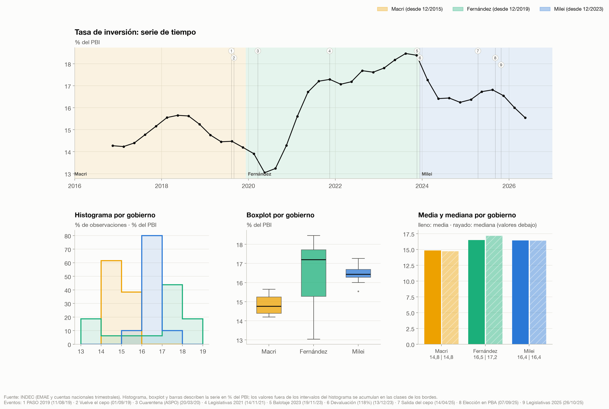

**Figura 2.18. Tasa de inversión (% del PBI, precios corrientes) por gobierno.**

**Tabla 2.37. Estadística descriptiva de la tasa de inversión (% del PBI)**

| Gobierno | Período | N | Media | Mediana | Desvío | Mín | Q1 | Q3 | Máx | CV (%) | Asimetría | Curtosis |
|:---|---:|---:|---:|---:|---:|---:|---:|---:|---:|---:|---:|---:|
| Macri | T4-16 a T4-19 | 13 | 14,8 | 14,8 | 0,6 | 14,2 | 14,4 | 15,3 | 15,7 | 3,7 | 0,42 | -1,50 |
| Fernández | T1-20 a T4-23 | 16 | 16,5 | 17,2 | 1,9 | 13,0 | 15,3 | 17,7 | 18,5 | 11,2 | -0,91 | -0,65 |
| Milei | T1-24 a T2-26 | 10 | 16,4 | 16,4 | 0,5 | 15,5 | 16,3 | 16,7 | 17,3 | 2,8 | -0,22 | 1,09 |
| Toda la muestra | T4-16 a T2-26 | 39 | 15,9 | 16,0 | 1,5 | 13,0 | 14,6 | 17,1 | 18,5 | 9,1 | -0,09 | -0,92 |

**Tabla 2.38. Distribución de frecuencias de la tasa de inversión (% del PBI)**

| Intervalo | Macri fa | Macri fr % | Macri Fr acum. % | Fernández fa | Fernández fr % | Fernández Fr acum. % | Milei fa | Milei fr % | Milei Fr acum. % |
|:---|---:|---:|---:|---:|---:|---:|---:|---:|---:|
| [13; 14) | 0 | 0,0 | 0,0 | 3 | 18,8 | 18,8 | 0 | 0,0 | 0,0 |
| [14; 15) | 8 | 61,5 | 61,5 | 1 | 6,2 | 25,0 | 0 | 0,0 | 0,0 |
| [15; 16) | 5 | 38,5 | 100,0 | 1 | 6,2 | 31,2 | 1 | 10,0 | 10,0 |
| [16; 17) | 0 | 0,0 | 100,0 | 1 | 6,2 | 37,5 | 8 | 80,0 | 90,0 |
| [17; 18) | 0 | 0,0 | 100,0 | 7 | 43,8 | 81,2 | 1 | 10,0 | 100,0 |
| [18; 19) | 0 | 0,0 | 100,0 | 3 | 18,8 | 100,0 | 0 | 0,0 | 100,0 |
| **Total** | 13 | 100,0 |  | 16 | 100,0 |  | 10 | 100,0 |  |

La tasa de inversión a precios corrientes es parecida con Fernández (16,5%) y con Milei (16,4%), y más baja con Macri (14,8%). Pero las formas son muy distintas: la de Fernández tiene el mayor desvío (1,9) porque recorre todo el camino del mínimo de la serie (13,0% en la cuarentena) al máximo (18,5% en el tercer trimestre de 2023); la de Milei es la más concentrada, con el 80,0% de sus trimestres en [16; 17), pero con una tendencia decreciente, de 17,3% a 15,5%, el valor más bajo desde 2020.

La tasa alta de fines del gobierno de Fernández está inflada por el precio relativo: con el dólar oficial atrasado y brecha de más de 100%, los bienes de capital importados (valuados al oficial) eran caros en pesos respecto del resto de la economía. Con Milei pasa lo contrario: la apreciación real y la apertura importadora abarataron la maquinaria y la tasa a precios corrientes cae aunque la cantidad física no lo haga en la misma medida. Por eso conviene leer esta tabla junto con la anterior: en volumen, la inversión con Milei cayó; en pesos corrientes, su peso en el PBI se mantuvo en el promedio de la década.

##### Consumo privado

*Qué es y cómo se mide.* El gasto de consumo final de los hogares a precios de 2004, cuentas nacionales trimestrales; variación interanual del trimestre.

*Fuente y período.* INDEC (`4.2_MGCP_2004_T_25`), T1-2017 a T2-2026. Trimestral, % interanual.

*Por qué se eligió.* Es el 70% de la demanda y el componente más ligado al salario real y al empleo: une la sección de ingresos con la de actividad.

*Limitaciones.* En las cuentas nacionales se obtiene en parte como residuo, de modo que absorbe errores de medición de los otros componentes.

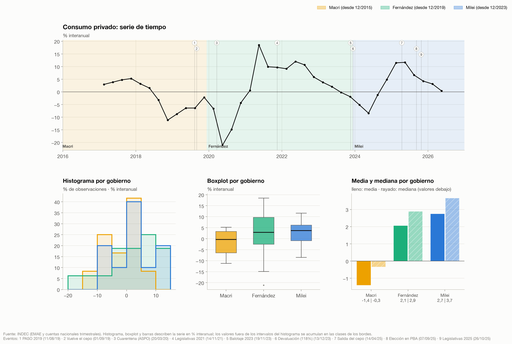

**Figura 2.19. Consumo privado: variación interanual del trimestre por gobierno.**

**Tabla 2.39. Estadística descriptiva del crecimiento interanual del consumo privado (%)**

| Gobierno | Período | N | Media | Mediana | Desvío | Mín | Q1 | Q3 | Máx | CV (%) | Asimetría | Curtosis |
|:---|---:|---:|---:|---:|---:|---:|---:|---:|---:|---:|---:|---:|
| Macri | T1-17 a T4-19 | 12 | -1,4 | -0,3 | 5,7 | -11,2 | -6,4 | 3,3 | 5,2 | – | -0,42 | -1,35 |
| Fernández | T1-20 a T4-23 | 16 | 2,1 | 2,9 | 10,3 | -21,1 | -2,5 | 9,7 | 18,5 | – | -0,76 | 0,50 |
| Milei | T1-24 a T2-26 | 10 | 2,7 | 3,7 | 6,6 | -8,4 | -0,9 | 6,2 | 11,7 | – | -0,26 | -0,53 |
| Toda la muestra | T1-17 a T2-26 | 38 | 1,1 | 2,5 | 8,2 | -21,1 | -4,1 | 5,7 | 18,5 | – | -0,47 | 0,49 |

**Tabla 2.40. Distribución de frecuencias del crecimiento interanual del consumo privado (%)**

| Intervalo | Macri fa | Macri fr % | Macri Fr acum. % | Fernández fa | Fernández fr % | Fernández Fr acum. % | Milei fa | Milei fr % | Milei Fr acum. % |
|:---|---:|---:|---:|---:|---:|---:|---:|---:|---:|
| menos de -20 | 0 | 0,0 | 0,0 | 1 | 6,2 | 6,2 | 0 | 0,0 | 0,0 |
| [-20; -15) | 0 | 0,0 | 0,0 | 0 | 0,0 | 6,2 | 0 | 0,0 | 0,0 |
| [-15; -10) | 1 | 8,3 | 8,3 | 1 | 6,2 | 12,5 | 0 | 0,0 | 0,0 |
| [-10; -5) | 3 | 25,0 | 33,3 | 1 | 6,2 | 18,8 | 2 | 20,0 | 20,0 |
| [-5; 0) | 2 | 16,7 | 50,0 | 3 | 18,8 | 37,5 | 1 | 10,0 | 30,0 |
| [0; 5) | 5 | 41,7 | 91,7 | 3 | 18,8 | 56,2 | 4 | 40,0 | 70,0 |
| [5; 10) | 1 | 8,3 | 100,0 | 4 | 25,0 | 81,2 | 1 | 10,0 | 80,0 |
| [10; 15) | 0 | 0,0 | 100,0 | 2 | 12,5 | 93,8 | 2 | 20,0 | 100,0 |
| 15 o más | 0 | 0,0 | 100,0 | 1 | 6,2 | 100,0 | 0 | 0,0 | 100,0 |
| **Total** | 12 | 100,0 |  | 16 | 100,0 |  | 10 | 100,0 |  |

El consumo privado reproduce la forma del PBI pero con más amplitud: media de 2,7% con Milei, 2,1% con Fernández y -1,4% con Macri, y desvíos mayores que los del producto en los tres gobiernos. Con Milei cae 5% y 8% interanual en la primera mitad de 2024, cuando el salario real tocó su piso, y crece 11,5% y 11,7% en la primera mitad de 2025, de la mano de la recuperación salarial, la vuelta del crédito al consumo y el abaratamiento de los bienes durables importados.

La distribución de Macri es la única con media negativa (-1,4%): la crisis de 2018-2019 se tradujo en caídas del consumo de hasta 11%, en línea con la caída del salario real de esos años. La clase modal de Milei ([0; 5)) es la misma que la de Macri. En el último dato (segundo trimestre de 2026) el consumo crece apenas 0,4% interanual: la desaceleración que mostraba el EMAE llega también al gasto de los hogares, en sintonía con el estancamiento del salario privado registrado desde 2025.

##### Consumo público

*Qué es y cómo se mide.* El gasto de consumo final del gobierno general (Nación, provincias y municipios) a precios de 2004: esencialmente salarios públicos y compras de bienes y servicios. Variación interanual del trimestre.

*Fuente y período.* INDEC (`4.2_DGCP_2004_T_30`), T1-2017 a T2-2026. Trimestral.

*Por qué se eligió.* Es la medida del ajuste fiscal desde las cuentas nacionales, y cubre también a las provincias.

*Limitaciones.* No incluye transferencias (jubilaciones, subsidios), que son la mayor parte del gasto nacional; por eso un ajuste fiscal fuerte puede verse poco en esta serie.

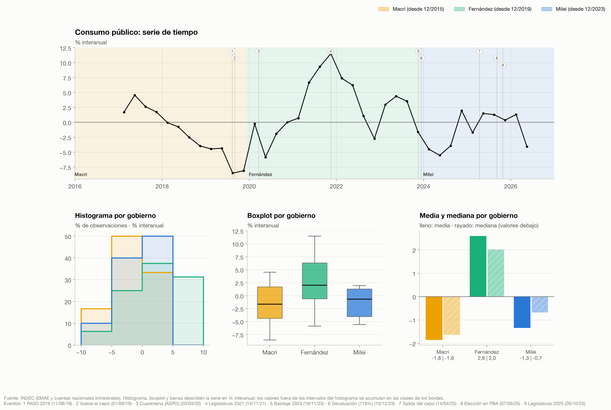

**Figura 2.20. Consumo público: variación interanual del trimestre por gobierno.**

**Tabla 2.41. Estadística descriptiva del crecimiento interanual del consumo público (%)**

| Gobierno | Período | N | Media | Mediana | Desvío | Mín | Q1 | Q3 | Máx | CV (%) | Asimetría | Curtosis |
|:---|---:|---:|---:|---:|---:|---:|---:|---:|---:|---:|---:|---:|
| Macri | T1-17 a T4-19 | 12 | -1,8 | -1,6 | 4,2 | -8,5 | -4,4 | 1,7 | 4,6 | – | -0,21 | -0,92 |
| Fernández | T1-20 a T4-23 | 16 | 2,6 | 2,0 | 4,8 | -5,8 | -0,6 | 6,3 | 11,5 | – | 0,20 | -0,59 |
| Milei | T1-24 a T2-26 | 10 | -1,3 | -0,7 | 2,9 | -5,5 | -4,0 | 1,3 | 2,0 | – | -0,24 | -2,00 |
| Toda la muestra | T1-17 a T2-26 | 38 | 0,2 | 0,2 | 4,6 | -8,5 | -3,6 | 2,5 | 11,5 | – | 0,35 | 0,05 |

**Tabla 2.42. Distribución de frecuencias del crecimiento interanual del consumo público (%)**

| Intervalo | Macri fa | Macri fr % | Macri Fr acum. % | Fernández fa | Fernández fr % | Fernández Fr acum. % | Milei fa | Milei fr % | Milei Fr acum. % |
|:---|---:|---:|---:|---:|---:|---:|---:|---:|---:|
| [-10; -5) | 2 | 16,7 | 16,7 | 1 | 6,2 | 6,2 | 1 | 10,0 | 10,0 |
| [-5; 0) | 6 | 50,0 | 66,7 | 4 | 25,0 | 31,2 | 4 | 40,0 | 50,0 |
| [0; 5) | 4 | 33,3 | 100,0 | 6 | 37,5 | 68,8 | 5 | 50,0 | 100,0 |
| [5; 10) | 0 | 0,0 | 100,0 | 4 | 25,0 | 93,8 | 0 | 0,0 | 100,0 |
| 10 o más | 0 | 0,0 | 100,0 | 1 | 6,2 | 100,0 | 0 | 0,0 | 100,0 |
| **Total** | 12 | 100,0 |  | 16 | 100,0 |  | 10 | 100,0 |  |

El consumo público cae en promedio con Macri (-1,8%) y con Milei (-1,3%) y crece con Fernández (2,6%): es la variable de cuentas nacionales que mejor separa a los gobiernos con programas de ajuste de los expansivos. Con Milei la distribución es la más compacta (desvío de 2,9, curtosis de -2,00): caídas de 4% a 5% en la primera mitad de 2024, estabilidad en 2025 y una nueva caída de 4,1% en el segundo trimestre de 2026.

Que la caída del consumo público sea moderada comparada con la del gasto primario nacional (que cae alrededor de 26% real entre 2023 y 2025, ver 2.4.4) tiene una explicación de composición: el consumo público incluye a las provincias, que mantuvieron buena parte de su gasto, y no incluye las transferencias, que fueron el centro del ajuste nacional (obra pública, subsidios energéticos, transferencias a provincias).

##### Exportaciones

*Qué es y cómo se mide.* Exportaciones de bienes y servicios a precios de 2004, cuentas nacionales trimestrales; variación interanual del trimestre.

*Fuente y período.* INDEC (`4.2_DGE_2004_T_26`), T1-2017 a T2-2026. Trimestral.

*Por qué se eligió.* Son la fuente genuina de dólares de la economía y la variable que define si el crecimiento puede sostenerse sin crisis de balanza de pagos.

*Limitaciones.* Muy dependientes del clima (la cosecha) y de los precios internacionales, que no son decisiones de política.

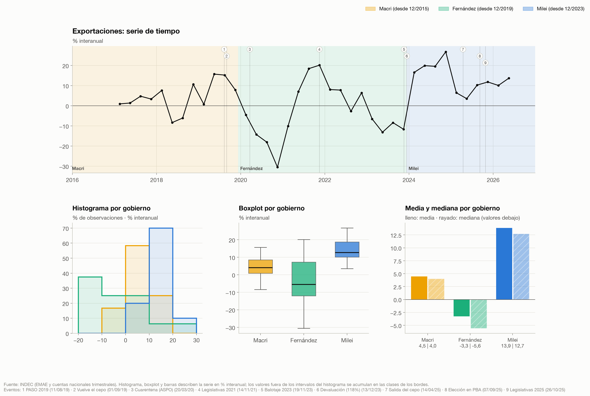

**Figura 2.21. Exportaciones: variación interanual del trimestre por gobierno.**

**Tabla 2.43. Estadística descriptiva del crecimiento interanual de las exportaciones (%)**

| Gobierno | Período | N | Media | Mediana | Desvío | Mín | Q1 | Q3 | Máx | CV (%) | Asimetría | Curtosis |
|:---|---:|---:|---:|---:|---:|---:|---:|---:|---:|---:|---:|---:|
| Macri | T1-17 a T4-19 | 12 | 4,5 | 4,0 | 7,5 | -8,4 | 0,9 | 8,6 | 15,7 | – | -0,12 | -0,46 |
| Fernández | T1-20 a T4-23 | 16 | -3,3 | -5,6 | 13,7 | -30,5 | -12,1 | 7,2 | 20,1 | – | 0,03 | -0,28 |
| Milei | T1-24 a T2-26 | 10 | 13,9 | 12,7 | 7,0 | 3,5 | 10,1 | 18,8 | 26,8 | 50,3 | 0,40 | -0,15 |
| Toda la muestra | T1-17 a T2-26 | 38 | 3,7 | 6,4 | 12,4 | -30,5 | -5,7 | 11,5 | 26,8 | – | -0,56 | 0,21 |

**Tabla 2.44. Distribución de frecuencias del crecimiento interanual de las exportaciones (%)**

| Intervalo | Macri fa | Macri fr % | Macri Fr acum. % | Fernández fa | Fernández fr % | Fernández Fr acum. % | Milei fa | Milei fr % | Milei Fr acum. % |
|:---|---:|---:|---:|---:|---:|---:|---:|---:|---:|
| menos de -20 | 0 | 0,0 | 0,0 | 1 | 6,2 | 6,2 | 0 | 0,0 | 0,0 |
| [-20; -10) | 0 | 0,0 | 0,0 | 5 | 31,2 | 37,5 | 0 | 0,0 | 0,0 |
| [-10; 0) | 2 | 16,7 | 16,7 | 4 | 25,0 | 62,5 | 0 | 0,0 | 0,0 |
| [0; 10) | 7 | 58,3 | 75,0 | 4 | 25,0 | 87,5 | 2 | 20,0 | 20,0 |
| [10; 20) | 3 | 25,0 | 100,0 | 1 | 6,2 | 93,8 | 7 | 70,0 | 90,0 |
| [20; 30) | 0 | 0,0 | 100,0 | 1 | 6,2 | 100,0 | 1 | 10,0 | 100,0 |
| **Total** | 12 | 100,0 |  | 16 | 100,0 |  | 10 | 100,0 |  |

Las exportaciones son la variable de actividad con la diferencia más grande a favor de Milei: crecimiento interanual medio de 13,9%, contra 4,5% con Macri y -3,3% con Fernández. Todos los trimestres de Milei tienen crecimiento positivo (mínimo de 3,5%) y el 70,0% está en la clase [10; 20), mientras que la clase modal de Fernández es [-20; -10). El boxplot de Milei no se superpone con la caja de Fernández.

Dos factores explican la mayor parte de esa diferencia y ninguno es enteramente de política. El primero es la **sequía de 2023**, la peor en décadas, que deprimió las exportaciones agrícolas del último año de Fernández y dejó una base muy baja: buena parte del crecimiento de 2024 es la cosecha que volvió a la normalidad. El segundo es la maduración de la **producción de petróleo y gas de Vaca Muerta**, con inversiones que empezaron en gobiernos anteriores y que convirtieron a la Argentina en exportadora neta de energía. Sobre esos dos factores actuaron medidas propias del gobierno, como la baja de retenciones y la unificación cambiaria, cuyo efecto aislado no se puede medir con estadística descriptiva.

##### Importaciones

*Qué es y cómo se mide.* Importaciones de bienes y servicios a precios de 2004, variación interanual del trimestre.

*Fuente y período.* INDEC (`4.2_OGI_2004_T_25`), T1-2017 a T2-2026. Trimestral.

*Por qué se eligió.* Son el componente que más responde al tipo de cambio real, a los controles cambiarios y a la apertura comercial, y su evolución muestra cómo se repartió la demanda interna entre producción local e importada.

*Limitaciones.* Mezcla bienes de consumo, insumos y bienes de capital, que responden a cosas distintas.

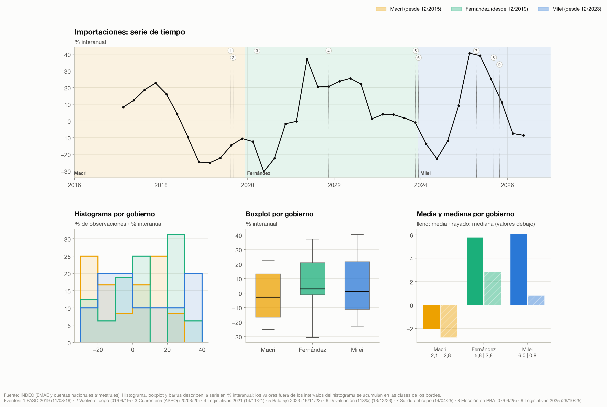

**Figura 2.22. Importaciones: variación interanual del trimestre por gobierno.**

**Tabla 2.45. Estadística descriptiva del crecimiento interanual de las importaciones (%)**

| Gobierno | Período | N | Media | Mediana | Desvío | Mín | Q1 | Q3 | Máx | CV (%) | Asimetría | Curtosis |
|:---|---:|---:|---:|---:|---:|---:|---:|---:|---:|---:|---:|---:|
| Macri | T1-17 a T4-19 | 12 | -2,1 | -2,8 | 17,8 | -25,1 | -16,6 | 13,3 | 22,7 | – | -0,01 | -1,70 |
| Fernández | T1-20 a T4-23 | 16 | 5,8 | 2,8 | 18,3 | -30,6 | -1,1 | 21,0 | 37,2 | – | -0,27 | -0,26 |
| Milei | T1-24 a T2-26 | 10 | 6,0 | 0,8 | 22,7 | -22,8 | -11,2 | 21,7 | 40,6 | – | 0,49 | -1,23 |
| Toda la muestra | T1-17 a T2-26 | 38 | 3,4 | 2,8 | 19,2 | -30,6 | -11,6 | 20,0 | 40,6 | – | 0,14 | -0,83 |

**Tabla 2.46. Distribución de frecuencias del crecimiento interanual de las importaciones (%)**

| Intervalo | Macri fa | Macri fr % | Macri Fr acum. % | Fernández fa | Fernández fr % | Fernández Fr acum. % | Milei fa | Milei fr % | Milei Fr acum. % |
|:---|---:|---:|---:|---:|---:|---:|---:|---:|---:|
| menos de -30 | 0 | 0,0 | 0,0 | 1 | 6,2 | 6,2 | 0 | 0,0 | 0,0 |
| [-30; -20) | 3 | 25,0 | 25,0 | 1 | 6,2 | 12,5 | 1 | 10,0 | 10,0 |
| [-20; -10) | 2 | 16,7 | 41,7 | 1 | 6,2 | 18,8 | 2 | 20,0 | 30,0 |
| [-10; 0) | 1 | 8,3 | 50,0 | 3 | 18,8 | 37,5 | 2 | 20,0 | 50,0 |
| [0; 10) | 2 | 16,7 | 66,7 | 4 | 25,0 | 62,5 | 1 | 10,0 | 60,0 |
| [10; 20) | 3 | 25,0 | 91,7 | 0 | 0,0 | 62,5 | 1 | 10,0 | 70,0 |
| [20; 30) | 1 | 8,3 | 100,0 | 5 | 31,2 | 93,8 | 1 | 10,0 | 80,0 |
| [30; 40) | 0 | 0,0 | 100,0 | 1 | 6,2 | 100,0 | 1 | 10,0 | 90,0 |
| 40 o más | 0 | 0,0 | 100,0 | 0 | 0,0 | 100,0 | 1 | 10,0 | 100,0 |
| **Total** | 12 | 100,0 |  | 16 | 100,0 |  | 10 | 100,0 |  |

Las importaciones son la variable más volátil de la demanda (desvíos de 17,8, 18,3 y 22,7 puntos) y la que tiene la distribución más "plana" en los tres gobiernos: ninguna clase concentra más de un tercio de los trimestres y las curtosis son negativas. Con Milei, la media (6,0%) y la mediana (0,8%) están muy separadas, señal de una distribución bimodal: caídas de 12% a 23% en los tres primeros trimestres de 2024, cuando la recesión y la devaluación las frenaron, y subas de 11% a 41% en 2025, con el tipo de cambio apreciado, la eliminación de licencias previas y la salida del cepo.

Las importaciones amplifican el ciclo del PBI en ambas direcciones, como la inversión, y son en buena medida su contracara: el boom de inversión de 2025 fue en gran parte maquinaria importada. En 2026 vuelven a caer (−7,5% y −8,6%), en línea con la desaceleración de la actividad y de la inversión.

##### Valor agregado por sector

El EMAE y el PBI esconden comportamientos sectoriales muy distintos. La tabla y la figura siguientes resumen el crecimiento interanual promedio de cada sector por gobierno (promedio de las variaciones interanuales trimestrales) y, para Milei, cuánto cambió el nivel de los últimos cuatro trimestres disponibles respecto de 2023, que compara años completos y por lo tanto no tiene problemas de estacionalidad.

*Fuente.* INDEC, valor agregado bruto por sector a precios de 2004, cuentas nacionales trimestrales (13 sectores, ids `11.2_*` en el script).

**Tabla 2.47. Crecimiento por sector y gobierno**

| Sector | Macri (% i.a. promedio) | Fernández (% i.a. promedio) | Milei (% i.a. promedio) | Últimos 4 trim. vs 2023 (%) |
|:---|---:|---:|---:|---:|
| Construcción | 2,1 | 5,2 | -5,0 | -13,7 |
| Industria | -2,7 | 2,9 | -3,4 | -8,9 |
| Comercio | -2,7 | 3,8 | -1,2 | -3,7 |
| Administración pública | 0,6 | 1,8 | -1,3 | -3,2 |
| Enseñanza | 1,2 | 1,4 | 0,4 | 1,1 |
| Electricidad, gas y agua | -1,3 | 1,7 | 0,8 | 1,8 |
| Inmobiliarias y empresariales | 1,1 | 2,5 | 1,5 | 3,7 |
| Transporte y comunicaciones | -0,5 | -0,5 | 1,5 | 3,9 |
| Pesca | 4,6 | -0,3 | 10,4 | 14,7 |
| Hoteles y restaurantes | 0,9 | 11,4 | 6,1 | 15,4 |
| Intermediación financiera | -0,9 | -0,7 | 9,7 | 23,2 |
| Minería y petróleo | -0,4 | 5,1 | 9,1 | 24,2 |
| Agro | 4,4 | -5,8 | 16,5 | 51,4 |

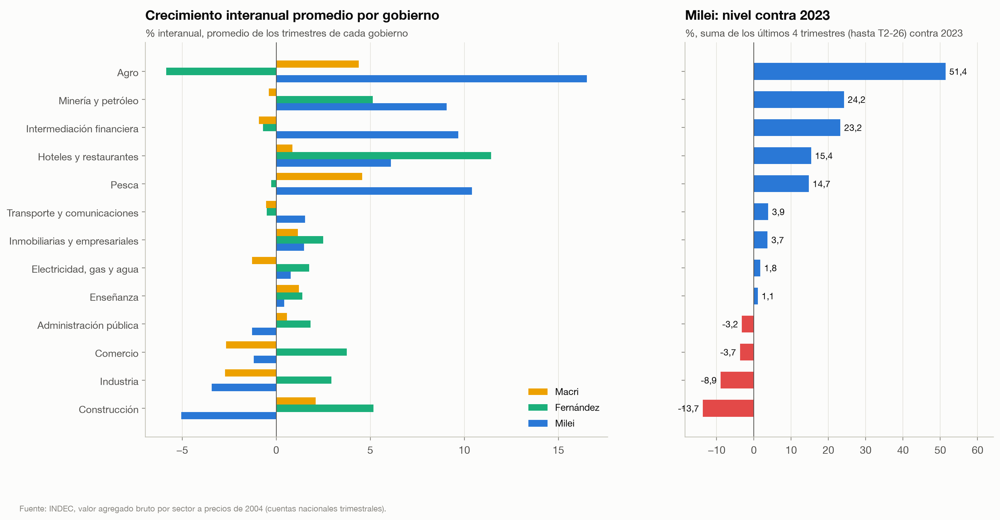

**Figura 2.23.** El crecimiento de Milei es **angosto**: se concentra en cinco sectores. El agro está 51,4% por encima de 2023 (con un crecimiento interanual promedio de 16,5%), la minería y el petróleo 24,2%, la intermediación financiera 23,2%, hoteles y restaurantes 15,4% y la pesca 14,7%. En el otro extremo, la construcción cambia -13,7% respecto de 2023, la industria -8,9%, el comercio -3,7% y la administración pública -3,2%.

Cada número tiene una explicación distinta. El agro compara con la sequía de 2023, de modo que su salto es más recuperación que crecimiento. La minería y el petróleo reflejan Vaca Muerta. La intermediación financiera crece por la remonetización y la vuelta del crédito con la desinflación, desde niveles muy bajos. La construcción cae por el fin de la obra pública (ver la composición del gasto) y la industria por la combinación de recesión de 2024, apertura importadora y dólar apreciado, que golpeó a los sectores que compiten con importaciones. Los sectores que más crecen son intensivos en capital y en recursos naturales y emplean relativamente poca gente; los que caen (construcción, industria, comercio) son los grandes empleadores. Esa es una de las razones por las que el crecimiento del PBI no se tradujo en una baja de la desocupación (sección 2.4.7).

Con Macri, los sectores ganadores eran los mismos recursos naturales (agro y pesca) y la construcción, con la obra pública de 2017; con Fernández, después de la pandemia, crecieron sobre todo los servicios (hoteles y restaurantes, comercio) y la construcción, mientras que el agro cayó por la sequía.

#### 2.4.4 Cuentas fiscales

Todas las variables fiscales son del Sector Público Nacional no financiero, en base caja, del Informe Mensual de Ingresos y Gastos (IMIG) de la Secretaría de Hacienda. Los flujos se expresan como **suma de 12 meses sobre el PBI nominal** de los cuatro trimestres correspondientes (en los dos últimos meses, sin PBI publicado, se usa el último disponible), lo que elimina la fuerte estacionalidad mensual (aguinaldos en junio y diciembre) y permite comparar años con inflaciones muy distintas. Una consecuencia de esa suma móvil es que **los primeros once meses de Milei contienen meses del gobierno anterior**: el resultado de diciembre de 2023 es, en realidad, el de todo 2023.

##### Gasto primario

*Qué es y cómo se mide.* El gasto total excluidos los intereses de la deuda, obtenido como ingresos primarios menos resultado primario. Se mide como % del PBI (nivel, en la figura) y como **variación real interanual** del gasto del mes, deflactado por el IPC (histograma, boxplot y frecuencias).

*Fuente y período.* Secretaría de Hacienda (`379.9_ING_PRIMAR017__36_12` − `379.9_SUPERAVIT_017__23_94`), enero de 2016 a agosto de 2026; % del PBI desde diciembre de 2016, variación real desde enero de 2017.

*Por qué se eligió.* El ajuste fiscal de Milei se hizo por el lado del gasto, y su tamaño es la diferencia más grande entre gobiernos de todo el estudio.

*Limitaciones.* Es base caja: los gastos devengados y no pagados (deuda flotante) no aparecen hasta que se pagan. La variación interanual de un mes puede estar distorsionada por cambios en el calendario de pagos (por ejemplo, un aguinaldo adelantado).

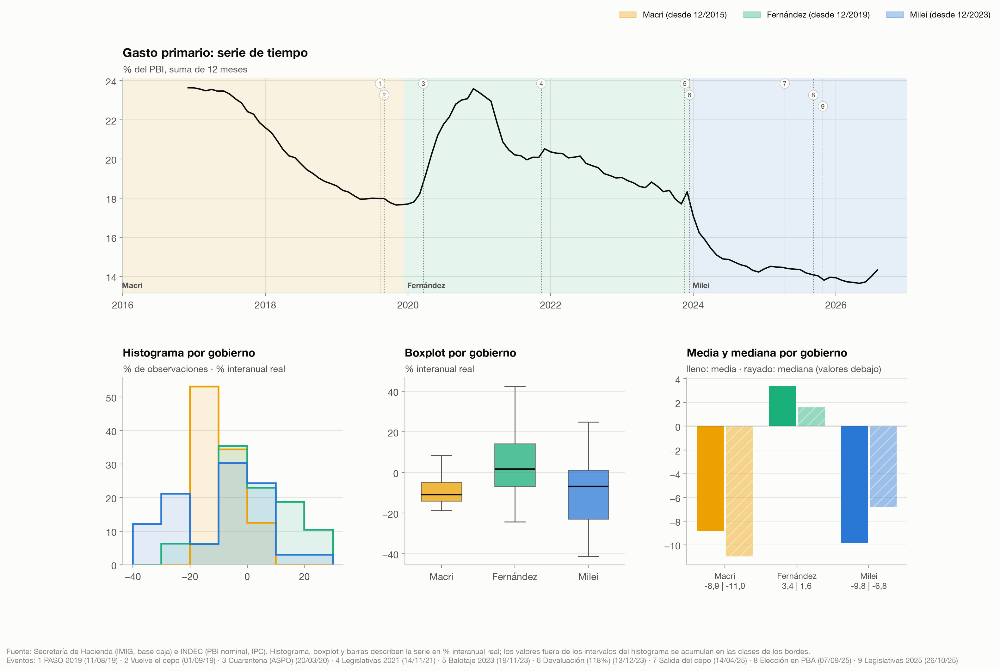

**Figura 2.24. Gasto primario: % del PBI (arriba) y distribución de su variación real interanual por gobierno.**

**Tabla 2.48. Estadística descriptiva de la variación real interanual del gasto primario (%)**

| Gobierno | Período | N | Media | Mediana | Desvío | Mín | Q1 | Q3 | Máx | CV (%) | Asimetría | Curtosis |
|:---|---:|---:|---:|---:|---:|---:|---:|---:|---:|---:|---:|---:|
| Macri | abr-17 a nov-19 | 32 | -8,9 | -11,0 | 6,6 | -18,5 | -14,0 | -4,8 | 8,4 | – | 0,68 | -0,06 |
| Fernández | dic-19 a nov-23 | 48 | 3,4 | 1,6 | 14,6 | -24,3 | -6,9 | 14,2 | 42,5 | – | 0,62 | 0,64 |
| Milei | dic-23 a ago-26 | 33 | -9,8 | -6,8 | 15,9 | -41,2 | -22,9 | 1,2 | 24,9 | – | -0,14 | -0,44 |
| Toda la muestra | abr-17 a ago-26 | 113 | -3,9 | -4,7 | 14,7 | -41,2 | -13,0 | 4,0 | 42,5 | – | 0,41 | 1,11 |

**Tabla 2.49. Estadística descriptiva del gasto primario (% del PBI, 12 meses)**

| Gobierno | Período | N | Media | Mediana | Desvío | Mín | Q1 | Q3 | Máx | CV (%) | Asimetría | Curtosis |
|:---|---:|---:|---:|---:|---:|---:|---:|---:|---:|---:|---:|---:|
| Macri | dic-16 a nov-19 | 36 | 20,5 | 20,1 | 2,2 | 17,7 | 18,4 | 22,9 | 23,6 | 10,8 | 0,20 | -1,62 |
| Fernández | dic-19 a nov-23 | 48 | 20,1 | 20,1 | 1,7 | 17,7 | 18,8 | 20,6 | 23,6 | 8,3 | 0,62 | -0,47 |
| Milei | dic-23 a ago-26 | 33 | 14,6 | 14,4 | 1,0 | 13,6 | 14,0 | 14,7 | 18,3 | 6,9 | 2,22 | 5,60 |
| Toda la muestra | dic-16 a ago-26 | 117 | 18,7 | 18,9 | 3,1 | 13,6 | 15,9 | 20,5 | 23,6 | 16,5 | -0,14 | -1,02 |

**Tabla 2.50. Distribución de frecuencias de la variación real interanual del gasto primario (%)**

| Intervalo | Macri fa | Macri fr % | Macri Fr acum. % | Fernández fa | Fernández fr % | Fernández Fr acum. % | Milei fa | Milei fr % | Milei Fr acum. % |
|:---|---:|---:|---:|---:|---:|---:|---:|---:|---:|
| menos de -40 | 0 | 0,0 | 0,0 | 0 | 0,0 | 0,0 | 1 | 3,0 | 3,0 |
| [-40; -30) | 0 | 0,0 | 0,0 | 0 | 0,0 | 0,0 | 3 | 9,1 | 12,1 |
| [-30; -20) | 0 | 0,0 | 0,0 | 3 | 6,2 | 6,2 | 7 | 21,2 | 33,3 |
| [-20; -10) | 17 | 53,1 | 53,1 | 3 | 6,2 | 12,5 | 2 | 6,1 | 39,4 |
| [-10; 0) | 11 | 34,4 | 87,5 | 17 | 35,4 | 47,9 | 10 | 30,3 | 69,7 |
| [0; 10) | 4 | 12,5 | 100,0 | 11 | 22,9 | 70,8 | 8 | 24,2 | 93,9 |
| [10; 20) | 0 | 0,0 | 100,0 | 9 | 18,8 | 89,6 | 1 | 3,0 | 97,0 |
| [20; 30) | 0 | 0,0 | 100,0 | 3 | 6,2 | 95,8 | 1 | 3,0 | 100,0 |
| 30 o más | 0 | 0,0 | 100,0 | 2 | 4,2 | 100,0 | 0 | 0,0 | 100,0 |
| **Total** | 32 | 100,0 |  | 48 | 100,0 |  | 33 | 100,0 |  |

El gasto primario promedio pasa de alrededor de 20% del PBI con Macri (20,5%) y Fernández (20,1%) a 14,6% con Milei: más de cinco puntos del producto, el cambio de nivel más grande del capítulo. Las tres distribuciones del nivel prácticamente no se superponen: el máximo de Milei (18,3%, que es diciembre de 2023 y por lo tanto el gasto de todo 2023) apenas toca los mínimos de los gobiernos anteriores, y desde mediados de 2024 la serie oscila entre 13,6% y 14,7%, los valores más bajos de la década. La asimetría (2,22) y la curtosis (5,60) de Milei las produce justamente ese primer tramo de transición.

En variaciones reales, las medias de Macri (-8,9%) y de Milei (-9,8%) son parecidas: los dos son gobiernos de ajuste del gasto. La diferencia está en la forma y la intensidad. Con Macri el ajuste fue gradual y sostenido (desvío de 6,6 puntos, el 53,1% de los meses en [-20; -10)); con Milei fue un shock concentrado: variaciones de hasta -41,2% interanual en enero de 2024 y luego, por efecto base, subas de hasta 24,9% en 2025 contra los meses más bajos de 2024. Por eso Milei tiene el mayor desvío (15,9) y una mediana (-6,8%) más alta que la media. Fernández es el único gobierno con gasto real creciente en promedio (3,4%), con un máximo de 42,5% en mayo de 2020 por los programas de la pandemia (IFE, ATP).

La comparación en % del PBI es más informativa que la de tasas, porque el PBI también cambió: el gasto cayó alrededor de 26% en términos reales entre 2023 y 2025 mientras el producto crecía, de modo que su peso en la economía bajó todavía más. La composición de esa caída se analiza al final de esta sección.

##### Ingresos primarios

*Qué es y cómo se mide.* Los ingresos totales del Sector Público Nacional excluidas las rentas de la propiedad financieras: impuestos, contribuciones a la seguridad social y otros ingresos corrientes y de capital. Como % del PBI (12 meses) y como variación real interanual.

*Fuente y período.* Secretaría de Hacienda (`379.9_ING_PRIMAR017__36_12`), enero de 2016 a agosto de 2026.

*Por qué se eligió.* El resultado fiscal es ingresos menos gastos: sin los ingresos no se puede saber si el superávit vino de gastar menos o de recaudar más.

*Limitaciones.* Incluye ingresos extraordinarios (moratorias, blanqueos, aportes únicos) que distorsionan las comparaciones interanuales de meses puntuales.

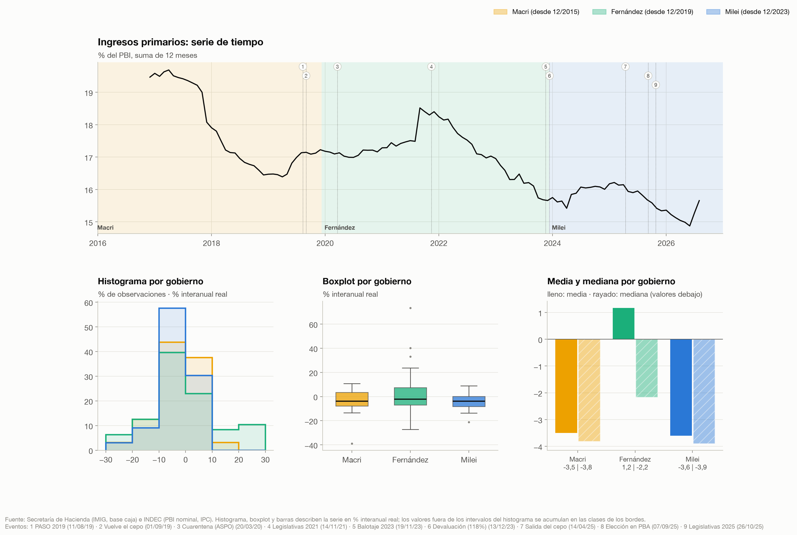

**Figura 2.25. Ingresos primarios: % del PBI (arriba) y distribución de su variación real interanual por gobierno.**

**Tabla 2.51. Estadística descriptiva de la variación real interanual de los ingresos primarios (%)**

| Gobierno | Período | N | Media | Mediana | Desvío | Mín | Q1 | Q3 | Máx | CV (%) | Asimetría | Curtosis |
|:---|---:|---:|---:|---:|---:|---:|---:|---:|---:|---:|---:|---:|
| Macri | abr-17 a nov-19 | 32 | -3,5 | -3,8 | 9,1 | -38,9 | -7,8 | 3,5 | 10,8 | – | -1,80 | 6,29 |
| Fernández | dic-19 a nov-23 | 48 | 1,2 | -2,2 | 17,3 | -27,3 | -6,9 | 7,5 | 73,5 | – | 1,76 | 5,83 |
| Milei | dic-23 a ago-26 | 33 | -3,6 | -3,9 | 6,8 | -21,1 | -8,3 | 0,1 | 8,9 | – | -0,08 | 0,33 |
| Toda la muestra | abr-17 a ago-26 | 113 | -1,5 | -3,4 | 12,9 | -38,9 | -8,1 | 3,6 | 73,5 | – | 1,94 | 10,68 |

**Tabla 2.52. Estadística descriptiva de los ingresos primarios (% del PBI, 12 meses)**

| Gobierno | Período | N | Media | Mediana | Desvío | Mín | Q1 | Q3 | Máx | CV (%) | Asimetría | Curtosis |
|:---|---:|---:|---:|---:|---:|---:|---:|---:|---:|---:|---:|---:|
| Macri | dic-16 a nov-19 | 36 | 17,8 | 17,1 | 1,2 | 16,4 | 16,8 | 19,3 | 19,7 | 6,9 | 0,48 | -1,54 |
| Fernández | dic-19 a nov-23 | 48 | 17,2 | 17,2 | 0,7 | 15,7 | 17,0 | 17,5 | 18,5 | 3,9 | -0,12 | 0,09 |
| Milei | dic-23 a ago-26 | 33 | 15,7 | 15,8 | 0,4 | 14,9 | 15,4 | 16,0 | 16,2 | 2,4 | -0,55 | -0,76 |
| Toda la muestra | dic-16 a ago-26 | 117 | 17,0 | 17,0 | 1,2 | 14,9 | 16,1 | 17,5 | 19,7 | 6,9 | 0,62 | -0,07 |

**Tabla 2.53. Distribución de frecuencias de la variación real interanual de los ingresos primarios (%)**

| Intervalo | Macri fa | Macri fr % | Macri Fr acum. % | Fernández fa | Fernández fr % | Fernández Fr acum. % | Milei fa | Milei fr % | Milei Fr acum. % |
|:---|---:|---:|---:|---:|---:|---:|---:|---:|---:|
| menos de -30 | 1 | 3,1 | 3,1 | 0 | 0,0 | 0,0 | 0 | 0,0 | 0,0 |
| [-30; -20) | 0 | 0,0 | 3,1 | 3 | 6,2 | 6,2 | 1 | 3,0 | 3,0 |
| [-20; -10) | 4 | 12,5 | 15,6 | 6 | 12,5 | 18,8 | 3 | 9,1 | 12,1 |
| [-10; 0) | 14 | 43,8 | 59,4 | 19 | 39,6 | 58,3 | 19 | 57,6 | 69,7 |
| [0; 10) | 12 | 37,5 | 96,9 | 11 | 22,9 | 81,2 | 10 | 30,3 | 100,0 |
| [10; 20) | 1 | 3,1 | 100,0 | 4 | 8,3 | 89,6 | 0 | 0,0 | 100,0 |
| [20; 30) | 0 | 0,0 | 100,0 | 2 | 4,2 | 93,8 | 0 | 0,0 | 100,0 |
| 30 o más | 0 | 0,0 | 100,0 | 3 | 6,2 | 100,0 | 0 | 0,0 | 100,0 |
| **Total** | 32 | 100,0 |  | 48 | 100,0 |  | 33 | 100,0 |  |

Los ingresos cuentan una historia que suele quedar oculta detrás del superávit: **la recaudación también bajó**. Su peso en el PBI cae en cada gobierno: 17,8% con Macri, 17,2% con Fernández y 15,7% con Milei, con un mínimo de la serie (14,9%) en junio de 2026. Con Milei la recaudación se sostuvo en 2024 con el impuesto PAIS y la suba de las retenciones, y bajó desde 2025 con la eliminación del impuesto PAIS, la baja de retenciones a las exportaciones agropecuarias y la caída de la recaudación ligada al comercio exterior.

En variaciones reales, las medias de Macri (-3,5%) y de Milei (-3,6%) son casi iguales y negativas, y la distribución de Milei es la más concentrada: el 57,6% de sus meses está en [-10; 0), con un desvío de 6,8 puntos contra 17,3 de Fernández. Los valores extremos de los gobiernos anteriores son ingresos extraordinarios: el mínimo de Macri (-38,9% en diciembre de 2017) compara contra diciembre de 2016, inflado por el impuesto especial del sinceramiento fiscal (blanqueo), y el máximo de Fernández (73,5% en septiembre de 2021) contra la recaudación deprimida de la pandemia y un ingreso extraordinario de ese mes.

Que el superávit se haya logrado con ingresos en baja confirma que el ajuste fue enteramente por el gasto, y es un dato relevante para su sostenibilidad: con una recaudación de alrededor de 15% del PBI, el margen para bajar más impuestos depende de seguir recortando gastos.

##### Resultado primario

*Qué es y cómo se mide.* Ingresos primarios menos gasto primario: el resultado antes del pago de intereses de la deuda. Suma de 12 meses sobre el PBI.

*Fuente y período.* Secretaría de Hacienda (`452.3_RESULTADO_RIO_0_M_18_54`), diciembre de 2016 a agosto de 2026. Mensual, % del PBI.

*Por qué se eligió.* El equilibrio fiscal ("déficit cero") fue el ancla del programa de Milei: es lo que permitió dejar de financiar al Tesoro con emisión monetaria, la causa de fondo de la inflación de los años anteriores.

*Limitaciones.* Abarca solo la Nación, no las provincias. Es base caja.

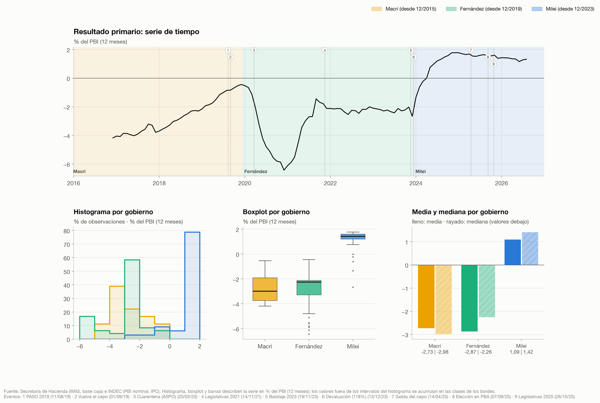

**Figura 2.26. Resultado primario (% del PBI, 12 meses) por gobierno.**

**Tabla 2.54. Estadística descriptiva del resultado primario (% del PBI)**

| Gobierno | Período | N | Media | Mediana | Desvío | Mín | Q1 | Q3 | Máx | CV (%) | Asimetría | Curtosis |
|:---|---:|---:|---:|---:|---:|---:|---:|---:|---:|---:|---:|---:|
| Macri | dic-16 a nov-19 | 36 | -2,73 | -2,98 | 1,14 | -4,17 | -3,73 | -1,91 | -0,53 | – | 0,52 | -1,01 |
| Fernández | dic-19 a nov-23 | 48 | -2,87 | -2,26 | 1,55 | -6,43 | -3,27 | -2,12 | -0,44 | – | -0,98 | 0,02 |
| Milei | dic-23 a ago-26 | 33 | 1,09 | 1,42 | 0,99 | -2,66 | 1,21 | 1,60 | 1,78 | – | -2,53 | 6,56 |
| Toda la muestra | dic-16 a ago-26 | 117 | -1,71 | -2,15 | 2,18 | -6,43 | -3,21 | -0,22 | 1,78 | – | 0,11 | -0,75 |

**Tabla 2.55. Distribución de frecuencias del resultado primario (% del PBI)**

| Intervalo | Macri fa | Macri fr % | Macri Fr acum. % | Fernández fa | Fernández fr % | Fernández Fr acum. % | Milei fa | Milei fr % | Milei Fr acum. % |
|:---|---:|---:|---:|---:|---:|---:|---:|---:|---:|
| menos de -6 | 0 | 0,0 | 0,0 | 2 | 4,2 | 4,2 | 0 | 0,0 | 0,0 |
| [-6; -5) | 0 | 0,0 | 0,0 | 6 | 12,5 | 16,7 | 0 | 0,0 | 0,0 |
| [-5; -4) | 4 | 11,1 | 11,1 | 3 | 6,2 | 22,9 | 0 | 0,0 | 0,0 |
| [-4; -3) | 14 | 38,9 | 50,0 | 2 | 4,2 | 27,1 | 0 | 0,0 | 0,0 |
| [-3; -2) | 8 | 22,2 | 72,2 | 28 | 58,3 | 85,4 | 1 | 3,0 | 3,0 |
| [-2; -1) | 6 | 16,7 | 88,9 | 4 | 8,3 | 93,8 | 1 | 3,0 | 6,1 |
| [-1; 0) | 4 | 11,1 | 100,0 | 3 | 6,2 | 100,0 | 3 | 9,1 | 15,2 |
| [0; 1) | 0 | 0,0 | 100,0 | 0 | 0,0 | 100,0 | 2 | 6,1 | 21,2 |
| [1; 2) | 0 | 0,0 | 100,0 | 0 | 0,0 | 100,0 | 26 | 78,8 | 100,0 |
| **Total** | 36 | 100,0 |  | 48 | 100,0 |  | 33 | 100,0 |  |

El resultado primario medio cambia de signo: -2,73% con Macri, -2,87% con Fernández y 1,09% con Milei. La tabla de frecuencias es la más nítida del estudio: el 78,8% de los meses de Milei está en la clase [1; 2), una clase en la que no hay **ningún** mes de los gobiernos anteriores, y el boxplot de Milei no se superpone con los otros dos. La mediana de Milei (1,42%) es más representativa que la media, porque el mínimo (-2,66%, diciembre de 2023) es el resultado de todo 2023; eso explica también su asimetría negativa (-2,53) y su curtosis (6,56).

Las trayectorias dentro de cada gobierno también son distintas. Con Macri el déficit primario se achica de manera continua (de -4,17% a -0,53%), con el acuerdo con el FMI de 2018 como acelerador. Con Fernández el déficit salta a -6,43% en la pandemia (diciembre de 2020) y luego se estabiliza alrededor de −2% a −3%. Con Milei el resultado pasa de −2,7% a superávit en mayo de 2024 (el primer valor positivo de la serie, en términos de 12 meses), llega a 1,78% en diciembre de 2024 y se mantiene entre 1,1% y 1,8% desde entonces.

Es el resultado más claro del programa y el que, según el propio gobierno, explica la desinflación: sin déficit que financiar, el Tesoro dejó de pedirle pesos al Banco Central. La correlación entre resultado primario e inflación del análisis bivariado (sección 2.6) es negativa con Milei, aunque, como se discute allí, en parte es el reflejo de dos tendencias simultáneas.

##### Resultado financiero

*Qué es y cómo se mide.* Resultado primario menos intereses de la deuda: el resultado fiscal "completo". Suma de 12 meses sobre el PBI.

*Fuente y período.* Secretaría de Hacienda (resultado primario menos `452.3_INTERESES_TOS_0_M_15_62`), diciembre de 2016 a agosto de 2026.

*Por qué se eligió.* Es el resultado que determina si el Estado necesita endeudarse o emitir: un superávit primario con déficit financiero sigue requiriendo financiamiento.

*Limitaciones.* En base caja, los intereses capitalizados de las Letras del Tesoro capitalizables (Lecaps), que se pagan al vencimiento junto con el capital, no se registran como intereses: el resultado financiero de 2024-2026 es algo más favorable que el devengado.

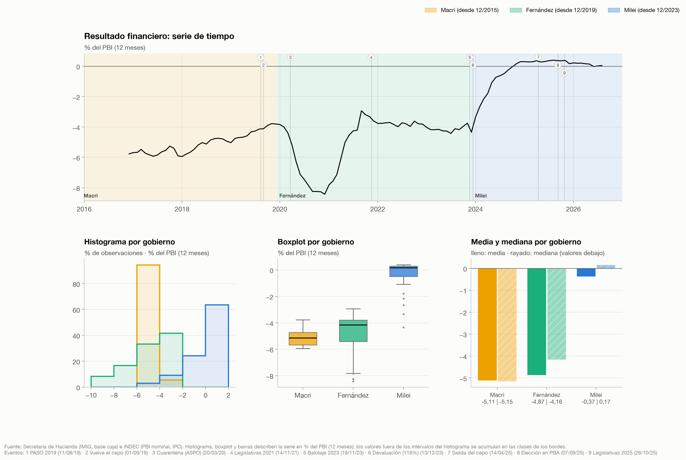

**Figura 2.27. Resultado financiero (% del PBI, 12 meses) por gobierno.**

**Tabla 2.56. Estadística descriptiva del resultado financiero (% del PBI)**

| Gobierno | Período | N | Media | Mediana | Desvío | Mín | Q1 | Q3 | Máx | CV (%) | Asimetría | Curtosis |
|:---|---:|---:|---:|---:|---:|---:|---:|---:|---:|---:|---:|---:|
| Macri | dic-16 a nov-19 | 36 | -5,11 | -5,15 | 0,63 | -5,94 | -5,67 | -4,73 | -3,77 | – | 0,46 | -0,84 |
| Fernández | dic-19 a nov-23 | 48 | -4,87 | -4,16 | 1,65 | -8,43 | -5,41 | -3,79 | -2,93 | – | -1,17 | -0,18 |
| Milei | dic-23 a ago-26 | 33 | -0,37 | 0,17 | 1,18 | -4,34 | -0,48 | 0,30 | 0,40 | – | -2,12 | 3,98 |
| Toda la muestra | dic-16 a ago-26 | 117 | -3,67 | -4,13 | 2,44 | -8,43 | -5,19 | -2,16 | 0,40 | – | 0,36 | -0,66 |

**Tabla 2.57. Distribución de frecuencias del resultado financiero (% del PBI)**

| Intervalo | Macri fa | Macri fr % | Macri Fr acum. % | Fernández fa | Fernández fr % | Fernández Fr acum. % | Milei fa | Milei fr % | Milei Fr acum. % |
|:---|---:|---:|---:|---:|---:|---:|---:|---:|---:|
| [-10; -8) | 0 | 0,0 | 0,0 | 4 | 8,3 | 8,3 | 0 | 0,0 | 0,0 |
| [-8; -6) | 0 | 0,0 | 0,0 | 8 | 16,7 | 25,0 | 0 | 0,0 | 0,0 |
| [-6; -4) | 34 | 94,4 | 94,4 | 16 | 33,3 | 58,3 | 1 | 3,0 | 3,0 |
| [-4; -2) | 2 | 5,6 | 100,0 | 20 | 41,7 | 100,0 | 3 | 9,1 | 12,1 |
| [-2; 0) | 0 | 0,0 | 100,0 | 0 | 0,0 | 100,0 | 8 | 24,2 | 36,4 |
| [0; 2) | 0 | 0,0 | 100,0 | 0 | 0,0 | 100,0 | 21 | 63,6 | 100,0 |
| **Total** | 36 | 100,0 |  | 48 | 100,0 |  | 33 | 100,0 |  |

Con Macri el déficit financiero fue muy estable (-5,11% de media, desvío de 0,63) y el 94,4% de sus meses cae en una sola clase, [-6; -4): el déficit primario bajaba, pero los intereses de la deuda que se tomaba para financiarlo subían en la misma proporción. Con Fernández el déficit financiero promedio (-4,87%) es parecido pero más disperso, que llega a -8,43% en la pandemia.

Milei es el único gobierno de la muestra con meses de superávit financiero: el 63,6% de sus meses está en [0; 2), la mediana es positiva (0,17%) y el máximo es 0,40% (agosto de 2025). La media es levemente negativa (-0,37%) solo por los primeros meses de la suma móvil, que arrastran el déficit de 2023. En el último dato el superávit financiero es casi nulo (0,05%), lo que muestra que el margen sobre el equilibrio es estrecho.

##### Intereses de la deuda

*Qué es y cómo se mide.* Los intereses pagados de la deuda pública nacional en base caja, suma de 12 meses sobre el PBI.

*Fuente y período.* Secretaría de Hacienda (`452.3_INTERESES_TOS_0_M_15_62`), diciembre de 2016 a agosto de 2026.

*Por qué se eligió.* Es el puente entre el resultado primario y el financiero, y refleja el costo de la deuda acumulada y de las decisiones de reestructuración.

*Limitaciones.* La misma de la variable anterior: en base caja no capta los intereses capitalizados de las Lecaps ni los que se pagan con nueva deuda dentro del mismo instrumento.

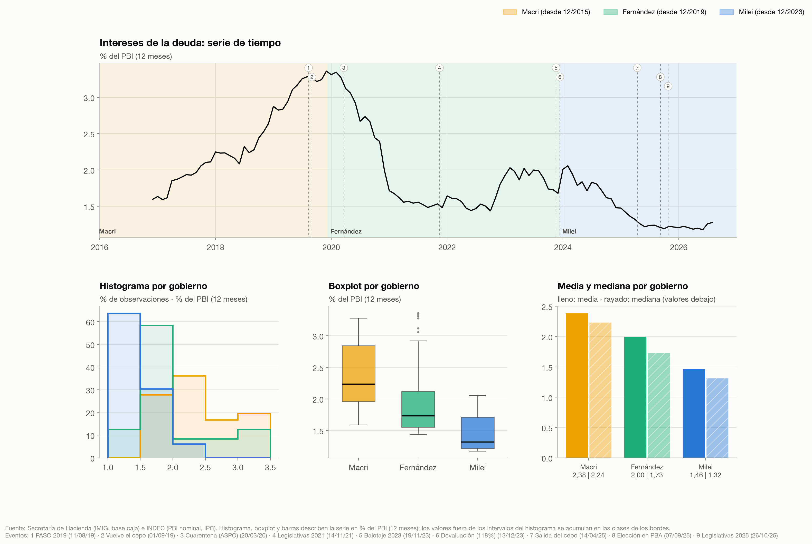

**Figura 2.28. Intereses de la deuda (% del PBI, 12 meses) por gobierno.**

**Tabla 2.58. Estadística descriptiva de los intereses de la deuda (% del PBI)**

| Gobierno | Período | N | Media | Mediana | Desvío | Mín | Q1 | Q3 | Máx | CV (%) | Asimetría | Curtosis |
|:---|---:|---:|---:|---:|---:|---:|---:|---:|---:|---:|---:|---:|
| Macri | dic-16 a nov-19 | 36 | 2,38 | 2,24 | 0,54 | 1,59 | 1,96 | 2,84 | 3,28 | 22,74 | 0,39 | -1,07 |
| Fernández | dic-19 a nov-23 | 48 | 2,00 | 1,73 | 0,60 | 1,44 | 1,55 | 2,12 | 3,36 | 30,16 | 1,19 | 0,10 |
| Milei | dic-23 a ago-26 | 33 | 1,46 | 1,32 | 0,28 | 1,18 | 1,22 | 1,71 | 2,06 | 19,47 | 0,71 | -0,95 |
| Toda la muestra | dic-16 a ago-26 | 117 | 1,96 | 1,83 | 0,62 | 1,18 | 1,52 | 2,24 | 3,36 | 31,60 | 0,86 | -0,26 |

**Tabla 2.59. Distribución de frecuencias de los intereses de la deuda (% del PBI)**

| Intervalo | Macri fa | Macri fr % | Macri Fr acum. % | Fernández fa | Fernández fr % | Fernández Fr acum. % | Milei fa | Milei fr % | Milei Fr acum. % |
|:---|---:|---:|---:|---:|---:|---:|---:|---:|---:|
| [1,0; 1,5) | 0 | 0,0 | 0,0 | 6 | 12,5 | 12,5 | 21 | 63,6 | 63,6 |
| [1,5; 2,0) | 10 | 27,8 | 27,8 | 28 | 58,3 | 70,8 | 10 | 30,3 | 93,9 |
| [2,0; 2,5) | 13 | 36,1 | 63,9 | 4 | 8,3 | 79,2 | 2 | 6,1 | 100,0 |
| [2,5; 3,0) | 6 | 16,7 | 80,6 | 4 | 8,3 | 87,5 | 0 | 0,0 | 100,0 |
| [3,0; 3,5) | 7 | 19,4 | 100,0 | 6 | 12,5 | 100,0 | 0 | 0,0 | 100,0 |
| **Total** | 36 | 100,0 |  | 48 | 100,0 |  | 33 | 100,0 |  |

Los intereses tienen tres regímenes claros. Con Macri suben de manera continua, de 1,59% a 3,28% del PBI, por el endeudamiento en moneda extranjera y la devaluación de 2018, que multiplicó en pesos el costo de la deuda en dólares. Con Fernández caen después de la reestructuración de la deuda con acreedores privados de 2020, que redujo los cupones de los bonos en dólares, hasta un mínimo de 1,44%. Con Milei bajan todavía más: media de 1,46%, el 63,6% de los meses en la clase más baja ([1,0; 1,5)) y un mínimo de la serie de 1,18% en junio de 2026.

Parte de esa baja es contable: la deuda en pesos se refinanció con Lecaps cuyos intereses no aparecen como tales en la base caja. Otra parte es real: el crecimiento del PBI en dólares, con un tipo de cambio apreciado, reduce el peso de la deuda en moneda extranjera. La comparación de los CV (todos entre 19% y 30%) muestra que los intereses son la variable fiscal con más tendencia dentro de cada gobierno.

##### Jubilaciones y pensiones

*Qué es y cómo se mide.* El gasto en prestaciones de la seguridad social (jubilaciones y pensiones contributivas). Como % del PBI (12 meses) y como variación real interanual.

*Fuente y período.* Secretaría de Hacienda (`452.2_JUBILACIONVAS_0_T_36_18`), enero de 2016 a agosto de 2026.

*Por qué se eligió.* Es el rubro más grande del gasto (un tercio en 2023, 44% en 2025) y el que más debate generó: su evolución depende de la fórmula de movilidad, que cambió en cada gobierno.

*Limitaciones.* Mide el gasto total, no el haber de cada jubilado: incluye el efecto del aumento de la cantidad de beneficiarios. No distingue entre el haber mínimo y los haberes más altos, que siguieron trayectorias distintas.

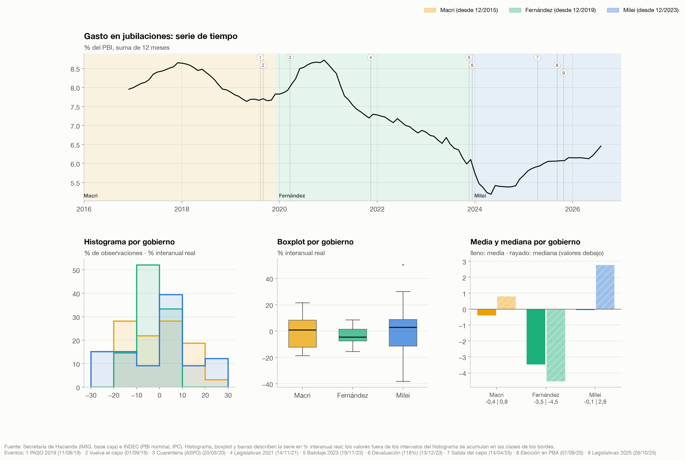

**Figura 2.29. Gasto en jubilaciones: % del PBI (arriba) y distribución de su variación real interanual por gobierno.**

**Tabla 2.60. Estadística descriptiva de la variación real interanual del gasto en jubilaciones (%)**

| Gobierno | Período | N | Media | Mediana | Desvío | Mín | Q1 | Q3 | Máx | CV (%) | Asimetría | Curtosis |
|:---|---:|---:|---:|---:|---:|---:|---:|---:|---:|---:|---:|---:|
| Macri | abr-17 a nov-19 | 32 | -0,4 | 0,8 | 11,8 | -18,6 | -12,2 | 8,3 | 21,6 | – | 0,06 | -1,23 |
| Fernández | dic-19 a nov-23 | 48 | -3,5 | -4,5 | 5,7 | -15,5 | -7,5 | 1,5 | 8,6 | – | 0,16 | -0,86 |
| Milei | dic-23 a ago-26 | 33 | -0,1 | 2,8 | 19,5 | -38,1 | -11,4 | 8,9 | 50,4 | – | 0,08 | 0,52 |
| Toda la muestra | abr-17 a ago-26 | 113 | -1,6 | -2,3 | 12,8 | -38,1 | -9,3 | 5,1 | 50,4 | – | 0,37 | 2,59 |

**Tabla 2.61. Estadística descriptiva del gasto en jubilaciones (% del PBI, 12 meses)**

| Gobierno | Período | N | Media | Mediana | Desvío | Mín | Q1 | Q3 | Máx | CV (%) | Asimetría | Curtosis |
|:---|---:|---:|---:|---:|---:|---:|---:|---:|---:|---:|---:|---:|
| Macri | dic-16 a nov-19 | 36 | 8,1 | 8,1 | 0,3 | 7,6 | 7,8 | 8,5 | 8,7 | 4,3 | -0,05 | -1,48 |
| Fernández | dic-19 a nov-23 | 48 | 7,4 | 7,3 | 0,8 | 6,0 | 6,9 | 8,1 | 8,7 | 10,3 | 0,19 | -1,03 |
| Milei | dic-23 a ago-26 | 33 | 5,8 | 5,9 | 0,4 | 5,2 | 5,4 | 6,1 | 6,5 | 6,1 | -0,33 | -1,24 |
| Toda la muestra | dic-16 a ago-26 | 117 | 7,2 | 7,3 | 1,1 | 5,2 | 6,1 | 8,1 | 8,7 | 14,8 | -0,26 | -1,26 |

**Tabla 2.62. Distribución de frecuencias de la variación real interanual del gasto en jubilaciones (%)**

| Intervalo | Macri fa | Macri fr % | Macri Fr acum. % | Fernández fa | Fernández fr % | Fernández Fr acum. % | Milei fa | Milei fr % | Milei Fr acum. % |
|:---|---:|---:|---:|---:|---:|---:|---:|---:|---:|
| menos de -30 | 0 | 0,0 | 0,0 | 0 | 0,0 | 0,0 | 3 | 9,1 | 9,1 |
| [-30; -20) | 0 | 0,0 | 0,0 | 0 | 0,0 | 0,0 | 2 | 6,1 | 15,2 |
| [-20; -10) | 9 | 28,1 | 28,1 | 7 | 14,6 | 14,6 | 5 | 15,2 | 30,3 |
| [-10; 0) | 7 | 21,9 | 50,0 | 25 | 52,1 | 66,7 | 3 | 9,1 | 39,4 |
| [0; 10) | 9 | 28,1 | 78,1 | 16 | 33,3 | 100,0 | 13 | 39,4 | 78,8 |
| [10; 20) | 6 | 18,8 | 96,9 | 0 | 0,0 | 100,0 | 3 | 9,1 | 87,9 |
| [20; 30) | 1 | 3,1 | 100,0 | 0 | 0,0 | 100,0 | 2 | 6,1 | 93,9 |
| 30 o más | 0 | 0,0 | 100,0 | 0 | 0,0 | 100,0 | 2 | 6,1 | 100,0 |
| **Total** | 32 | 100,0 |  | 48 | 100,0 |  | 33 | 100,0 |  |

El gasto en jubilaciones cae como % del PBI en cada gobierno: 8,1% con Macri, 7,4% con Fernández y 5,8% con Milei. Con Fernández la caída es la más fuerte dentro del período (de 8,7% en 2020 a 6,0% en noviembre de 2023): la fórmula de movilidad de 2021 ajustaba con rezago de varios meses y con inflación en aceleración los haberes quedaban cada vez más atrás. Con Milei el piso es 5,2% en mayo de 2024 y desde ahí el gasto **sube** hasta 6,5% en el último dato.

Las variaciones reales lo muestran con precisión. Con Milei la distribución es la más dispersa (desvío de 19,5 puntos): una variación de -38,1% interanual en enero de 2024, cuando la fórmula heredada actualizó los haberes muy por debajo de la inflación de la devaluación, y subas de hasta 50,4% en 2025 contra esa base deprimida. En el medio, un decreto de marzo de 2024 (DNU 274/2024) cambió la fórmula, desde abril, a una indexación mensual por la inflación pasada, que desde entonces preservó el valor real de los haberes. La mediana de Milei (2,8%) es la más alta de los tres gobiernos; la media (-0,1%) es casi cero.

La paradoja aparente es que las jubilaciones pasaron de un tercio a 44% del gasto primario (ver las tortas más abajo) mientras su gasto real caía en 2024. No hay contradicción: el total cayó mucho más que las jubilaciones, así que su participación subió. El haber mínimo con el bono previsional, congelado en términos nominales desde 2024, sí perdió valor real; esta serie, que es el gasto total, no permite verlo.

##### Subsidios a la energía

*Qué es y cómo se mide.* Transferencias corrientes al sector energético (CAMMESA, ENARSA y otros) que cubren la diferencia entre el costo de la energía y las tarifas. Solo existen con frecuencia trimestral en datos.gob.ar; se miden como % del PBI del trimestre.

*Fuente y período.* Secretaría de Hacienda (`452.2_ENERGIAGIA_0_T_7_79`), T1-2016 a T2-2026. Trimestral.

*Por qué se eligió.* Es el rubro donde la "corrección de precios relativos" (la suba de tarifas de la sección de precios) se traduce directamente en menor gasto.

*Limitaciones.* Muy estacional (suben en invierno por la importación de gas) y con pagos atrasados que se mueven de un trimestre a otro.

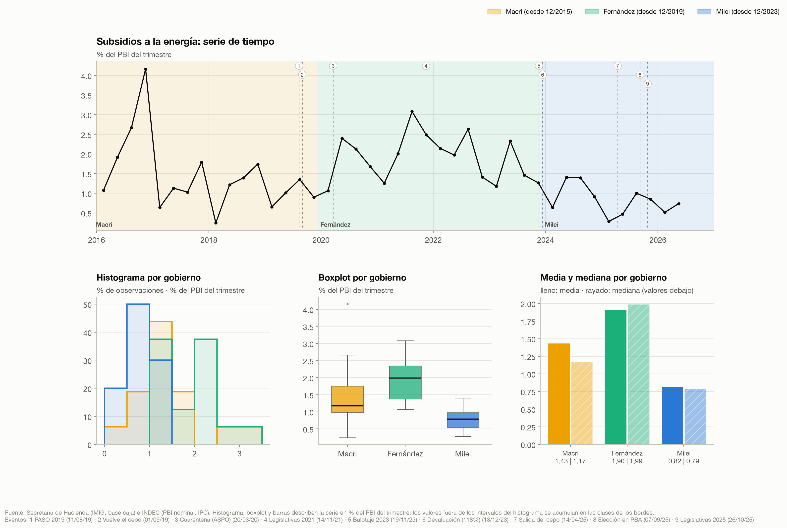

**Figura 2.30. Subsidios a la energía (% del PBI del trimestre) por gobierno.**

**Tabla 2.63. Estadística descriptiva de los subsidios a la energía (% del PBI del trimestre)**

| Gobierno | Período | N | Media | Mediana | Desvío | Mín | Q1 | Q3 | Máx | CV (%) | Asimetría | Curtosis |
|:---|---:|---:|---:|---:|---:|---:|---:|---:|---:|---:|---:|---:|
| Macri | T1-16 a T4-19 | 16 | 1,43 | 1,17 | 0,93 | 0,24 | 0,98 | 1,75 | 4,16 | 64,96 | 1,83 | 4,37 |
| Fernández | T1-20 a T4-23 | 16 | 1,90 | 1,99 | 0,60 | 1,06 | 1,37 | 2,34 | 3,08 | 31,35 | 0,24 | -0,87 |
| Milei | T1-24 a T2-26 | 10 | 0,82 | 0,79 | 0,37 | 0,28 | 0,54 | 0,98 | 1,41 | 45,72 | 0,43 | -0,60 |
| Toda la muestra | T1-16 a T2-26 | 42 | 1,47 | 1,31 | 0,81 | 0,24 | 0,93 | 1,96 | 4,16 | 55,23 | 1,07 | 1,67 |

**Tabla 2.64. Distribución de frecuencias de los subsidios a la energía (% del PBI del trimestre)**

| Intervalo | Macri fa | Macri fr % | Macri Fr acum. % | Fernández fa | Fernández fr % | Fernández Fr acum. % | Milei fa | Milei fr % | Milei Fr acum. % |
|:---|---:|---:|---:|---:|---:|---:|---:|---:|---:|
| [0,0; 0,5) | 1 | 6,2 | 6,2 | 0 | 0,0 | 0,0 | 2 | 20,0 | 20,0 |
| [0,5; 1,0) | 3 | 18,8 | 25,0 | 0 | 0,0 | 0,0 | 5 | 50,0 | 70,0 |
| [1,0; 1,5) | 7 | 43,8 | 68,8 | 6 | 37,5 | 37,5 | 3 | 30,0 | 100,0 |
| [1,5; 2,0) | 3 | 18,8 | 87,5 | 2 | 12,5 | 50,0 | 0 | 0,0 | 100,0 |
| [2,0; 2,5) | 0 | 0,0 | 87,5 | 6 | 37,5 | 87,5 | 0 | 0,0 | 100,0 |
| [2,5; 3,0) | 1 | 6,2 | 93,8 | 1 | 6,2 | 93,8 | 0 | 0,0 | 100,0 |
| [3,0; 3,5) | 0 | 0,0 | 93,8 | 1 | 6,2 | 100,0 | 0 | 0,0 | 100,0 |
| 3,5 o más | 1 | 6,2 | 100,0 | 0 | 0,0 | 100,0 | 0 | 0,0 | 100,0 |
| **Total** | 16 | 100,0 |  | 16 | 100,0 |  | 10 | 100,0 |  |

Los subsidios energéticos son el rubro con la caída más clara: de 1,90% del PBI por trimestre con Fernández a 0,82% con Milei, menos de la mitad. La clase modal de Milei ([0,5; 1,0)) está una clase por debajo de la de los otros dos gobiernos ([1,0; 1,5)), y su máximo (1,41%) es apenas superior a la mediana de Macri.

Macri tiene la distribución más asimétrica (1,83) porque arranca con los subsidios heredados de 2015 (hasta 4,16% en el cuarto trimestre de 2016) y los reduce con los aumentos de tarifas de 2016-2018: un proceso muy parecido al de Milei, que se revirtió con Fernández, cuando el congelamiento de tarifas y la suba del precio internacional del gas en 2022 los llevaron de nuevo a 2% a 3% del PBI trimestral. La comparación con el precio relativo de los regulados (sección 2.4.1) cierra el círculo: los dos gobiernos que subieron tarifas por encima de la inflación bajaron subsidios, y el que las congeló los subió.

##### Composición del gasto y de la demanda (tortas)

Para ver la composición del gasto se usa el gasto de cada año completo en pesos corrientes: las participaciones no necesitan deflactarse, porque numerador y denominador están en la misma moneda del mismo año.

**Tabla 2.65. Estructura del gasto primario, 2023 y 2025 (% del total)**

| Rubro (% del gasto primario) | 2023 | 2025 | Cambio (pp) |
|:---|---:|---:|---:|
| Jubilaciones y pensiones | 33,3 | 44,1 | +10,8 |
| Asignaciones (AUH y familiares) | 4,4 | 7,4 | +3,1 |
| Pensiones no contributivas | 3,0 | 3,7 | +0,6 |
| Salarios del Estado nacional | 14,2 | 13,8 | -0,4 |
| Subsidios a la energía | 8,3 | 4,8 | -3,5 |
| Subsidios al transporte | 2,6 | 2,3 | -0,3 |
| Transferencias a provincias | 2,0 | 1,1 | -0,9 |
| Obra pública (gasto de capital) | 6,1 | 1,6 | -4,5 |
| Resto del gasto primario | 26,1 | 21,2 | -4,9 |

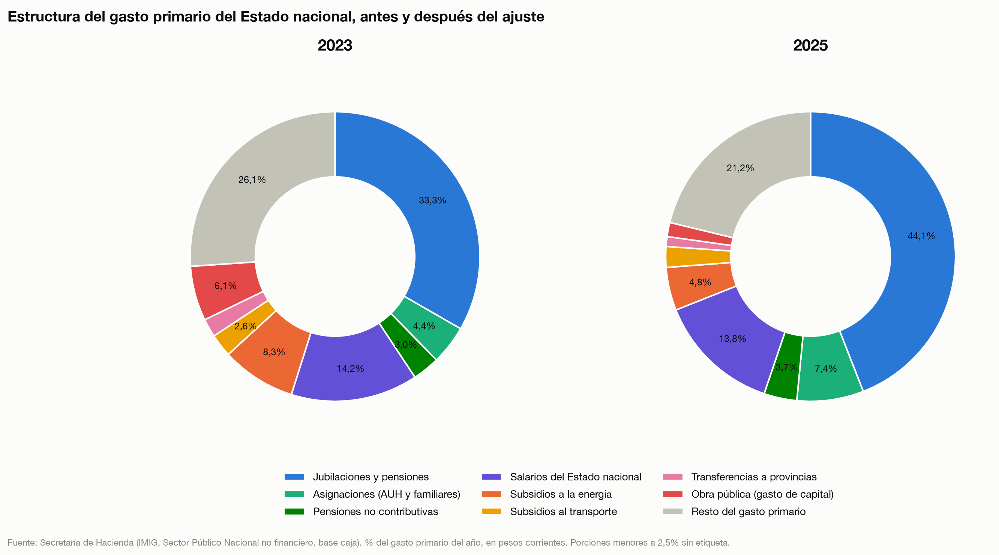

**Figura 2.31.** La composición del gasto cambió más que en cualquier otro momento de la serie. Las jubilaciones pasaron de un tercio a 44% del gasto primario y las asignaciones (AUH y familiares) de 4,4% a 7,4%. Esto **no** significa que se gastara más en jubilaciones: su gasto real cayó 4% entre 2023 y 2025 (ver `estudio/results.md`), pero el total cayó 26% y los rubros que más se recortaron (obra pública, de 6,1% a 1,6% del gasto; subsidios a la energía, de 8,3% a 4,8%) dejaron más espacio relativo a las prestaciones sociales. Es un buen ejemplo de por qué una torta debe leerse junto con el tamaño del total: una porción más grande de una torta más chica puede ser un monto menor.

Para el PBI por componente se usan las cuentas nacionales a precios corrientes. Una torta necesita partes positivas que sumen el total, y el PBI no cumple eso por el lado de la demanda (las importaciones restan); por eso se grafica la composición de la demanda final, C + G + I + X, y las importaciones se informan aparte. Las exportaciones a precios corrientes se obtienen por identidad (demanda global menos el resto de sus componentes), porque esa serie viene vacía en la API.

**Tabla 2.66. Componentes de la demanda (% del PBI, precios corrientes)**

| Componente (% del PBI, precios corrientes) | 2017 | 2019 | 2023 | 2025 |
|:---|---:|---:|---:|---:|
| Consumo privado | 66,7 | 66,1 | 65,8 | 70,8 |
| Consumo público | 17,7 | 16,4 | 16,2 | 15,3 |
| Inversión (IBIF) | 15,2 | 14,2 | 18,4 | 16,6 |
| Exportaciones | 11,3 | 17,9 | 12,7 | 15,5 |
| Importaciones | 14,0 | 14,7 | 13,7 | 14,8 |
| Existencias y discrepancia | 3,1 | 0,0 | 0,6 | -3,4 |

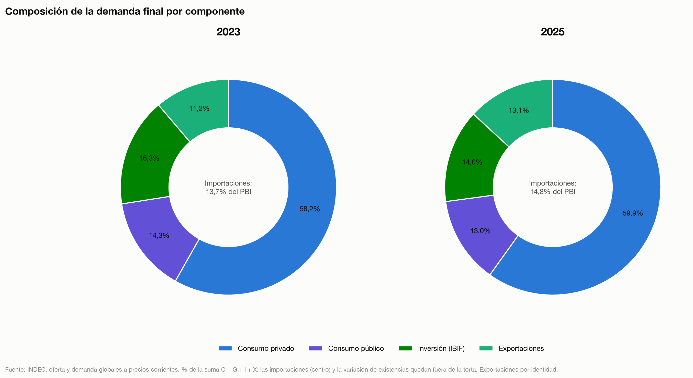

**Figura 2.32.** Entre 2023 y 2025 crece el peso del consumo privado (de 65,8% a 70,8% del PBI) y de las exportaciones (de 12,7% a 15,5%, por la normalización de la cosecha después de la sequía y por Vaca Muerta), y bajan el consumo público (de 16,2% a 15,3%) y la inversión (de 18,4% a 16,6%). Las importaciones también suben (de 13,7% a 14,8%), en línea con la apertura comercial. La caída del consumo público en el PBI es la contraparte, en las cuentas nacionales, del ajuste fiscal de esta sección.

#### 2.4.5 Tipo de cambio y reservas

##### Dólar oficial: depreciación mensual y tipo de cambio real

*Qué es y cómo se mide.* El tipo de cambio mayorista de referencia de la Comunicación A 3500 del BCRA, en pesos por dólar, promediado por mes. La distribución describe su **depreciación mensual** (variación % del promedio mensual); la serie de la figura muestra el **tipo de cambio real** bilateral (oficial / IPC, noviembre de 2023 = 100), que indica cuán caro o barato está el dólar en relación con los precios internos.

*Fuente y período.* BCRA (API de Estadísticas Monetarias v4, variable 5), diciembre de 2015 a octubre de 2026; IPC del INDEC para el tipo de cambio real. Mensual.

*Por qué se eligió.* La devaluación del 13/12/2023 (118% en un día) y la salida del cepo del 14/4/2025 son los dos eventos cambiarios centrales del período; el tipo de cambio es además el principal canal de traspaso a precios (sección 2.6) y el precio que define la competitividad de los sectores transables.

*Limitaciones.* El tipo de cambio real no descuenta la inflación de Estados Unidos (alrededor de 3% anual) y es bilateral, no multilateral. El promedio mensual reparte un salto discreto entre dos meses: la devaluación de diciembre de 2023 aparece como +81% en diciembre y el resto en enero.

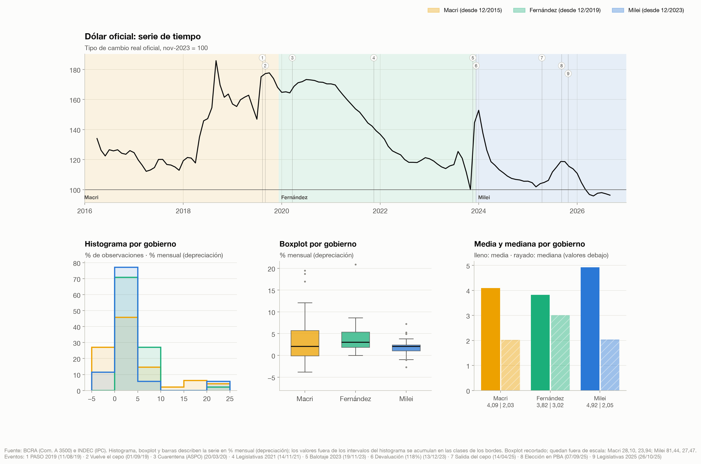

**Figura 2.33. Tipo de cambio real oficial (arriba) y distribución de la depreciación mensual por gobierno.**

**Tabla 2.67. Estadística descriptiva de la depreciación mensual del dólar oficial (%)**

| Gobierno | Período | N | Media | Mediana | Desvío | Mín | Q1 | Q3 | Máx | CV (%) | Asimetría | Curtosis |
|:---|---:|---:|---:|---:|---:|---:|---:|---:|---:|---:|---:|---:|
| Macri | dic-15 a nov-19 | 48 | 4,09 | 2,03 | 7,03 | -3,81 | -0,11 | 5,71 | 28,10 | – | 1,80 | 3,17 |
| Fernández | dic-19 a nov-23 | 48 | 3,82 | 3,02 | 3,33 | 0,01 | 1,87 | 5,35 | 20,89 | 87,01 | 2,98 | 13,96 |
| Milei | dic-23 a oct-26 | 35 | 4,92 | 2,05 | 14,12 | -2,74 | 1,07 | 2,42 | 81,44 | – | 5,07 | 27,24 |
| Toda la muestra | dic-15 a oct-26 | 131 | 4,22 | 2,24 | 8,61 | -3,81 | 1,04 | 4,78 | 81,44 | – | 6,16 | 50,47 |

**Tabla 2.68. Estadística descriptiva del tipo de cambio real oficial (nov-2023 = 100)**

| Gobierno | Período | N | Media | Mediana | Desvío | Mín | Q1 | Q3 | Máx | CV (%) | Asimetría | Curtosis |
|:---|---:|---:|---:|---:|---:|---:|---:|---:|---:|---:|---:|---:|
| Macri | abr-16 a nov-19 | 44 | 138,2 | 126,4 | 22,4 | 112,2 | 120,0 | 157,7 | 185,9 | 16,2 | 0,59 | -1,11 |
| Fernández | dic-19 a nov-23 | 48 | 142,4 | 140,8 | 23,4 | 100,0 | 119,9 | 166,7 | 173,3 | 16,4 | 0,03 | -1,65 |
| Milei | dic-23 a sep-26 | 34 | 111,0 | 107,1 | 13,2 | 95,8 | 104,1 | 115,4 | 152,8 | 11,9 | 1,60 | 2,86 |
| Toda la muestra | abr-16 a sep-26 | 126 | 132,5 | 123,4 | 24,5 | 95,8 | 115,1 | 155,2 | 185,9 | 18,5 | 0,49 | -1,10 |

**Tabla 2.69. Distribución de frecuencias de la depreciación mensual del dólar oficial (%)**

| Intervalo | Macri fa | Macri fr % | Macri Fr acum. % | Fernández fa | Fernández fr % | Fernández Fr acum. % | Milei fa | Milei fr % | Milei Fr acum. % |
|:---|---:|---:|---:|---:|---:|---:|---:|---:|---:|
| [-5; 0) | 13 | 27,1 | 27,1 | 0 | 0,0 | 0,0 | 4 | 11,4 | 11,4 |
| [0; 5) | 22 | 45,8 | 72,9 | 34 | 70,8 | 70,8 | 27 | 77,1 | 88,6 |
| [5; 10) | 7 | 14,6 | 87,5 | 13 | 27,1 | 97,9 | 2 | 5,7 | 94,3 |
| [10; 15) | 1 | 2,1 | 89,6 | 0 | 0,0 | 97,9 | 0 | 0,0 | 94,3 |
| [15; 20) | 3 | 6,2 | 95,8 | 0 | 0,0 | 97,9 | 0 | 0,0 | 94,3 |
| [20; 25) | 1 | 2,1 | 97,9 | 1 | 2,1 | 100,0 | 0 | 0,0 | 94,3 |
| 25 o más | 1 | 2,1 | 100,0 | 0 | 0,0 | 100,0 | 2 | 5,7 | 100,0 |
| **Total** | 48 | 100,0 |  | 48 | 100,0 |  | 35 | 100,0 |  |

La depreciación mensual mediana es casi igual con Macri (2,03%) y con Milei (2,05%) y más alta con Fernández (3,02%), pero Milei tiene la distribución más extrema de todo el capítulo: asimetría de 5,07 y curtosis de 27,24, por un único salto (81,44% en diciembre de 2023) seguido de un crawling peg de 2% mensual hasta abril de 2025 y de una flotación entre bandas desde entonces. La tabla de frecuencias muestra que el 77,1% de los meses de Milei está en [0; 5), la concentración más alta de los tres gobiernos. Es el tipo de variable donde la media y el desvío describen mal el proceso: lo que hay es un régimen con un salto discreto.

Los regímenes cambiarios de los gobiernos anteriores dejan huellas igual de nítidas. Con Macri, que tuvo tipo de cambio flotante, el 45,8% de los meses cae en la clase modal y más de un cuarto de los meses tiene depreciación **negativa** (el peso se apreció): es la distribución más dispersa en el cuerpo, con las crisis de 2018 (+28,1% en septiembre) y 2019 en la cola. Con Fernández no hay ningún mes negativo: con cepo y un crawling peg administrado, el oficial subió todos los meses, con un salto de 20,89% después de las PASO de agosto de 2023.

En tipo de cambio real, el promedio de Milei (111,0) es el más bajo de los tres gobiernos, es decir, el peso más apreciado. La serie lo explica: la devaluación lleva el tipo de cambio real a 152,8 en enero de 2024, pero como la inflación de los meses siguientes fue muy superior al 2% del crawling peg, la ganancia se erosiona en un año y medio. Después de un repunte en la previa electoral de 2025, el tipo de cambio real cae a 95,8 en mayo de 2026, por debajo del nivel de noviembre de 2023. Es el costo del ancla cambiaria: ayuda a bajar la inflación, pero encarece la producción local en dólares y explica parte del mal desempeño de la industria y del boom de importaciones.

##### Brecha cambiaria

*Qué es y cómo se mide.* La diferencia porcentual entre el dólar contado con liquidación (CCL), que se obtiene comprando un activo en pesos y vendiéndolo en dólares en el exterior, y el dólar oficial mayorista. Promedio mensual de datos diarios.

*Fuente y período.* BCRA (oficial) y ArgentinaDatos (`cotizaciones/dolares/contadoconliqui`), enero de 2016 a octubre de 2026. Mensual, en %.

*Por qué se eligió.* Es el termómetro de los controles cambiarios: sin cepo la brecha es casi cero, y su tamaño mide cuánto se desvía el precio oficial del que surge del mercado. Una brecha alta anticipa devaluaciones y alimenta expectativas de inflación.

*Limitaciones.* El CCL es un mercado chico y su precio puede ser afectado por intervenciones del BCRA. Después de abril de 2025, con restricciones para empresas que todavía siguen, la brecha no es exactamente cero.

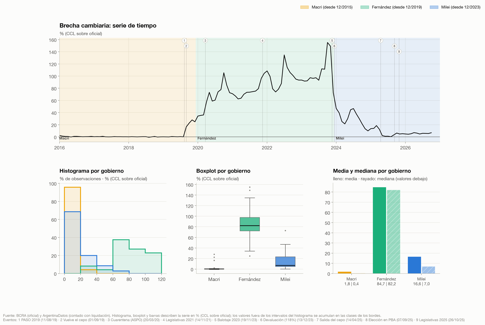

**Figura 2.34. Brecha cambiaria (CCL sobre oficial, %) por gobierno.**

**Tabla 2.70. Estadística descriptiva de la brecha cambiaria (%)**

| Gobierno | Período | N | Media | Mediana | Desvío | Mín | Q1 | Q3 | Máx | CV (%) | Asimetría | Curtosis |
|:---|---:|---:|---:|---:|---:|---:|---:|---:|---:|---:|---:|---:|
| Macri | ene-16 a nov-19 | 47 | 1,8 | 0,4 | 5,6 | -0,5 | 0,2 | 0,7 | 27,9 | – | 3,92 | 14,77 |
| Fernández | dic-19 a nov-23 | 48 | 84,7 | 82,2 | 26,5 | 24,9 | 72,3 | 97,9 | 155,2 | 31,2 | 0,23 | 0,93 |
| Milei | dic-23 a oct-26 | 35 | 16,6 | 7,0 | 17,2 | 0,3 | 5,0 | 23,4 | 72,8 | 103,6 | 1,53 | 2,11 |
| Toda la muestra | ene-16 a oct-26 | 130 | 36,4 | 13,5 | 41,9 | -0,5 | 0,5 | 73,5 | 155,2 | – | 0,82 | -0,59 |

**Tabla 2.71. Distribución de frecuencias de la brecha cambiaria (%)**

| Intervalo | Macri fa | Macri fr % | Macri Fr acum. % | Fernández fa | Fernández fr % | Fernández Fr acum. % | Milei fa | Milei fr % | Milei Fr acum. % |
|:---|---:|---:|---:|---:|---:|---:|---:|---:|---:|
| menos de 0 | 3 | 6,4 | 6,4 | 0 | 0,0 | 0,0 | 0 | 0,0 | 0,0 |
| [0; 20) | 42 | 89,4 | 95,7 | 0 | 0,0 | 0,0 | 24 | 68,6 | 68,6 |
| [20; 40) | 2 | 4,3 | 100,0 | 4 | 8,3 | 8,3 | 7 | 20,0 | 88,6 |
| [40; 60) | 0 | 0,0 | 100,0 | 2 | 4,2 | 12,5 | 3 | 8,6 | 97,1 |
| [60; 80) | 0 | 0,0 | 100,0 | 18 | 37,5 | 50,0 | 1 | 2,9 | 100,0 |
| [80; 100) | 0 | 0,0 | 100,0 | 13 | 27,1 | 77,1 | 0 | 0,0 | 100,0 |
| [100; 120) | 0 | 0,0 | 100,0 | 8 | 16,7 | 93,8 | 0 | 0,0 | 100,0 |
| 120 o más | 0 | 0,0 | 100,0 | 3 | 6,2 | 100,0 | 0 | 0,0 | 100,0 |
| **Total** | 47 | 100,0 |  | 48 | 100,0 |  | 35 | 100,0 |  |

La brecha separa a los tres gobiernos como pocas variables. Con Macri, sin cepo hasta septiembre de 2019, la mediana es 0,4% y el 89,4% de los meses está en [0; 20); la media (1,8%) y la curtosis (14,77) las producen los tres últimos meses, con el cepo de vuelta. Con Fernández la brecha es estructural: media de 84,7%, nunca baja de 25% y llega a 155,2% en octubre de 2023, en la previa del balotaje. Su clase modal es [60; 80).

Con Milei la brecha cae de 72,8% en diciembre de 2023 (con el oficial ya devaluado) a menos de 20% en pocos meses, se mantiene en un rango de 10% a 50% durante 2024 mientras rige el cepo con el "dólar blend" (que liquidaba el 20% de las exportaciones al CCL), y prácticamente desaparece con la salida del cepo de abril de 2025 (mínimo de 0,3% en agosto de 2025). La media (16,6%) y la mediana (7,0%) están muy separadas porque la distribución mezcla los dos regímenes.

La correlación entre brecha e inflación es alta con Fernández y con Milei (sección 2.6), lo que es coherente con la idea de que la brecha anticipa la devaluación del oficial y, con ella, la inflación; pero con Milei la brecha y la inflación también bajaron juntas por motivos comunes (estabilización, superávit fiscal), así que la correlación no prueba una causalidad.

##### Reservas internacionales

*Qué es y cómo se mide.* Las reservas internacionales brutas del BCRA en miles de millones de dólares, dato de fin de mes. La distribución describe su variación mensual (%).

*Fuente y período.* BCRA (API de Estadísticas Monetarias v4, variable 1), enero de 2016 a octubre de 2026. Mensual.

*Por qué se eligió.* Son el respaldo de la moneda y la capacidad del BCRA de defender el tipo de cambio y pagar deuda; su caída precedió a las crisis de 2018-2019 y 2023.

*Limitaciones.* Las reservas brutas incluyen pasivos: el swap con China, encajes de los depósitos en dólares, préstamos de organismos internacionales y repos con bancos. Las reservas **netas**, que descuentan esos pasivos, son mucho menores y, en algunos períodos, negativas; no hay una serie oficial de reservas netas.

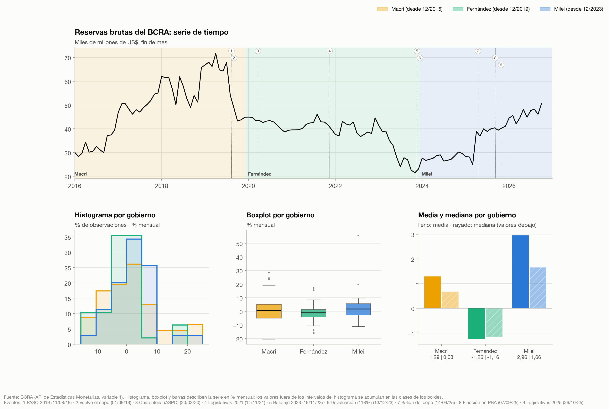

**Figura 2.35. Reservas brutas del BCRA (arriba) y distribución de su variación mensual por gobierno.**

**Tabla 2.72. Estadística descriptiva de la variación mensual de las reservas (%)**

| Gobierno | Período | N | Media | Mediana | Desvío | Mín | Q1 | Q3 | Máx | CV (%) | Asimetría | Curtosis |
|:---|---:|---:|---:|---:|---:|---:|---:|---:|---:|---:|---:|---:|
| Macri | feb-16 a nov-19 | 46 | 1,29 | 0,68 | 10,02 | -20,32 | -4,98 | 5,28 | 28,51 | – | 0,74 | 0,90 |
| Fernández | dic-19 a nov-23 | 48 | -1,25 | -1,16 | 6,71 | -16,22 | -4,06 | 1,40 | 17,34 | – | 0,56 | 2,06 |
| Milei | dic-23 a oct-26 | 35 | 2,96 | 1,66 | 11,04 | -11,14 | -2,61 | 5,72 | 55,80 | – | 3,35 | 15,55 |
| Toda la muestra | feb-16 a oct-26 | 129 | 0,80 | 0,32 | 9,34 | -20,32 | -4,30 | 3,94 | 55,80 | – | 2,00 | 9,30 |

**Tabla 2.73. Estadística descriptiva de las reservas brutas (miles de millones de US$)**

| Gobierno | Período | N | Media | Mediana | Desvío | Mín | Q1 | Q3 | Máx | CV (%) | Asimetría | Curtosis |
|:---|---:|---:|---:|---:|---:|---:|---:|---:|---:|---:|---:|---:|
| Macri | ene-16 a nov-19 | 47 | 49,63 | 50,24 | 12,34 | 28,40 | 41,28 | 59,75 | 71,66 | 24,87 | -0,18 | -0,92 |
| Fernández | dic-19 a nov-23 | 48 | 38,91 | 40,06 | 5,98 | 21,51 | 37,91 | 42,82 | 46,18 | 15,37 | -1,60 | 1,99 |
| Milei | dic-23 a oct-26 | 35 | 35,95 | 38,87 | 8,45 | 23,07 | 27,88 | 43,28 | 50,60 | 23,51 | 0,11 | -1,53 |
| Toda la muestra | ene-16 a oct-26 | 130 | 41,99 | 41,55 | 10,99 | 21,51 | 35,43 | 47,90 | 71,66 | 26,18 | 0,50 | 0,06 |

**Tabla 2.74. Distribución de frecuencias de la variación mensual de las reservas (%)**

| Intervalo | Macri fa | Macri fr % | Macri Fr acum. % | Fernández fa | Fernández fr % | Fernández Fr acum. % | Milei fa | Milei fr % | Milei Fr acum. % |
|:---|---:|---:|---:|---:|---:|---:|---:|---:|---:|
| menos de -15 | 1 | 2,2 | 2,2 | 2 | 4,2 | 4,2 | 0 | 0,0 | 0,0 |
| [-15; -10) | 3 | 6,5 | 8,7 | 3 | 6,2 | 10,4 | 1 | 2,9 | 2,9 |
| [-10; -5) | 8 | 17,4 | 26,1 | 5 | 10,4 | 20,8 | 4 | 11,4 | 14,3 |
| [-5; 0) | 9 | 19,6 | 45,7 | 17 | 35,4 | 56,2 | 7 | 20,0 | 34,3 |
| [0; 5) | 12 | 26,1 | 71,7 | 17 | 35,4 | 91,7 | 12 | 34,3 | 68,6 |
| [5; 10) | 6 | 13,0 | 84,8 | 1 | 2,1 | 93,7 | 9 | 25,7 | 94,3 |
| [10; 15) | 2 | 4,3 | 89,1 | 0 | 0,0 | 93,7 | 0 | 0,0 | 94,3 |
| [15; 20) | 2 | 4,3 | 93,5 | 3 | 6,2 | 100,0 | 1 | 2,9 | 97,1 |
| [20; 25) | 2 | 4,3 | 97,8 | 0 | 0,0 | 100,0 | 0 | 0,0 | 97,1 |
| 25 o más | 1 | 2,2 | 100,0 | 0 | 0,0 | 100,0 | 1 | 2,9 | 100,0 |
| **Total** | 46 | 100,0 |  | 48 | 100,0 |  | 35 | 100,0 |  |

En niveles, las reservas promedio son las más altas con Macri (49,63 mil millones, con un máximo de 71,66 en abril de 2019 por los desembolsos del FMI) y las más bajas con Milei (35,95), pero las trayectorias son opuestas: Macri y Fernández terminan con menos reservas de las que tenían en su mejor momento (Fernández deja el mínimo de la serie, 21,51 mil millones en noviembre de 2023), mientras que Milei empieza en ese piso y termina en el máximo de su período (50,60 mil millones en octubre de 2026).

La variación mensual media es positiva con Macri (1,29%) y con Milei (2,96%) y negativa con Fernández (-1,25%), cuya clase modal es [-5; 0). Con Milei la distribución es muy asimétrica (3,35) y con una curtosis de 15,55, por un solo mes: abril de 2025, con +55,80% por el primer desembolso del nuevo acuerdo con el FMI (alrededor de US$ 12.000 millones) al salir del cepo. Sin ese mes, la mediana (1,66%) muestra una acumulación moderada pero sostenida.

Es importante no leer el aumento de las reservas brutas como una mejora equivalente de la solvencia externa: buena parte del aumento de 2025-2026 es deuda (FMI, repos, colocaciones del Tesoro), no compras de divisas del BCRA en el mercado.

#### 2.4.6 Mercados

##### Riesgo país

*Qué es y cómo se mide.* El spread del índice EMBI de JP Morgan para Argentina: la diferencia de rendimiento entre los bonos soberanos argentinos en dólares y los bonos del Tesoro de Estados Unidos de plazo similar, en puntos básicos (100 pb = 1 punto porcentual). Dato diario.

*Fuente y período.* JP Morgan vía ArgentinaDatos (`finanzas/indices/riesgo-pais`), diciembre de 2015 a octubre de 2026. Diario.

*Por qué se eligió.* Resume en un número la probabilidad de default que asignan los inversores y determina el costo al que el país podría volver a financiarse en los mercados internacionales. Es una evaluación del programa económico en tiempo real.

*Limitaciones.* Depende también de la tasa de Estados Unidos y del apetito global por riesgo emergente: no es solo una calificación del gobierno. Las observaciones diarias están muy autocorrelacionadas, de modo que el N de la tabla sobrestima mucho la información disponible.

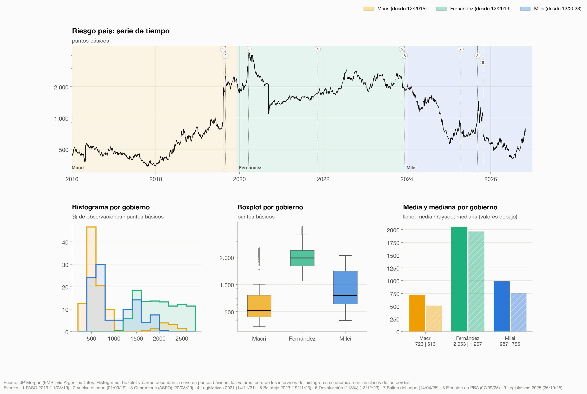

**Figura 2.36. Riesgo país (puntos básicos, escala logarítmica) por gobierno.**

**Tabla 2.75. Estadística descriptiva del riesgo país (puntos básicos)**

| Gobierno | Período | N | Media | Mediana | Desvío | Mín | Q1 | Q3 | Máx | CV (%) | Asimetría | Curtosis |
|:---|---:|---:|---:|---:|---:|---:|---:|---:|---:|---:|---:|---:|
| Macri | 10/12/15 a 09/12/19 | 1.132 | 723 | 513 | 518 | 342 | 439 | 764 | 2.532 | 72 | 2,26 | 3,97 |
| Fernández | 10/12/19 a 09/12/23 | 1.453 | 2.053 | 1.967 | 545 | 1.101 | 1.601 | 2.384 | 4.362 | 27 | 1,25 | 2,37 |
| Milei | 10/12/23 a 30/10/26 | 859 | 987 | 755 | 465 | 402 | 608 | 1.415 | 2.102 | 47 | 0,65 | -0,91 |
| Toda la muestra | 10/12/15 a 30/10/26 | 3.444 | 1.350 | 1.382 | 799 | 342 | 589 | 1.951 | 4.362 | 59 | 0,58 | -0,23 |

**Tabla 2.76. Distribución de frecuencias del riesgo país (puntos básicos)**

| Intervalo | Macri fa | Macri fr % | Macri Fr acum. % | Fernández fa | Fernández fr % | Fernández Fr acum. % | Milei fa | Milei fr % | Milei Fr acum. % |
|:---|---:|---:|---:|---:|---:|---:|---:|---:|---:|
| [200; 400) | 142 | 12,5 | 12,5 | 0 | 0,0 | 0,0 | 0 | 0,0 | 0,0 |
| [400; 600) | 528 | 46,6 | 59,2 | 0 | 0,0 | 0,0 | 206 | 24,0 | 24,0 |
| [600; 800) | 231 | 20,4 | 79,6 | 0 | 0,0 | 0,0 | 257 | 29,9 | 53,9 |
| [800; 1.000) | 112 | 9,9 | 89,5 | 0 | 0,0 | 0,0 | 44 | 5,1 | 59,0 |
| [1.000; 1.200) | 1 | 0,1 | 89,6 | 7 | 0,5 | 0,5 | 44 | 5,1 | 64,1 |
| [1.200; 1.400) | 0 | 0,0 | 89,6 | 84 | 5,8 | 6,3 | 85 | 9,9 | 74,0 |
| [1.400; 1.600) | 1 | 0,1 | 89,7 | 268 | 18,4 | 24,7 | 121 | 14,1 | 88,1 |
| [1.600; 1.800) | 6 | 0,5 | 90,2 | 196 | 13,5 | 38,2 | 34 | 4,0 | 92,1 |
| [1.800; 2.000) | 16 | 1,4 | 91,6 | 198 | 13,6 | 51,8 | 64 | 7,5 | 99,5 |
| [2.000; 2.200) | 44 | 3,9 | 95,5 | 192 | 13,2 | 65,0 | 4 | 0,5 | 100,0 |
| [2.200; 2.400) | 34 | 3,0 | 98,5 | 165 | 11,4 | 76,4 | 0 | 0,0 | 100,0 |
| [2.400; 2.600) | 17 | 1,5 | 100,0 | 177 | 12,2 | 88,6 | 0 | 0,0 | 100,0 |
| [2.600; 2.800) | 0 | 0,0 | 100,0 | 82 | 5,6 | 94,2 | 0 | 0,0 | 100,0 |
| 2.800 o más | 0 | 0,0 | 100,0 | 84 | 5,8 | 100,0 | 0 | 0,0 | 100,0 |
| **Total** | 1132 | 100,0 |  | 1453 | 100,0 |  | 859 | 100,0 |  |

El riesgo país promedio con Milei (987 pb) es menos de la mitad del de Fernández (2.053 pb) y más alto que el de Macri (723 pb). Las medianas son más informativas: 513 pb con Macri, 1.967 con Fernández y 755 con Milei. La media de Macri está inflada por los meses posteriores a las PASO de 2019 (hasta 2.532 pb el 30/8/2019), y por eso su asimetría (2,26) es la más alta. La de Fernández, por el pico de la pandemia (4.362 pb el 23/3/2020) y por el default técnico previo a la reestructuración.

La tabla de frecuencias muestra tres distribuciones casi separadas: la clase modal de Macri es [400; 600) (46,6% de los días), la de Milei [600; 800) (29,9%) y la de Fernández [1.400; 1.600), con una distribución mucho más plana (solo 18,4% de los días en la clase modal). El boxplot de Milei es el más alto en relación con su mediana: su caja va de 608 a 1.415 pb porque el período tiene una tendencia fuerte, no un nivel estable.

La trayectoria con Milei: de alrededor de 1.900 pb al asumir a un mínimo de 402 pb en julio de 2026, con dos interrupciones. La primera, en 2025, con la incertidumbre electoral: el riesgo país subió a más de 1.400 pb antes y después de la derrota oficialista en la provincia de Buenos Aires (evento 8) y cayó bruscamente después de las legislativas de octubre (evento 9). La segunda, en los últimos meses de la muestra, con una suba hasta 787 pb a fines de octubre de 2026. Que el riesgo país no haya bajado de 400 pb, a pesar del superávit fiscal, indica que los mercados todavía no consideran a la Argentina un emisor de riesgo normal: el acceso al financiamiento voluntario sigue siendo caro.

##### Acciones argentinas (13 ADRs)

*Qué es y cómo se mide.* Una canasta equiponderada de las 13 acciones argentinas más líquidas que cotizan en Nueva York (GGAL, BMA, BBAR, SUPV, YPF, PAM, TGS, CEPU, EDN, TEO, CRESY, LOMA, IRS), con precios ajustados por dividendos, en dólares. La distribución describe el **retorno logarítmico diario** en %, 100 · ln(P_t / P_t−1); la serie muestra el nivel de la canasta (2/1/2019 = 1).

*Fuente y período.* Yahoo Finance, enero de 2019 a octubre de 2026. Diario.

*Por qué se eligió.* Los precios de mercado son la evaluación en tiempo real de las expectativas sobre la economía y la política, y a diferencia de las estadísticas oficiales no tienen rezago.

*Limitaciones.* La canasta está sesgada a bancos y energía, y no representa a la economía en su conjunto. Empieza en 2019: el período de Macri cubre solo su último año, que incluye las PASO.

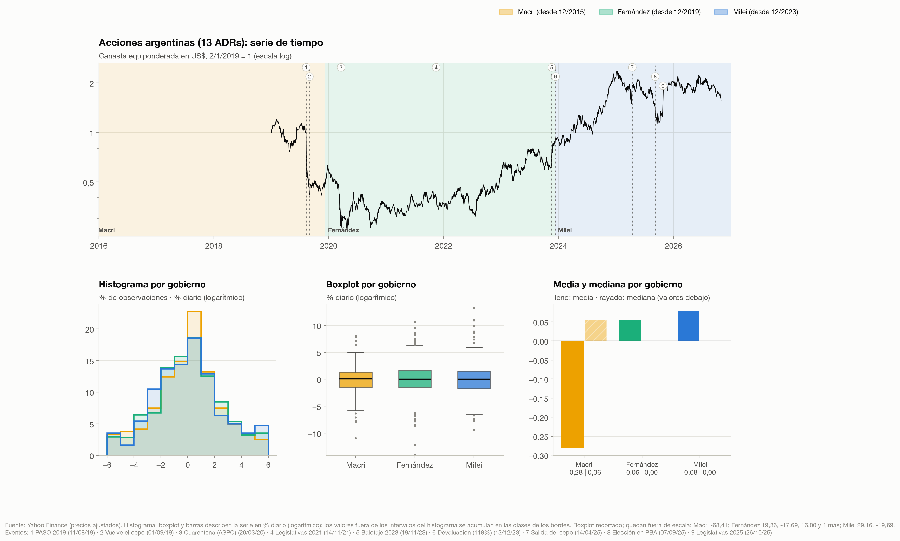

**Figura 2.37. Canasta de ADRs argentinos (arriba, escala logarítmica) y distribución del retorno diario por gobierno.**

**Tabla 2.77. Estadística descriptiva del retorno diario de la canasta de ADRs (%, logarítmico)**

| Gobierno | Período | N | Media | Mediana | Desvío | Mín | Q1 | Q3 | Máx | CV (%) | Asimetría | Curtosis |
|:---|---:|---:|---:|---:|---:|---:|---:|---:|---:|---:|---:|---:|
| Macri | 03/01/19 a 09/12/19 | 242 | -0,28 | 0,06 | 5,14 | -68,41 | -1,47 | 1,36 | 8,08 | – | -9,70 | 128,31 |
| Fernández | 10/12/19 a 08/12/23 | 1.030 | 0,05 | 0,00 | 2,87 | -17,69 | -1,48 | 1,69 | 19,36 | – | -0,01 | 5,65 |
| Milei | 11/12/23 a 30/10/26 | 744 | 0,08 | 0,00 | 3,01 | -19,69 | -1,74 | 1,55 | 29,16 | – | 1,16 | 14,37 |
| Toda la muestra | 03/01/19 a 30/10/26 | 2.016 | 0,02 | 0,00 | 3,27 | -68,41 | -1,54 | 1,57 | 29,16 | – | -4,19 | 99,31 |

**Tabla 2.78. Estadística descriptiva del nivel de la canasta de ADRs (2/1/2019 = 1)**

| Gobierno | Período | N | Media | Mediana | Desvío | Mín | Q1 | Q3 | Máx | CV (%) | Asimetría | Curtosis |
|:---|---:|---:|---:|---:|---:|---:|---:|---:|---:|---:|---:|---:|
| Macri | 02/01/19 a 09/12/19 | 243 | 0,81 | 0,88 | 0,27 | 0,41 | 0,49 | 1,05 | 1,20 | 32,60 | -0,30 | -1,56 |
| Fernández | 10/12/19 a 08/12/23 | 1.030 | 0,45 | 0,40 | 0,14 | 0,26 | 0,35 | 0,54 | 0,88 | 30,39 | 1,04 | 0,16 |
| Milei | 11/12/23 a 30/10/26 | 744 | 1,62 | 1,78 | 0,41 | 0,83 | 1,22 | 1,95 | 2,37 | 25,34 | -0,47 | -1,15 |
| Toda la muestra | 02/01/19 a 30/10/26 | 2.017 | 0,93 | 0,65 | 0,61 | 0,26 | 0,40 | 1,35 | 2,37 | 66,13 | 0,74 | -0,93 |

**Tabla 2.79. Distribución de frecuencias del retorno diario de la canasta de ADRs (%)**

| Intervalo | Macri fa | Macri fr % | Macri Fr acum. % | Fernández fa | Fernández fr % | Fernández Fr acum. % | Milei fa | Milei fr % | Milei Fr acum. % |
|:---|---:|---:|---:|---:|---:|---:|---:|---:|---:|
| menos de -6 | 6 | 2,5 | 2,5 | 17 | 1,7 | 1,7 | 12 | 1,6 | 1,6 |
| [-6; -5) | 2 | 0,8 | 3,3 | 13 | 1,3 | 2,9 | 14 | 1,9 | 3,5 |
| [-5; -4) | 9 | 3,7 | 7,0 | 29 | 2,8 | 5,7 | 12 | 1,6 | 5,1 |
| [-4; -3) | 10 | 4,1 | 11,2 | 66 | 6,4 | 12,1 | 40 | 5,4 | 10,5 |
| [-3; -2) | 18 | 7,4 | 18,6 | 69 | 6,7 | 18,8 | 78 | 10,5 | 21,0 |
| [-2; -1) | 30 | 12,4 | 31,0 | 143 | 13,9 | 32,7 | 102 | 13,7 | 34,7 |
| [-1; 0) | 36 | 14,9 | 45,9 | 161 | 15,6 | 48,3 | 107 | 14,4 | 49,1 |
| [0; 1) | 55 | 22,7 | 68,6 | 192 | 18,6 | 67,0 | 138 | 18,5 | 67,6 |
| [1; 2) | 32 | 13,2 | 81,8 | 129 | 12,5 | 79,5 | 96 | 12,9 | 80,5 |
| [2; 3) | 18 | 7,4 | 89,3 | 87 | 8,4 | 88,0 | 47 | 6,3 | 86,8 |
| [3; 4) | 12 | 5,0 | 94,2 | 55 | 5,3 | 93,3 | 37 | 5,0 | 91,8 |
| [4; 5) | 8 | 3,3 | 97,5 | 33 | 3,2 | 96,5 | 26 | 3,5 | 95,3 |
| [5; 6) | 0 | 0,0 | 97,5 | 19 | 1,8 | 98,3 | 23 | 3,1 | 98,4 |
| 6 o más | 6 | 2,5 | 100,0 | 17 | 1,7 | 100,0 | 12 | 1,6 | 100,0 |
| **Total** | 242 | 100,0 |  | 1030 | 100,0 |  | 744 | 100,0 |  |

Los retornos diarios tienen las colas más pesadas del capítulo. La curtosis de 128,31 de Macri la produce un solo día, el 12/8/2019, con −68,4% logarítmico (la canasta perdió la mitad de su valor en una sesión, la reacción a las PASO). Sin él, las curtosis de Fernández (5,65) y de Milei (14,37) siguen lejos de la normal: con Milei, el peor día fue el 8/9/2025, después de la elección bonaerense (-19,69%), y el mejor el 27/10/2025, después de las legislativas (+29,16%). Es la evidencia descriptiva de por qué los modelos de riesgo de mercado para activos argentinos usan distribuciones t de Student o volatilidad condicional (GARCH) en lugar de la normal.

La tabla de frecuencias muestra que, a diferencia de las variables macroeconómicas, las distribuciones de los tres gobiernos son muy parecidas en el cuerpo: la clase modal es [0; 1) en los tres, con alrededor del 19% al 23% de los días, y la mediana diaria es prácticamente cero. Las diferencias de rendimiento acumulado entre gobiernos, enormes en niveles, surgen de diferencias de media diarias muy chicas (0,05% contra 0,08%) acumuladas durante cientos de días.

En niveles, la canasta promedia 0,45 con Fernández (con un piso de 0,26 en abril de 2020) y 1,62 con Milei, con un máximo de 2,37 en enero de 2025: las acciones argentinas se multiplicaron por casi tres entre la asunción y ese máximo, en una de las subas más grandes del mundo en ese período, y desde ahí oscilaron con la política.

##### Bonos soberanos (GD30, GD35, GD41)

*Qué es y cómo se mide.* Una cartera equiponderada de los tres bonos Globales en dólares más líquidos de la reestructuración de 2020, medida por **retorno total** (variación de precio más cupones y amortizaciones cobrados), para que la amortización del GD30 no parezca una pérdida. La distribución describe el retorno diario en %; la serie, el índice de retorno total (1/10/2021 = 100).

*Fuente y período.* BYMA vía data912 (GD30D, GD35D, GD41D, en dólares MEP), octubre de 2021 a octubre de 2026. Diario.

*Por qué se eligió.* Es la medida directa de cuánto valía la deuda del país para sus tenedores, y la contracara del riesgo país en precios.

*Limitaciones.* Los datos empiezan en octubre de 2021: la comparación con Fernández cubre solo su segunda mitad y no hay datos de Macri. Algunos saltos diarios grandes de signo opuesto en días consecutivos (como el 3 y 4 de agosto de 2023) parecen problemas de registro de precios más que movimientos reales.

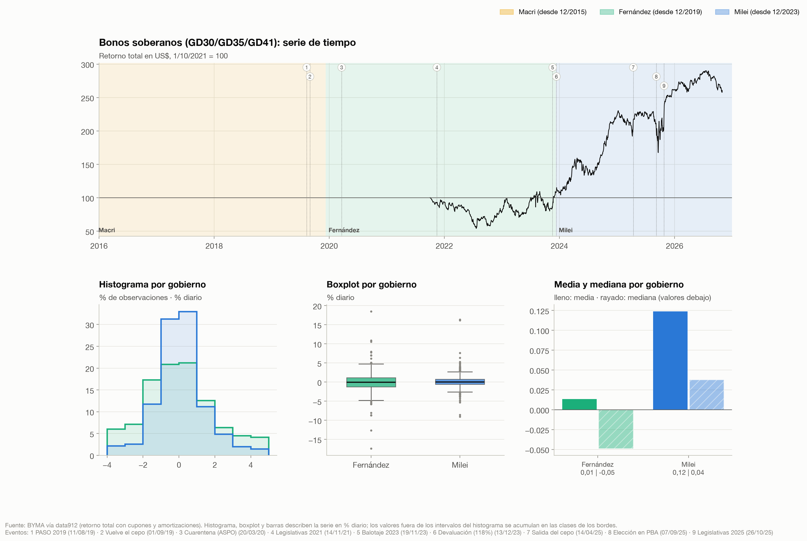

**Figura 2.38. Índice de retorno total de los Globales (arriba) y distribución del retorno diario por gobierno.**

**Tabla 2.80. Estadística descriptiva del retorno diario total de la cartera GD30/GD35/GD41 (%)**

| Gobierno | Período | N | Media | Mediana | Desvío | Mín | Q1 | Q3 | Máx | CV (%) | Asimetría | Curtosis |
|:---|---:|---:|---:|---:|---:|---:|---:|---:|---:|---:|---:|---:|
| Fernández | 01/10/21 a 07/12/23 | 533 | 0,01 | -0,05 | 2,54 | -17,37 | -1,23 | 1,16 | 18,52 | – | 0,18 | 11,37 |
| Milei | 11/12/23 a 30/10/26 | 707 | 0,12 | 0,04 | 1,69 | -9,03 | -0,59 | 0,74 | 16,38 | – | 2,25 | 25,47 |
| Toda la muestra | 01/10/21 a 30/10/26 | 1.240 | 0,08 | 0,01 | 2,10 | -17,37 | -0,86 | 0,86 | 18,52 | – | 0,78 | 17,04 |

**Tabla 2.81. Estadística descriptiva del índice de retorno total (1/10/2021 = 100)**

| Gobierno | Período | N | Media | Mediana | Desvío | Mín | Q1 | Q3 | Máx | CV (%) | Asimetría | Curtosis |
|:---|---:|---:|---:|---:|---:|---:|---:|---:|---:|---:|---:|---:|
| Fernández | 01/10/21 a 07/12/23 | 533 | 83,39 | 84,48 | 12,14 | 54,12 | 75,64 | 92,34 | 109,42 | 14,56 | -0,29 | -0,53 |
| Milei | 11/12/23 a 30/10/26 | 707 | 211,57 | 219,95 | 54,75 | 104,24 | 156,14 | 262,70 | 290,12 | 25,88 | -0,35 | -1,12 |
| Toda la muestra | 01/10/21 a 30/10/26 | 1.240 | 156,48 | 137,05 | 76,17 | 54,12 | 86,89 | 224,44 | 290,12 | 48,68 | 0,37 | -1,42 |

**Tabla 2.82. Distribución de frecuencias del retorno diario de los bonos (%)**

| Intervalo | Fernández fa | Fernández fr % | Fernández Fr acum. % | Milei fa | Milei fr % | Milei Fr acum. % |
|:---|---:|---:|---:|---:|---:|---:|
| menos de -4 | 21 | 3,9 | 3,9 | 6 | 0,8 | 0,8 |
| [-4; -3) | 11 | 2,1 | 6,0 | 9 | 1,3 | 2,1 |
| [-3; -2) | 38 | 7,1 | 13,1 | 18 | 2,5 | 4,7 |
| [-2; -1) | 92 | 17,3 | 30,4 | 83 | 11,7 | 16,4 |
| [-1; 0) | 111 | 20,8 | 51,2 | 221 | 31,3 | 47,7 |
| [0; 1) | 113 | 21,2 | 72,4 | 233 | 33,0 | 80,6 |
| [1; 2) | 67 | 12,6 | 85,0 | 79 | 11,2 | 91,8 |
| [2; 3) | 34 | 6,4 | 91,4 | 34 | 4,8 | 96,6 |
| [3; 4) | 24 | 4,5 | 95,9 | 14 | 2,0 | 98,6 |
| [4; 5) | 11 | 2,1 | 97,9 | 4 | 0,6 | 99,2 |
| 5 o más | 11 | 2,1 | 100,0 | 6 | 0,8 | 100,0 |
| **Total** | 533 | 100,0 |  | 707 | 100,0 |  |

El retorno medio diario de los bonos con Milei (0,12% por día) es el más alto de los dos gobiernos con datos, con un desvío (1,69) menor que con Fernández (2,54): rindieron más y con menos volatilidad. La tabla de frecuencias muestra que el 33,0% de los días de Milei cae en la clase [0; 1), contra el 21,2% de Fernández: la distribución de Milei es mucho más concentrada en pequeñas ganancias diarias.

En niveles, el índice de retorno total pasa de alrededor de 104 en enero de 2024 a un máximo de 290,12 en julio de 2026: un tenedor de Globales casi triplicó su inversión en dólares durante el gobierno, la contracara de la baja del riesgo país de 1.900 a 400 pb. Con Fernández el índice cae a 54,12 en julio de 2022 (la renuncia del ministro Guzmán), y termina el período algo por encima del valor con el que empezó (109,42 en agosto de 2023 fue su máximo).

La curtosis de Milei (25,47) y su asimetría positiva (2,25) las producen los días alrededor de los eventos de 2025: −9,0% el 8/9/2025, tras la elección bonaerense, y +16,4% el 22/9/2025, con el anuncio de apoyo financiero del Tesoro de Estados Unidos.

#### 2.4.7 Indicadores sociales

##### Pobreza

*Qué es y cómo se mide.* El porcentaje de personas que viven en hogares cuyo ingreso total no alcanza para comprar la Canasta Básica Total (alimentos y otros bienes y servicios esenciales), según la EPH de 31 aglomerados urbanos, por semestre.

*Fuente y período.* INDEC, comunicados semestrales de "Incidencia de la pobreza y la indigencia"; los valores de S2-2025 (28,2%) y S1-2026 (32,3%) son del comunicado del 24/9/2026. Segundo semestre de 2016 al primer semestre de 2026. Semestral.

*Por qué se eligió.* Es el indicador social más seguido y el que mejor refleja el efecto combinado de inflación, salarios, empleo y transferencias sobre los hogares.

*Limitaciones.* Solo 20 observaciones en diez años (5 de Milei), de modo que asimetría y curtosis son muy inestables. Cubre solo la población urbana; la EPH subdeclara ingresos; y la canasta se valoriza con el IPC, cuya canasta de 2004 subestima el peso de las tarifas.

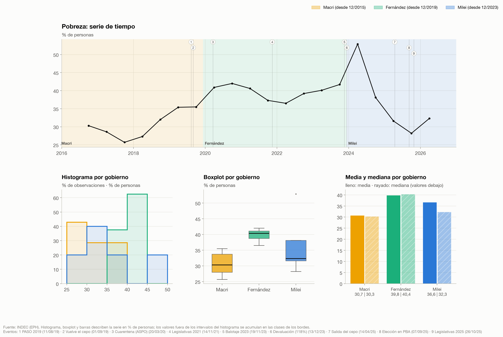

**Figura 2.39. Pobreza (% de personas, semestral) por gobierno.**

**Tabla 2.83. Estadística descriptiva de la pobreza (%)**

| Gobierno | Período | N | Media | Mediana | Desvío | Mín | Q1 | Q3 | Máx | CV (%) | Asimetría | Curtosis |
|:---|---:|---:|---:|---:|---:|---:|---:|---:|---:|---:|---:|---:|
| Macri | S2-16 a S2-19 | 7 | 30,7 | 30,3 | 3,8 | 25,7 | 28,0 | 33,7 | 35,5 | 12,5 | 0,19 | -1,49 |
| Fernández | S1-20 a S2-23 | 8 | 39,8 | 40,4 | 2,0 | 36,5 | 38,7 | 41,1 | 42,0 | 5,0 | -0,75 | -0,70 |
| Milei | S1-24 a S1-26 | 5 | 36,6 | 32,3 | 9,8 | 28,2 | 31,6 | 38,1 | 52,9 | 26,7 | 1,57 | 2,45 |
| Toda la muestra | S2-16 a S1-26 | 20 | 35,8 | 36,0 | 6,5 | 25,7 | 31,3 | 40,2 | 52,9 | 18,2 | 0,63 | 0,94 |

**Tabla 2.84. Distribución de frecuencias de la pobreza (%)**

| Intervalo | Macri fa | Macri fr % | Macri Fr acum. % | Fernández fa | Fernández fr % | Fernández Fr acum. % | Milei fa | Milei fr % | Milei Fr acum. % |
|:---|---:|---:|---:|---:|---:|---:|---:|---:|---:|
| [25; 30) | 3 | 42,9 | 42,9 | 0 | 0,0 | 0,0 | 1 | 20,0 | 20,0 |
| [30; 35) | 2 | 28,6 | 71,4 | 0 | 0,0 | 0,0 | 2 | 40,0 | 60,0 |
| [35; 40) | 2 | 28,6 | 100,0 | 3 | 37,5 | 37,5 | 1 | 20,0 | 80,0 |
| [40; 45) | 0 | 0,0 | 100,0 | 5 | 62,5 | 100,0 | 0 | 0,0 | 80,0 |
| [45; 50) | 0 | 0,0 | 100,0 | 0 | 0,0 | 100,0 | 0 | 0,0 | 80,0 |
| 50 o más | 0 | 0,0 | 100,0 | 0 | 0,0 | 100,0 | 1 | 20,0 | 100,0 |
| **Total** | 7 | 100,0 |  | 8 | 100,0 |  | 5 | 100,0 |  |

La pobreza media con Milei (36,6%) está entre la de Macri (30,7%) y la de Fernández (39,8%), pero con solo 5 semestres y un recorrido de 52,9% a 28,2% la media no es un buen resumen. La mediana (32,3%) y el CV de 26,7%, el más alto de los tres gobiernos, dicen que es el período con la pobreza más cambiante, con el pico de la década (52,9%) y el valor más bajo desde 2018 (28,2%) dentro del mismo gobierno. La tabla de frecuencias muestra que el 62,5% de los semestres de Fernández está en [40; 45), mientras que Milei tiene semestres en cuatro clases distintas.

El pico del primer semestre de 2024 es la consecuencia directa de la devaluación: la canasta básica subió con la inflación de 25% mensual mientras los ingresos quedaban atrás. La baja posterior es igual de rápida y tiene tres motores: la desinflación (que frenó la suba de la canasta), la recuperación del salario informal (el ingreso de los hogares de menores ingresos) y el aumento real de la AUH y de la Tarjeta Alimentar. La suba del primer semestre de 2026 (de 28,2% a 32,3%) es en parte estacional (el primer semestre suele ser peor que el segundo) y en parte refleja la desaceleración de la actividad y del salario formal.

##### Desocupación

*Qué es y cómo se mide.* Los desocupados (personas que no trabajan, buscaron trabajo y están disponibles) como porcentaje de la población económicamente activa, EPH, 31 aglomerados, por trimestre.

*Fuente y período.* INDEC (`42.3_EPH_PUNTUATAL_0_M_30`), segundo trimestre de 2016 al segundo trimestre de 2026. Trimestral.

*Por qué se eligió.* Completa la lectura del mercado de trabajo: el salario real puede subir porque se pierden los empleos peor pagos, y la pobreza depende tanto del salario como de tener trabajo.

*Limitaciones.* Es estacional (más alta en el primer trimestre), por lo que conviene comparar trimestres iguales. No capta la precarización (empleo no registrado, monotributo) ni el desaliento (quien deja de buscar trabajo deja de contar como desocupado).

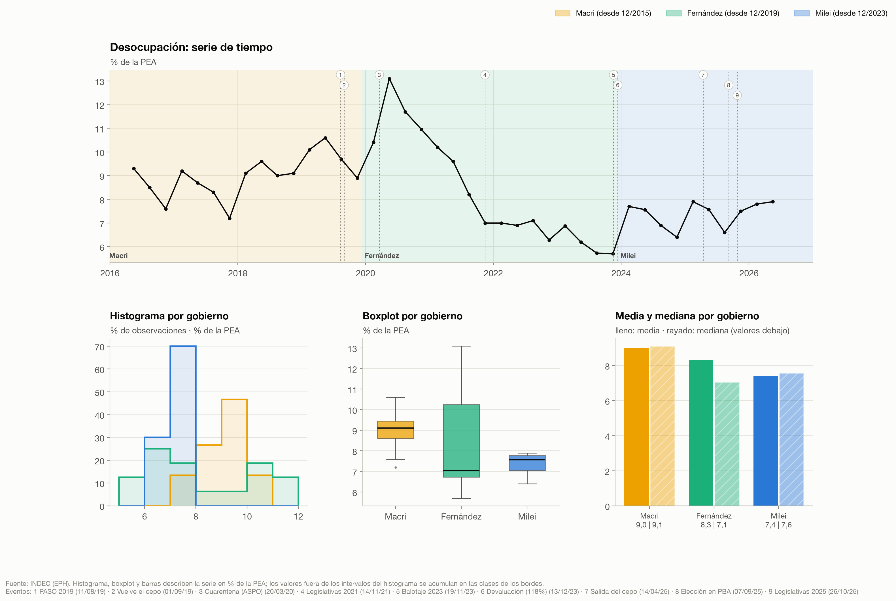

**Figura 2.40. Desocupación (% de la PEA, trimestral) por gobierno.**

**Tabla 2.85. Estadística descriptiva de la desocupación (%)**

| Gobierno | Período | N | Media | Mediana | Desvío | Mín | Q1 | Q3 | Máx | CV (%) | Asimetría | Curtosis |
|:---|---:|---:|---:|---:|---:|---:|---:|---:|---:|---:|---:|---:|
| Macri | T2-16 a T4-19 | 15 | 9,0 | 9,1 | 0,9 | 7,2 | 8,6 | 9,4 | 10,6 | 9,8 | -0,34 | 0,46 |
| Fernández | T1-20 a T4-23 | 16 | 8,3 | 7,1 | 2,3 | 5,7 | 6,7 | 10,2 | 13,1 | 28,2 | 0,72 | -0,76 |
| Milei | T1-24 a T2-26 | 10 | 7,4 | 7,6 | 0,5 | 6,4 | 7,1 | 7,8 | 7,9 | 7,4 | -0,97 | -0,58 |
| Toda la muestra | T2-16 a T2-26 | 41 | 8,3 | 7,9 | 1,7 | 5,7 | 7,0 | 9,3 | 13,1 | 20,0 | 0,68 | 0,34 |

**Tabla 2.86. Distribución de frecuencias de la desocupación (%)**

| Intervalo | Macri fa | Macri fr % | Macri Fr acum. % | Fernández fa | Fernández fr % | Fernández Fr acum. % | Milei fa | Milei fr % | Milei Fr acum. % |
|:---|---:|---:|---:|---:|---:|---:|---:|---:|---:|
| [5; 6) | 0 | 0,0 | 0,0 | 2 | 12,5 | 12,5 | 0 | 0,0 | 0,0 |
| [6; 7) | 0 | 0,0 | 0,0 | 4 | 25,0 | 37,5 | 3 | 30,0 | 30,0 |
| [7; 8) | 2 | 13,3 | 13,3 | 3 | 18,8 | 56,2 | 7 | 70,0 | 100,0 |
| [8; 9) | 4 | 26,7 | 40,0 | 1 | 6,2 | 62,5 | 0 | 0,0 | 100,0 |
| [9; 10) | 7 | 46,7 | 86,7 | 1 | 6,2 | 68,8 | 0 | 0,0 | 100,0 |
| [10; 11) | 2 | 13,3 | 100,0 | 3 | 18,8 | 87,5 | 0 | 0,0 | 100,0 |
| [11; 12) | 0 | 0,0 | 100,0 | 1 | 6,2 | 93,8 | 0 | 0,0 | 100,0 |
| 12 o más | 0 | 0,0 | 100,0 | 1 | 6,2 | 100,0 | 0 | 0,0 | 100,0 |
| **Total** | 15 | 100,0 |  | 16 | 100,0 |  | 10 | 100,0 |  |

La desocupación media con Milei (7,4%) es la más baja de los tres gobiernos (contra 9,0% y 8,3%) y la menos dispersa (desvío de 0,5): el 70,0% de sus trimestres está en [7; 8). Pero conviene leerla con cuidado. La de Fernández incluye el pico de la pandemia (13,1% en el segundo trimestre de 2020) y termina con el mínimo de la serie (5,7% en el cuarto trimestre de 2023); por eso su mediana (7,1%) es más baja que la de Milei (7,6%) y su distribución es la más asimétrica.

Comparando trimestres iguales, que es lo correcto para una serie estacional, la desocupación con Milei **subió**: de 6,2% en el segundo trimestre de 2023 a 7,6% en el de 2025 y 7,9% en el de 2026. Es coherente con la composición sectorial del crecimiento (sección 2.4.3): los sectores que crecieron emplean poca gente y los que cayeron, mucha.

La relación entre desocupación y crecimiento (ley de Okun) y entre desocupación e inflación (curva de Phillips) se analiza en la sección 2.6.

### 2.5 Comparación entre gobiernos

Esta sección junta las variables principales para comparar los tres gobiernos de un vistazo.

#### 2.5.1 Promedios por gobierno


**Figura 2.41.** Cada barra es la media del período y el segmento vertical, ± un error estándar (desvío / √N). Las barras resumen lo que ya mostraron las tablas: la mayor diferencia entre gobiernos está en el resultado fiscal; en la variación mensual del salario real privado los intervalos se superponen por completo; en el crecimiento del PBI los intervalos también se superponen. **Advertencia metodológica:** el error estándar así calculado supone observaciones independientes, y estas series son muy persistentes (ver la sección 2.7): los intervalos verdaderos son más anchos. Un test formal de diferencia de medias debería usar errores estándar robustos a autocorrelación (Newey-West), lo que se deja para el capítulo econométrico.

#### 2.5.2 Variación acumulada y anualizada

La variación acumulada compara el último dato del gobierno anterior con el último dato del propio. Como los períodos tienen distinto largo (Milei lleva menos de tres años), se anualiza: (1 + variación acumulada)^(1/años) − 1. Las filas con asterisco no empiezan en el último dato del gobierno anterior porque la serie no existe antes (Macri).

**Tabla 2.87. Variación acumulada y anualizada por gobierno**

| Variable | Gobierno | Desde | Hasta | Años | Acumulada (%) | Anualizada (%) |
|:---|---:|---:|---:|---:|---:|---:|
| IPC (inflación) * | Macri | abr-16 | nov-19 | 3,6 | 219,3 | 38,3 |
| IPC (inflación) | Fernández | nov-19 | nov-23 | 4,0 | 930,7 | 79,2 |
| IPC (inflación) | Milei | nov-23 | sep-26 | 2,8 | 344,2 | 69,3 |
| Salario real privado registrado * | Macri | abr-16 | nov-19 | 3,6 | -11,5 | -3,3 |
| Salario real privado registrado | Fernández | nov-19 | nov-23 | 4,0 | -4,7 | -1,2 |
| Salario real privado registrado | Milei | nov-23 | jul-26 | 2,7 | -3,4 | -1,3 |
| Salario real público * | Macri | abr-16 | nov-19 | 3,6 | -14,0 | -4,1 |
| Salario real público | Fernández | nov-19 | nov-23 | 4,0 | -5,6 | -1,4 |
| Salario real público | Milei | nov-23 | jul-26 | 2,7 | -15,8 | -6,3 |
| Salario real no registrado * | Macri | may-16 | nov-19 | 3,5 | -18,3 | -5,6 |
| Salario real no registrado | Fernández | nov-19 | nov-23 | 4,0 | -16,1 | -4,3 |
| Salario real no registrado | Milei | nov-23 | feb-26 | 2,3 | 41,6 | 16,7 |
| Salario mínimo real * | Macri | abr-16 | nov-19 | 3,6 | -12,8 | -3,7 |
| Salario mínimo real | Fernández | nov-19 | nov-23 | 4,0 | -16,1 | -4,3 |
| Salario mínimo real | Milei | nov-23 | sep-26 | 2,8 | -40,8 | -16,9 |
| Actividad (EMAE) * | Macri | ene-16 | nov-19 | 3,8 | -4,7 | -1,3 |
| Actividad (EMAE) | Fernández | nov-19 | nov-23 | 4,0 | 3,9 | 1,0 |
| Actividad (EMAE) | Milei | nov-23 | jul-26 | 2,7 | 2,2 | 0,8 |
| PBI (4 trimestres) * | Macri | T4-16 | T4-19 | 3,0 | -1,9 | -0,6 |
| PBI (4 trimestres) | Fernández | T4-19 | T4-23 | 4,0 | 3,5 | 0,9 |
| PBI (4 trimestres) | Milei | T4-23 | T2-26 | 2,5 | 4,2 | 1,7 |
| Inversión (4 trimestres) * | Macri | T4-16 | T4-19 | 3,0 | -10,2 | -3,5 |
| Inversión (4 trimestres) | Fernández | T4-19 | T4-23 | 4,0 | 25,5 | 5,8 |
| Inversión (4 trimestres) | Milei | T4-23 | T2-26 | 2,5 | -9,7 | -4,0 |
| Dólar oficial real * | Macri | abr-16 | nov-19 | 3,6 | 29,8 | 7,6 |
| Dólar oficial real | Fernández | nov-19 | nov-23 | 4,0 | -42,5 | -12,9 |
| Dólar oficial real | Milei | nov-23 | sep-26 | 2,8 | -3,7 | -1,3 |
| Riesgo país | Macri | 09/12/15 | 09/12/19 | 4,0 | 340,4 | 44,9 |
| Riesgo país | Fernández | 09/12/19 | 09/12/23 | 4,0 | -11,9 | -3,1 |
| Riesgo país | Milei | 09/12/23 | 30/10/26 | 2,9 | -59,0 | -26,5 |


**Figura 2.42.** La inflación anualizada de Milei (69%) es menor que la de Fernández (79%) y mayor que la de Macri (38%, con sus primeros cinco meses fuera de la muestra), y está dominada por los primeros cuatro meses: anualizada, la inflación fue de 62% entre abril y diciembre de 2024, 31,5% en 2025 y 33% en los nueve meses de 2026. En términos reales, el patrón de Milei es el más heterogéneo: el salario no registrado sube 16,7% por año y el mínimo cae 16,9% por año; el salario público cae 6,3% anual, el privado registrado 1,3% (igual que con Fernández); el PBI crece 1,7% por año (el mejor de los tres) y la inversión cae 4% por año. El tipo de cambio real termina casi donde empezó (−1,3% anual) después de recorrer un salto de 50% y su reversión.

#### 2.5.3 Boxplots comparados


**Figura 2.43.** Los diagramas de caja de las variables principales, uno al lado del otro, permiten comparar posición, dispersión y valores atípicos al mismo tiempo. En la inflación, la caja de Milei (rango intercuartil) es la más angosta y está a la altura de la de Macri, y los meses de diciembre de 2023 a marzo de 2024 aparecen como **atípicos** (más de 1,5 rangos intercuartiles por encima del tercer cuartil). En el resultado primario la caja de Milei no se superpone con ninguna de las anteriores: es la variable donde el cambio de régimen es visible incluso en la distribución completa. El riesgo país de Macri tiene una caja baja con muchos atípicos (los meses posteriores a las PASO); el de Milei tiene una caja alta, porque en su período el riesgo país bajó de 2.000 a 400 puntos y volvió a subir: una distribución con tendencia, no un nivel estable.

### 2.6 Análisis bivariado

Las secciones anteriores describieron cada variable por separado. Esta sección mira cómo se mueven de a pares, con tres herramientas: una matriz de correlaciones por gobierno, una tabla de pares seleccionados con su significatividad y diagramas de dispersión. Ninguna de ellas mide causalidad: una correlación puede deberse a que una variable afecta a la otra, a que ambas responden a una tercera o, en series con tendencia, a que simplemente se movieron en la misma dirección en el mismo período (correlación espuria). Este último problema es serio acá, porque la sección 2.7 muestra que varias de estas series son no estacionarias. Por eso la matriz usa **tasas de variación** siempre que es posible.

#### 2.6.1 Matriz de correlaciones

Se usa la correlación de rangos de **Spearman** (ρ), que mide asociación monótona y no lineal y es robusta a valores extremos: con Pearson, los cuatro meses posteriores a la devaluación dominarían todas las correlaciones de Milei. Las variables son mensuales: inflación, depreciación del oficial, brecha cambiaria (nivel), variación del salario real y nominal privado registrado, variación del EMAE, variación de las reservas, variación del riesgo país (logarítmica, promedio mensual) y resultado primario (% del PBI, 12 meses).


**Figura 2.44. Matriz de correlaciones de Spearman, toda la muestra y por gobierno.**

**Tabla 2.88. Correlaciones de Spearman, gobierno de Milei**

| ρ de Spearman | Inflación | Depreciación | Brecha | Salario real | Salario nominal | EMAE | Reservas | Riesgo país | Res. primario |
|:---|---:|---:|---:|---:|---:|---:|---:|---:|---:|
| Inflación | 1,00 | -0,10 | 0,79 | -0,05 | 0,76 | 0,01 | 0,11 | -0,11 | -0,54 |
| Depreciación | -0,10 | 1,00 | 0,08 | 0,13 | 0,08 | 0,10 | 0,04 | -0,10 | -0,06 |
| Brecha | 0,79 | 0,08 | 1,00 | 0,23 | 0,86 | 0,09 | 0,03 | -0,10 | -0,47 |
| Salario real | -0,05 | 0,13 | 0,23 | 1,00 | 0,41 | 0,30 | -0,05 | -0,06 | -0,10 |
| Salario nominal | 0,76 | 0,08 | 0,86 | 0,41 | 1,00 | 0,13 | 0,15 | -0,12 | -0,49 |
| EMAE | 0,01 | 0,10 | 0,09 | 0,30 | 0,13 | 1,00 | -0,22 | 0,36 | 0,21 |
| Reservas | 0,11 | 0,04 | 0,03 | -0,05 | 0,15 | -0,22 | 1,00 | -0,13 | -0,13 |
| Riesgo país | -0,11 | -0,10 | -0,10 | -0,06 | -0,12 | 0,36 | -0,13 | 1,00 | 0,02 |
| Res. primario | -0,54 | -0,06 | -0,47 | -0,10 | -0,49 | 0,21 | -0,13 | 0,02 | 1,00 |

**Tabla 2.89. Correlaciones de Spearman, toda la muestra (may-2016 a sep-2026)**

| ρ de Spearman | Inflación | Depreciación | Brecha | Salario real | Salario nominal | EMAE | Reservas | Riesgo país | Res. primario |
|:---|---:|---:|---:|---:|---:|---:|---:|---:|---:|
| Inflación | 1,00 | 0,33 | 0,57 | -0,23 | 0,72 | -0,16 | -0,20 | 0,13 | 0,01 |
| Depreciación | 0,33 | 1,00 | 0,24 | -0,15 | 0,24 | -0,01 | -0,13 | 0,24 | -0,13 |
| Brecha | 0,57 | 0,24 | 1,00 | 0,02 | 0,54 | 0,08 | -0,14 | -0,08 | -0,05 |
| Salario real | -0,23 | -0,15 | 0,02 | 1,00 | 0,40 | 0,10 | -0,02 | -0,13 | 0,10 |
| Salario nominal | 0,72 | 0,24 | 0,54 | 0,40 | 1,00 | -0,11 | -0,16 | 0,04 | 0,12 |
| EMAE | -0,16 | -0,01 | 0,08 | 0,10 | -0,11 | 1,00 | 0,03 | -0,16 | -0,12 |
| Reservas | -0,20 | -0,13 | -0,14 | -0,02 | -0,16 | 0,03 | 1,00 | -0,13 | 0,01 |
| Riesgo país | 0,13 | 0,24 | -0,08 | -0,13 | 0,04 | -0,16 | -0,13 | 1,00 | -0,04 |
| Res. primario | 0,01 | -0,13 | -0,05 | 0,10 | 0,12 | -0,12 | 0,01 | -0,04 | 1,00 |

Tres resultados de la matriz son robustos en los tres gobiernos y en toda la muestra. El primero es la relación entre **inflación y salario nominal** (ρ de 0,72 en toda la muestra, 0,76 con Milei): los salarios en pesos siguen a los precios, y cuanto más alta es la inflación más frecuentes y grandes son los aumentos. El segundo, la relación entre **inflación y brecha** (0,57 en toda la muestra), que se analiza abajo. El tercero, la correlación negativa entre **inflación y salario real** (-0,23): los meses de inflación alta son meses de pérdida real.

Las diferencias entre gobiernos son tan informativas como las similitudes. Con Macri la correlación entre inflación y salario real es fuerte (-0,65) y entre inflación y salario nominal, débil (0,35): las paritarias eran anuales, de modo que un salto de inflación se trasladaba casi entero al salario real. Con Fernández y con Milei ocurre lo contrario (inflación y salario nominal con ρ de 0,77 y 0,76; inflación y salario real casi sin correlación): con inflación alta, los salarios se indexaron con revisiones cada pocos meses y absorbieron la inflación con menos pérdida mes a mes. Con Macri aparece además una correlación alta entre depreciación y riesgo país (0,62), propia de las crisis cambiarias de 2018-2019, en las que el dólar y el riesgo país saltaban juntos.

Con Milei hay dos correlaciones nuevas. La **depreciación deja de correlacionarse con la inflación** (ρ de -0,10, contra 0,56 con Fernández): con un crawling peg fijo de 2% durante 2024 la depreciación casi no varió, mientras la inflación bajaba de 25% a 3%, y desde abril de 2025 el dólar se movió sin que la inflación lo acompañara. Y el **resultado primario se correlaciona negativamente con la inflación** (-0,54) y con la brecha (-0,47): los meses de mayor superávit son los de menor inflación. Es la relación que predice la teoría fiscal de la inflación, pero también la que produciría una correlación espuria entre dos series con tendencia opuesta durante el mismo año y medio. Con Macri la misma correlación tiene signo contrario (0,73): el déficit bajaba mientras la inflación subía. La matriz sola no puede distinguir entre ambas interpretaciones; esa es tarea del modelo.

#### 2.6.2 Pares seleccionados

La tabla siguiente informa, para diez pares de variables con una relación económica conocida, la correlación lineal de Pearson (r), la de rangos de Spearman (ρ) y sus p-valores (H0: correlación nula), por gobierno y para toda la muestra. Comparar las dos columnas es en sí un diagnóstico: cuando r es alta y ρ baja, la correlación la producen unos pocos valores extremos.

**Tabla 2.90. Correlaciones de pares seleccionados por gobierno**

| Relación | Gobierno | N | Pearson r | p (Pearson) | Spearman ρ | p (Spearman) |
|:---|---:|---:|---:|---:|---:|---:|
| Traspaso a precios | Macri | 43 | 0,40 | 0,007 | 0,19 | 0,216 |
| Traspaso a precios | Fernández | 48 | 0,60 | 0,000 | 0,56 | 0,000 |
| Traspaso a precios | Milei | 34 | 0,81 | 0,000 | -0,10 | 0,576 |
| Traspaso a precios | Toda la muestra | 125 | 0,68 | 0,000 | 0,33 | 0,000 |
| Inflación y salario real | Macri | 43 | -0,72 | 0,000 | -0,65 | 0,000 |
| Inflación y salario real | Fernández | 48 | -0,24 | 0,107 | -0,08 | 0,581 |
| Inflación y salario real | Milei | 32 | -0,59 | 0,000 | -0,05 | 0,793 |
| Inflación y salario real | Toda la muestra | 123 | -0,43 | 0,000 | -0,23 | 0,011 |
| Inflación y salario nominal | Macri | 43 | 0,30 | 0,051 | 0,35 | 0,023 |
| Inflación y salario nominal | Fernández | 48 | 0,78 | 0,000 | 0,77 | 0,000 |
| Inflación y salario nominal | Milei | 32 | 0,86 | 0,000 | 0,76 | 0,000 |
| Inflación y salario nominal | Toda la muestra | 123 | 0,82 | 0,000 | 0,72 | 0,000 |
| Curva de Phillips | Macri | 11 | 0,69 | 0,020 | 0,78 | 0,005 |
| Curva de Phillips | Fernández | 16 | -0,72 | 0,002 | -0,94 | 0,000 |
| Curva de Phillips | Milei | 10 | -0,16 | 0,665 | -0,18 | 0,614 |
| Curva de Phillips | Toda la muestra | 37 | -0,41 | 0,012 | -0,47 | 0,004 |
| Ley de Okun | Macri | 11 | -0,83 | 0,002 | -0,80 | 0,003 |
| Ley de Okun | Fernández | 16 | -0,88 | 0,000 | -0,87 | 0,000 |
| Ley de Okun | Milei | 10 | -0,64 | 0,046 | -0,72 | 0,019 |
| Ley de Okun | Toda la muestra | 37 | -0,78 | 0,000 | -0,72 | 0,000 |
| Disciplina fiscal y riesgo | Macri | 36 | 0,81 | 0,000 | 0,80 | 0,000 |
| Disciplina fiscal y riesgo | Fernández | 48 | 0,41 | 0,004 | 0,34 | 0,018 |
| Disciplina fiscal y riesgo | Milei | 33 | -0,74 | 0,000 | -0,32 | 0,069 |
| Disciplina fiscal y riesgo | Toda la muestra | 117 | -0,16 | 0,095 | 0,03 | 0,779 |
| Brecha e inflación | Macri | 43 | 0,31 | 0,040 | -0,08 | 0,618 |
| Brecha e inflación | Fernández | 48 | 0,69 | 0,000 | 0,71 | 0,000 |
| Brecha e inflación | Milei | 34 | 0,79 | 0,000 | 0,79 | 0,000 |
| Brecha e inflación | Toda la muestra | 125 | 0,47 | 0,000 | 0,57 | 0,000 |
| Regulados y núcleo | Macri | 35 | 0,29 | 0,086 | 0,48 | 0,003 |
| Regulados y núcleo | Fernández | 48 | 0,81 | 0,000 | 0,87 | 0,000 |
| Regulados y núcleo | Milei | 33 | 0,86 | 0,000 | 0,82 | 0,000 |
| Regulados y núcleo | Toda la muestra | 116 | 0,79 | 0,000 | 0,68 | 0,000 |
| Reservas y riesgo país | Macri | 46 | -0,33 | 0,028 | -0,22 | 0,135 |
| Reservas y riesgo país | Fernández | 48 | -0,03 | 0,864 | 0,05 | 0,746 |
| Reservas y riesgo país | Milei | 35 | 0,03 | 0,843 | -0,13 | 0,455 |
| Reservas y riesgo país | Toda la muestra | 129 | -0,12 | 0,166 | -0,13 | 0,147 |
| Actividad y salario real | Macri | 43 | 0,35 | 0,020 | 0,24 | 0,122 |
| Actividad y salario real | Fernández | 48 | 0,01 | 0,939 | -0,11 | 0,462 |
| Actividad y salario real | Milei | 32 | 0,38 | 0,032 | 0,30 | 0,100 |
| Actividad y salario real | Toda la muestra | 123 | 0,13 | 0,155 | 0,10 | 0,280 |


**Figura 2.45. Diagramas de dispersión de seis pares, con recta de mínimos cuadrados por gobierno.**

**Traspaso a precios (depreciación e inflación).** Con Fernández la correlación es alta y robusta (r = 0,60, ρ = 0,56): en un régimen con cepo y brecha alta, cada aceleración del crawling peg o cada salto del oficial se trasladaba rápido a precios. Con Milei la r de Pearson es todavía más alta (0,81), pero la ρ de Spearman es -0,10 (p = 0,000 para Pearson, no significativa para Spearman): **toda la correlación de Milei la producen diciembre de 2023 y enero de 2024**. Fuera de esos meses, depreciación e inflación no se movieron juntas: la inflación cayó con un dólar que subía 2% por mes y no repuntó con la flotación de 2025. Es el ejemplo más claro del capítulo de por qué hay que mirar ambas correlaciones. Con Macri la relación es débil (r = 0,40, ρ = 0,19): con tipo de cambio flotante, sin brecha y con una inflación más baja, el traspaso fue menor y más lento.

**Inflación y salario.** Como se vio en la matriz, el salario real cae con la inflación con Macri (r = -0,72) y casi no se relaciona con ella con Fernández (-0,24); con Milei, de nuevo, la r (-0,59) la produce diciembre de 2023 y la ρ es casi cero (-0,05). El salario nominal, en cambio, acompaña a la inflación en los tres gobiernos y cada vez más: r de 0,30, 0,78 y 0,86. Es la evidencia de la creciente indexación de la economía argentina, que hace más rápida la transmisión de la inflación a salarios en ambas direcciones: cuando la inflación sube, pero también cuando baja.

**Curva de Phillips (desocupación e inflación interanual, trimestral).** No hay una curva de Phillips estable: la correlación es positiva con Macri (r = 0,69, estanflación: en 2018-2019 subieron juntas la inflación y la desocupación), negativa con Fernández (-0,72, la recuperación pospandemia bajó la desocupación mientras la inflación se aceleraba) y nula con Milei (-0,16, p = 0,665). Con Milei la inflación bajó de casi 300% a 31% interanual con una desocupación que se movió en un rango de un punto y medio: la desinflación no tuvo el costo en desempleo que sugiere una curva de Phillips tradicional, aunque sí lo tuvo en salario real y actividad durante 2024. Es coherente con un cambio de expectativas por el ancla fiscal más que con un enfriamiento de la demanda.

**Ley de Okun (crecimiento del PBI y cambio de la desocupación, trimestral).** Es la relación más estable del capítulo: negativa y significativa en los tres gobiernos (r = -0,83, -0,88 y -0,64) y en toda la muestra (-0,78). Los trimestres de crecimiento son trimestres de baja de la desocupación. En la figura, la recta de Milei está desplazada hacia arriba respecto de las otras: para un mismo crecimiento del PBI, la desocupación bajó menos o subió más. Es lo esperable si el crecimiento se concentra en sectores poco intensivos en empleo (agro, minería, energía, finanzas), como mostró la sección 2.4.3.

**Disciplina fiscal y riesgo país.** Con Milei la relación tiene el signo esperado y es fuerte en Pearson (r = -0,74): más superávit, menos riesgo país. Pero con Macri es positiva y todavía más fuerte (0,81): el déficit primario bajaba mientras el riesgo país subía, porque la crisis de 2018-2019 fue de financiamiento externo y no de déficit primario. En toda la muestra la correlación es nula (-0,16). Ambas series son I(1) (sección 2.7), así que estas correlaciones en niveles son exactamente el tipo de resultado que puede ser espurio; lo que muestran es que el resultado fiscal no alcanza, por sí solo, para explicar el riesgo país.

**Otros pares.** La brecha y la inflación están muy correlacionadas con Fernández (r = 0,69) y con Milei (0,79), y nada con Macri, que casi no tuvo brecha. Los precios regulados y la núcleo se mueven juntos con Fernández y Milei (r de 0,81 y 0,86), lo que indica que la política tarifaria acompañó a la inflación general en lugar de usarse como ancla independiente. La variación de las reservas y la del riesgo país no tienen correlación mensual en ningún gobierno, y la actividad y el salario real tienen una correlación positiva débil con Macri y con Milei (r de 0,35 y 0,38).

#### 2.6.3 Traspaso a precios con rezagos

La correlación contemporánea no capta que la depreciación puede trasladarse a precios con algunos meses de rezago. La correlación cruzada mide corr(inflación_t, depreciación_t−k) para rezagos k de 0 a 6 meses, por gobierno.

**Tabla 2.91. Correlación cruzada entre la inflación y la depreciación rezagada k meses**

| Rezago k (meses) | Macri (Pearson) | Fernández (Pearson) | Milei (Pearson) | Macri (Spearman) | Fernández (Spearman) | Milei (Spearman) |
|:---|---:|---:|---:|---:|---:|---:|
| 0 | 0,40 | 0,60 | 0,81 | 0,19 | 0,56 | -0,10 |
| 1 | 0,53 | 0,62 | 0,84 | 0,28 | 0,62 | -0,14 |
| 2 | 0,19 | 0,61 | 0,79 | 0,21 | 0,72 | 0,01 |
| 3 | 0,28 | 0,74 | 0,86 | 0,24 | 0,70 | 0,22 |
| 4 | 0,28 | 0,73 | 0,83 | 0,18 | 0,66 | 0,39 |
| 5 | 0,28 | 0,71 | 0,50 | 0,23 | 0,60 | 0,54 |
| 6 | 0,33 | 0,64 | 0,60 | 0,37 | 0,53 | 0,57 |


**Figura 2.46.** Con Fernández la correlación es alta y estable en todos los rezagos (Pearson entre 0,60 y 0,74, Spearman entre 0,53 y 0,72), con un máximo a los 2-3 meses: el traspaso era rápido y persistente, propio de una economía con indexación generalizada y expectativas de devaluación permanentes. Con Macri la correlación es máxima a 1 mes (Pearson 0,53) y luego cae: traspaso rápido pero menos persistente. Con Milei, Pearson y Spearman cuentan historias opuestas en los primeros rezagos (Pearson 0,81 y Spearman -0,10 en el rezago 0): lo que Pearson ve es el shock de diciembre de 2023, que contamina todos los rezagos hasta 4 meses. Spearman, robusta a ese shock, muestra correlaciones nulas en los rezagos 0 a 2 y positivas a 5-6 meses (0,54 y 0,57), por encima de la banda de significatividad aproximada. Con 34 observaciones y tendencias comunes, esa correlación tardía no alcanza para afirmar un traspaso diferido; es una hipótesis para el modelo.

La conclusión práctica es que el traspaso del tipo de cambio a precios no es un parámetro fijo de la economía argentina: depende del régimen cambiario, de la brecha y de la credibilidad de la política. Un modelo que estime un único coeficiente de traspaso para toda la muestra estaría mezclando regímenes.

### 2.7 Preparación para el modelo econométrico

Esta sección no estima el modelo: describe las propiedades de las series que van a condicionar su especificación.

#### 2.7.1 Estacionariedad: pruebas ADF y KPSS

Se usan dos pruebas con hipótesis nulas opuestas. La de Dickey-Fuller aumentada (ADF) tiene como nula que la serie tiene **raíz unitaria** (no es estacionaria); la KPSS tiene como nula que la serie **es estacionaria**. Usarlas juntas evita leer la falta de rechazo de una sola como prueba de lo contrario: una serie es I(0) si el ADF rechaza (p < 0,05) y el KPSS no rechaza (p > 0,05); tiene raíz unitaria si pasa lo inverso; y el resultado es ambiguo si ambas rechazan o ninguna. Los rezagos del ADF se eligen por el criterio de Akaike. "Det." indica los componentes deterministas (c: constante; ct: constante y tendencia). El p-valor del KPSS que informa statsmodels está acotado entre 0,01 y 0,10 porque se interpola en la tabla de Kwiatkowski et al. (1992).

**Tabla 2.92. Pruebas de raíz unitaria, niveles y primeras diferencias**

| Variable | Det. | N | ADF nivel (p) | KPSS nivel (p) | ADF dif. (p) | KPSS dif. (p) | Nivel | Diferencia |
|:---|---:|---:|---:|---:|---:|---:|---:|---:|
| Inflación mensual (%) | c | 125 | -2,81 (0,056) | 0,37 (0,090) | -6,67 (0,000) | 0,09 (≥0,10) | ambiguo | I(0) |
| Inflación interanual (%) | c | 114 | -2,35 (0,156) | 0,46 (0,053) | -2,19 (0,209) | 0,12 (≥0,10) | ambiguo | ambiguo |
| log IPC | ct | 126 | -2,06 (0,566) | 0,38 (≤0,01) | -2,77 (0,063) | 0,38 (0,086) | raíz unitaria | ambiguo |
| log salario real privado registrado | c | 124 | -1,33 (0,614) | 1,55 (≤0,01) | -4,80 (0,000) | 0,05 (≥0,10) | raíz unitaria | I(0) |
| log salario real público | c | 124 | -1,15 (0,696) | 1,63 (≤0,01) | -5,59 (0,000) | 0,05 (≥0,10) | raíz unitaria | I(0) |
| log salario real no registrado | c | 118 | -1,81 (0,377) | 1,00 (≤0,01) | -4,16 (0,001) | 0,27 (≥0,10) | raíz unitaria | I(0) |
| log EMAE | c | 122 | -2,24 (0,191) | 0,39 (0,082) | -8,91 (0,000) | 0,05 (≥0,10) | ambiguo | I(0) |
| Depreciación mensual oficial (%) | c | 125 | -8,62 (0,000) | 0,17 (≥0,10) | -8,15 (0,000) | 0,12 (≥0,10) | I(0) | I(0) |
| log tipo de cambio real | c | 126 | -0,87 (0,799) | 0,77 (≤0,01) | -9,61 (0,000) | 0,16 (≥0,10) | raíz unitaria | I(0) |
| Resultado primario 12m (% PBI) | c | 117 | -1,97 (0,300) | 1,02 (≤0,01) | -4,30 (0,000) | 0,06 (≥0,10) | raíz unitaria | I(0) |
| log riesgo país (prom. mensual) | c | 130 | -1,49 (0,539) | 0,62 (0,021) | -8,25 (0,000) | 0,30 (≥0,10) | raíz unitaria | I(0) |
| log PBI real (trimestral) | ct | 42 | -2,77 (0,207) | 0,16 (0,040) | -2,72 (0,070) | 0,10 (≥0,10) | raíz unitaria | ambiguo |
| log IBIF real (trimestral) | ct | 42 | -3,28 (0,069) | 0,08 (≥0,10) | -5,86 (0,000) | 0,07 (≥0,10) | ambiguo | I(0) |

- **Los niveles de las variables reales son no estacionarios.** El logaritmo del salario real (los tres), del tipo de cambio real y del riesgo país, y el resultado primario como % del PBI tienen raíz unitaria en niveles y son estacionarios en primeras diferencias: son I(1). Cualquier regresión entre ellas en niveles corre riesgo de ser espuria salvo que estén cointegradas; es lo que se advirtió en el análisis bivariado (resultado fiscal y riesgo país).
- **La inflación mensual está en el límite.** El ADF casi rechaza (p = 0,056) y el KPSS casi rechaza (p = 0,09): es el resultado "ambiguo" típico de una serie estacionaria con cambios de nivel. Perron (1989) mostró que un quiebre estructural no modelado sesga el ADF hacia no rechazar la raíz unitaria, así que la evidencia es compatible con una inflación I(0) alrededor de una media que cambió de régimen (ver 2.7.4). En primera diferencia es claramente I(0).
- **El log del IPC** tiene raíz unitaria en niveles y su diferencia (la inflación) es ambigua: con inflación alta y persistente el nivel de precios puede comportarse como I(2). Modelar la inflación y no el nivel de precios evita ese problema.
- **La depreciación mensual es I(0)** en niveles: es una tasa de variación sin tendencia.
- **Las series trimestrales (PBI e IBIF)** dan resultados débiles: con 42 observaciones y estacionalidad, las pruebas tienen poca potencia. El logaritmo del PBI es I(1); para el modelo conviene usar su variación interanual o la serie desestacionalizada.

#### 2.7.2 Autocorrelación de la inflación mensual: ACF y PACF


**Tabla 2.93. Prueba de Ljung-Box de la inflación mensual (H0: no hay autocorrelación hasta el rezago indicado)**

| Rezagos | Q nivel | p nivel | Q diferencia | p diferencia |
|:---|---:|---:|---:|---:|
| 6 | 288,4 | 0,0000 | 37,9 | 0,0000 |
| 12 | 333,1 | 0,0000 | 38,5 | 0,0001 |
| 24 | 343,7 | 0,0000 | 41,6 | 0,0144 |

**Figura 2.47.** En niveles, la función de autocorrelación (ACF) decae lentamente y en forma monótona (0,85 en el primer rezago, significativa hasta el quinto), mientras que la autocorrelación parcial (PACF) se corta después de pocos rezagos: es significativa en los rezagos 1 (0,85), 2 (−0,17), 3 (0,38) y 4 (−0,25) y luego queda dentro de la banda. Ese patrón (ACF que decae, PACF que se corta) es la firma de un **proceso autorregresivo de orden bajo, AR(3) o AR(4)**. La Ljung-Box rechaza con holgura la ausencia de autocorrelación: la inflación de un mes predice la del siguiente (inercia inflacionaria). En primera diferencia aparece una autocorrelación negativa grande en el rezago 2 (−0,43), señal de que diferenciar una serie que es casi estacionaria introduce estructura artificial (sobrediferenciación): es otro argumento para modelar la inflación en niveles con quiebres, y no en diferencias.

#### 2.7.3 Estacionalidad

Se estima un factor estacional por mes (o trimestre) como el promedio de la serie sin tendencia (la tendencia es una media móvil centrada de 12 meses o 4 trimestres), y se prueba con Kruskal-Wallis si todos los meses tienen la misma distribución. Kruskal-Wallis es la versión no paramétrica del ANOVA: compara rangos y no medias, lo que lo hace robusto a los valores extremos. Para la inflación se excluye la ventana de noviembre de 2023 a marzo de 2024: con ella adentro, diciembre aparece como el mes más inflacionario del año solo por la devaluación.

**Tabla 2.94. Estacionalidad**

| Serie | Kruskal-Wallis H | p-valor | Mes/trimestre de mayor factor | Factor máximo |
|:---|---:|---:|---:|---:|
| Inflación mensual | 30,5 | 0,0013 | mar | 1,06 pp |
| Gasto primario real | 77,9 | 0,0000 | dic | 32,99 % |
| PBI real (sin desestacionalizar) | 20,3 | 0,0001 | T2 | 4,73 % |
| EMAE desestacionalizado (var. mensual) | 14,2 | 0,2225 | may | 1,08 pp |


**Figura 2.48.** La inflación mensual tiene una estacionalidad moderada pero estadísticamente significativa (p = 0,001): marzo (inicio de clases, cambio de temporada de ropa) está 1,1 puntos por encima de la tendencia y mayo a julio entre 0,7 y 0,85 por debajo. El gasto primario real tiene una estacionalidad enorme (+33,0% en diciembre y +17% en junio por el aguinaldo), que justifica trabajar con sumas de 12 meses o variaciones interanuales como en este capítulo. El PBI sin desestacionalizar sube 4,7% en el segundo trimestre (cosecha gruesa) y cae -2,9% en el primero. Como control, el EMAE desestacionalizado no muestra estacionalidad residual (p = 0,22): la desestacionalización del INDEC funciona. Consecuencia para el modelo: la inflación mensual necesita dummies estacionales (al menos para marzo y el bloque mayo-julio) o un componente SARIMA.

#### 2.7.4 Quiebres estructurales

Se usan tres pruebas complementarias.

1. **Test de Quandt-Andrews (QLR o sup-F).** Para cada fecha candidata, entre el 15% y el 85% de la muestra, se calcula el estadístico F de Chow de un cambio en los dos coeficientes de un AR(1) de la inflación (constante y persistencia). Como la fecha se elige donde el F es máximo, los valores críticos no son los de la F habitual sino los de Andrews (1993): 5,00 (10%), 5,86 (5%) y 7,78 (1%) para q = 2.
2. **Test de Chow en fechas elegidas a priori** (diciembre de 2023, devaluación y cambio de gobierno; abril de 2025, salida del cepo). Como las fechas no se eligen mirando los datos, valen los valores críticos F habituales.
3. **Test de Zivot-Andrews**: raíz unitaria con un quiebre en la constante en una fecha desconocida, que corrige el sesgo de Perron del ADF.


**Tabla 2.95. Test de Chow en fechas conocidas**

| Serie | Fecha del quiebre | F | p |
|:---|---:|---:|---:|
| Inflación mensual, AR(1) | dic-23 | 0,46 | 0,6313 |
| Inflación mensual, AR(1) | abr-25 | 0,45 | 0,6360 |
| Var. mensual del EMAE (media) | dic-23 | 0,00 | 0,9561 |
| Var. mensual del EMAE (media) | abr-25 | 0,01 | 0,9425 |
| Var. mensual salario real privado (media) | dic-23 | 0,06 | 0,8009 |
| Var. mensual salario real privado (media) | abr-25 | 0,00 | 0,9861 |
| Depreciación mensual oficial, AR(1) | dic-23 | 0,16 | 0,8486 |
| Depreciación mensual oficial, AR(1) | abr-25 | 0,55 | 0,5770 |

**Tabla 2.96. Test de Zivot-Andrews (H0: raíz unitaria sin quiebre)**

| Serie | ZA | p | VC 5% | Quiebre |
|:---|---:|---:|---:|---:|
| Inflación mensual | -4,47 | 0,127 | -4,81 | feb-24 |
| log salario real privado registrado | -4,07 | 0,309 | -4,81 | ago-18 |
| log EMAE | -3,20 | 0,839 | -4,81 | mar-18 |
| log tipo de cambio real | -4,82 | 0,049 | -4,81 | abr-18 |

**Figura 2.49. Estadístico F del QLR por fecha candidata y lectura de las pruebas.**

- El QLR encuentra un quiebre muy significativo en la dinámica de la inflación con máximo en **ene-24** (F = 13,5, por encima del valor crítico de 1%). La fecha es la que separa el shock de la devaluación (diciembre de 2023, que queda en el primer tramo) del proceso de desinflación (desde enero de 2024): el cambio de régimen no es tanto el salto de precios como la velocidad de convergencia posterior.
- El test de Chow **en diciembre de 2023 no rechaza** (p = 0,63) para el AR(1) de la inflación. No contradice al QLR: si diciembre de 2023 se asigna al segundo tramo, ese dato extremo (25,5% después de 12,8%) queda como un residuo enorme dentro del tramo nuevo y los coeficientes estimados de ambos tramos se parecen. Un mes desplazado cambia por completo la conclusión, lo que indica que el quiebre debe modelarse con una **dummy de impulso** para los meses de la devaluación más una **dummy de régimen** desde enero de 2024, y no solo con un corte de muestra.
- La salida del cepo (abril de 2025) no produce un quiebre detectable en la inflación ni en la depreciación mensual: en el gráfico se ve como un cambio de media (de 4,61% promedio de todo el gobierno a alrededor de 2,3% desde abril de 2025), pero esa baja ya venía ocurriendo antes.
- Las **medias** de la variación mensual del EMAE y del salario real privado no cambian en ninguna de las dos fechas (p > 0,8): lo que cambió con Milei en esas variables es su volatilidad y la forma de la distribución (un shock inicial y una recuperación), no su tendencia de largo plazo.
- Zivot-Andrews no rechaza la raíz unitaria para la inflación, el salario real ni el EMAE aun permitiendo un quiebre, y la rechaza en el límite (p = 0,049) para el tipo de cambio real con quiebre en la crisis de abril de 2018.

#### 2.7.5 Qué modelo sugieren los datos

Resumiendo la evidencia de este capítulo:

| Hallazgo descriptivo | Implicancia para el modelo |
|:---|:---|
| Inflación mensual persistente (PACF significativa en los rezagos 1 a 4), ADF/KPSS en el límite, quiebre en ene-24 | Modelo autorregresivo en niveles, AR(3)-AR(4), con dummy de impulso (dic-23 a feb-24) y dummy de régimen (desde ene-24) |
| Estacionalidad significativa de la inflación (marzo, mayo-julio) | Dummies mensuales o componente SARIMA(p,0,q)(1,0,0)₁₂ |
| Salarios reales, tipo de cambio real, riesgo país y resultado fiscal son I(1) | Trabajar en diferencias, o probar cointegración (Johansen) antes de usar niveles |
| Depreciación mensual I(0) con un salto discreto; traspaso a precios distinto en cada régimen (2.6.3) | Depreciación como regresor de la inflación, con coeficientes que cambian por régimen (interacción con dummies) y rezagos de 0 a 6 meses |
| Pearson y Spearman discrepan en los pares de Milei por los meses de la devaluación | Estimaciones robustas (excluir o modelar con dummies dic-23 a feb-24) y chequeos de sensibilidad |
| Ley de Okun estable, curva de Phillips inestable | La desocupación es más útil como variable de actividad que como determinante de la inflación |
| Colas pesadas (curtosis de 5 a 128) en inflación, depreciación y retornos | Errores robustos; en mercados, distribución t o GARCH |
| Errores estándar ingenuos subestiman la incertidumbre de las diferencias entre gobiernos | Regresiones con dummies de gobierno y errores Newey-West (HAC) |

**Propuesta para el capítulo econométrico.** El modelo más adecuado a los datos es un **ARIMAX para la inflación mensual**: un AR(3) o AR(4) en niveles con dummies estacionales, una dummy de impulso para la devaluación y una dummy de régimen desde enero de 2024, más la depreciación mensual del oficial (contemporánea y rezagada, con coeficiente distinto por régimen cambiario) como regresor exógeno. Permite responder dos preguntas concretas: cuánto bajó la "inflación inercial" con el cambio de régimen y cuánto del salto de 2023-2024 fue traspaso del tipo de cambio. Como extensión, un **VAR en tasas de variación** (depreciación, inflación, variación del salario nominal y del EMAE, todas I(0)), identificado con un orden de Cholesky que va de lo más exógeno (tipo de cambio) a lo más endógeno (actividad), permitiría estimar el traspaso a precios y a salarios con funciones de impulso-respuesta. Con 125 observaciones mensuales un VAR de cuatro variables y dos o tres rezagos es estimable, pero no uno más grande. Para las comparaciones simples entre gobiernos alcanza una **regresión de cada variable sobre dummies de gobierno con errores HAC**, que formaliza las diferencias de medias de las tablas de este capítulo. Un modelo de cambio de régimen de Markov (Hamilton, 1989) sería la alternativa si se quisiera que los datos fechen los regímenes en lugar de imponerlos.

### 2.8 Limitaciones del análisis descriptivo

- **Períodos desiguales.** Milei lleva menos de tres años, contra cuatro de sus antecesores, y su período incluye a la vez el costo de la estabilización (2024) y el rebote (2025). Las estadísticas de cada gobierno resumen ciclos distintos.
- **Herencia y contexto.** La asignación por gobierno es contable, no causal: la inflación de diciembre de 2023 se registra en el período de Milei aunque refleje precios reprimidos heredados, y la sequía de 2023 y la pandemia de 2020 no son decisiones de política. Separar efecto gobierno de efecto contexto es tarea del modelo, no de la estadística descriptiva.
- **Macri incompleto.** Faltan los primeros meses del gobierno de Macri en las series de precios y salarios, que fueron de inflación alta, y los ADRs y los bonos empiezan en 2019 y 2021.
- **Pocas observaciones en las series trimestrales y semestrales.** Con 10 trimestres o 5 semestres por gobierno, asimetría, curtosis y tablas de frecuencias son muy inestables y deben leerse solo como descripción.
- **Correlación no es causalidad.** Las correlaciones de la sección 2.6 describen co-movimientos; en series con tendencia pueden ser espurias, y ninguna permite atribuir un efecto a una política.
- **Revisiones.** El INDEC revisa el EMAE y las cuentas nacionales con cada publicación; los datos están congelados a octubre de 2026.

### Referencias

- Andrews, D. W. K. (1993). Tests for parameter instability and structural change with unknown change point. *Econometrica*, 61(4), 821-856.
- Dickey, D. A. y Fuller, W. A. (1979). Distribution of the estimators for autoregressive time series with a unit root. *Journal of the American Statistical Association*, 74(366), 427-431.
- Hamilton, J. D. (1989). A new approach to the economic analysis of nonstationary time series and the business cycle. *Econometrica*, 57(2), 357-384.
- Kruskal, W. H. y Wallis, W. A. (1952). Use of ranks in one-criterion variance analysis. *Journal of the American Statistical Association*, 47(260), 583-621.
- Kwiatkowski, D., Phillips, P. C. B., Schmidt, P. y Shin, Y. (1992). Testing the null hypothesis of stationarity against the alternative of a unit root. *Journal of Econometrics*, 54(1-3), 159-178.
- Ljung, G. M. y Box, G. E. P. (1978). On a measure of lack of fit in time series models. *Biometrika*, 65(2), 297-303.
- Okun, A. M. (1962). Potential GNP: its measurement and significance. *Proceedings of the Business and Economic Statistics Section*, American Statistical Association, 98-104.
- Perron, P. (1989). The great crash, the oil price shock, and the unit root hypothesis. *Econometrica*, 57(6), 1361-1401.
- Phillips, A. W. (1958). The relation between unemployment and the rate of change of money wage rates in the United Kingdom, 1861-1957. *Economica*, 25(100), 283-299.
- Spearman, C. (1904). The proof and measurement of association between two things. *The American Journal of Psychology*, 15(1), 72-101.
- Stock, J. H. y Watson, M. W. (2019). *Introduction to Econometrics* (4.ª ed.). Pearson. Tabla 14.5 (valores críticos del QLR).
- Sturges, H. A. (1926). The choice of a class interval. *Journal of the American Statistical Association*, 21(153), 65-66.
- Yule, G. U. (1926). Why do we sometimes get nonsense-correlations between time-series? *Journal of the Royal Statistical Society*, 89(1), 1-63.
- Zivot, E. y Andrews, D. W. K. (1992). Further evidence on the great crash, the oil-price shock, and the unit-root hypothesis. *Journal of Business & Economic Statistics*, 10(3), 251-270.
- INDEC: Índice de Precios al Consumidor, Índice de Salarios, EMAE, Informe de Avance del Nivel de Actividad, Encuesta Permanente de Hogares (microdatos e informes de pobreza y de mercado de trabajo).
- Secretaría de Hacienda: Informe Mensual de Ingresos y Gastos (IMIG) del Sector Público Nacional no financiero, base caja.
- BCRA: API de Estadísticas Monetarias v4.0. Datos abiertos: [datos.gob.ar](https://datos.gob.ar), [ArgentinaDatos](https://argentinadatos.com), [data912](https://data912.com).

<!-- descriptivo:fin -->
