# Capítulo 2. Análisis descriptivo de las variables

**La economía argentina bajo tres gobiernos: Macri (2015-2019), Fernández (2019-2023) y Milei (desde diciembre de 2023)**

> Este documento se genera con `uv run python estudio/descriptivo/descriptivo.py` a partir de `estudio/descriptivo/plantilla.md`. Las tablas y los números entre llaves de la plantilla los calcula el script con los datos congelados en `data/` (último dato: inflación de {{ultimo_ipc}}, actividad de julio de 2026, cuentas nacionales del segundo trimestre de 2026, cuentas fiscales de agosto de 2026 y mercados al 30/10/2026). El texto interpretativo se escribió sobre esos datos: si se actualizan, las tablas cambian solas pero conviene releer el texto.

## 2.1 Objetivo y criterios

Este capítulo describe, una por una, las variables con las que el estudio evalúa el desempeño económico del gobierno de Javier Milei. Para cada una se presenta qué mide, de dónde sale, por qué se eligió y qué limitaciones tiene. Después se resume su distribución con estadística descriptiva y gráficos, comparando a Milei con los dos gobiernos anteriores. El capítulo termina con las pruebas que preparan el modelo econométrico del capítulo siguiente: estacionariedad, autocorrelación, estacionalidad y quiebres estructurales. Acá no se estima ningún modelo causal: el objetivo es conocer los datos antes de modelarlos.

**Criterios comunes a todo el capítulo**

- **Períodos de gobierno.** Macri asumió el 10/12/2015, Fernández el 10/12/2019 y Milei el 10/12/2023. Cada observación se asigna al gobierno que estaba en el cargo en el **punto medio** del período que describe. Así, diciembre de 2023 es de Milei (asumió el día 10 y el mes incluye la devaluación del 13), pero el cuarto trimestre de 2023 y el segundo semestre de 2023 son de Fernández.
- **Muestra.** La mayoría de las series oficiales de datos.gob.ar que usa el estudio arrancan en enero de 2016. El IPC del INDEC se volvió a publicar en mayo de 2016 (después de la emergencia estadística declarada en enero de ese año), así que la inflación del gobierno de Macri empieza en mayo de 2016 y faltan sus primeros cinco meses, que incluyeron la salida del cepo de diciembre de 2015. **Las estadísticas de Macri son de un período incompleto y probablemente subestiman la inflación y la caída salarial de su primer año.**
- **Deflactor.** Las variables "reales" se deflactan mes a mes por el IPC nacional del INDEC (diciembre de 2016 = 100), extendido hacia atrás hasta abril de 2016 con las variaciones del IPC-GBA. La base de los índices reales es noviembre de 2023 = 100, el último mes completo del gobierno anterior.
- **Asimetría y curtosis.** Se reportan los estimadores muestrales corregidos de pandas. La curtosis es *en exceso*: 0 corresponde a una distribución normal, valores positivos indican colas más pesadas que la normal.
- **Coeficiente de variación.** CV = desvío / media × 100. Solo se informa cuando la variable es estrictamente positiva: en tasas de variación que cambian de signo (crecimiento del PBI, resultado fiscal) la media puede estar cerca de cero y el CV se vuelve arbitrariamente grande y no tiene interpretación.

## 2.2 Fichas técnicas de las variables

### Tabla resumen

| Dimensión | Variable | Fuente | Id / origen | Frecuencia | Unidad | Período |
|:---|:---|:---|:---|:---|:---|:---|
| Precios | Inflación mensual | INDEC (IPC) | ArgentinaDatos `finanzas/indices/inflacion` | Mensual | % mensual | may-16 a sep-26 |
| Precios | Nivel del IPC (y núcleo, regulados) | INDEC | `148.3_INIVELNAL_DICI_M_26`, `148.3_INUCLEONAL_DICI_M_19`, `148.3_IREGULANAL_DICI_M_22` | Mensual | Índice dic-16 = 100 | dic-16 a sep-26 |
| Ingresos | Salario privado registrado | INDEC (índice de salarios) | `149.1_SOR_PRIADO_OCTU_0_25` | Mensual | Índice oct-16 = 100, deflactado | abr-16 a jul-26 |
| Ingresos | Salario público | INDEC | `149.1_SOR_PUBICO_OCTU_0_14` | Mensual | Ídem | abr-16 a jul-26 |
| Ingresos | Salario no registrado | INDEC | `149.1_SOR_PRIADO_OCTU_0_28` (corrido −5 meses) | Mensual | Ídem | may-16 a feb-26 |
| Ingresos | Salario mínimo, vital y móvil | Ministerio de Trabajo | `57.1_SMVMM_0_M_34` | Mensual | $ por mes, deflactado | abr-16 a sep-26 |
| Actividad | EMAE desestacionalizado | INDEC | `143.3_NO_PR_2004_A_31` | Mensual | Índice 2004 = 100 | ene-16 a jul-26 |
| Actividad | PBI real | INDEC (cuentas nacionales) | `4.2_OGP_2004_T_17` | Trimestral | Millones de $ de 2004, tasa anual | T1-16 a T2-26 |
| Actividad | Inversión (IBIF) real | INDEC | `4.2_DGIT_2004_T_25` | Trimestral | Ídem | T1-16 a T2-26 |
| Actividad | PBI y componentes nominales | INDEC | `4.4_OGP_2004_T_17`, `4.4_DGCP_2004_T_27`, `4.4_DGCP_2004_T_30`, `4.4_DGI_2004_T_19`, `4.4_OGI_2004_T_25`, `4.4_DGT_2004_T_20`, `4.4_DE_2004_T_24`, `4.4_VE_2004_T_21` | Trimestral | Millones de $ corrientes, tasa anual | T1-16 a T2-26 |
| Fiscal | Resultado primario | Secretaría de Hacienda (IMIG) | `452.3_RESULTADO_RIO_0_M_18_54` | Mensual | Millones de $ | ene-16 a ago-26 |
| Fiscal | Intereses de la deuda | Hacienda | `452.3_INTERESES_TOS_0_M_15_62` | Mensual | Millones de $ | ene-16 a ago-26 |
| Fiscal | Gasto primario | Hacienda | `379.9_ING_PRIMAR017__36_12` − `379.9_SUPERAVIT_017__23_94` | Mensual | Millones de $ | ene-16 a ago-26 |
| Fiscal | Gasto por rubro | Hacienda | ids `452.2_*` y `452.3_CAPITAL_*` (ver `estudio/run.py`, `FISCAL`) | Mensual | Millones de $ | ene-16 a ago-26 |
| Fiscal | Subsidios a la energía | Hacienda | `452.2_ENERGIAGIA_0_T_7_79` | Trimestral | Millones de $ | T1-16 a T2-26 |
| Cambio | Dólar oficial mayorista | BCRA (Com. A 3500) | API BCRA v4, variable 5 | Diaria | $ por US$ | dic-15 a oct-26 |
| Cambio | Contado con liquidación | ArgentinaDatos | `cotizaciones/dolares/contadoconliqui` | Diaria | $ por US$ | 2016 a oct-26 |
| Cambio | Reservas brutas | BCRA | API BCRA v4, variable 1 | Diaria | Millones de US$ | 2016 a oct-26 |
| Mercados | Riesgo país | JP Morgan (EMBI) vía ArgentinaDatos | `finanzas/indices/riesgo-pais` | Diaria | Puntos básicos | dic-15 a oct-26 |
| Mercados | Acciones (13 ADRs) | Yahoo Finance | GGAL, BMA, BBAR, SUPV, YPF, PAM, TGS, CEPU, EDN, TEO, CRESY, LOMA, IRS | Diaria | US$, ajustado | ene-19 a oct-26 |
| Mercados | Bonos soberanos | BYMA vía data912 | GD30D, GD35D, GD41D | Diaria | US$ MEP por 100 VN | oct-21 a oct-26 |
| Social | Pobreza | INDEC (EPH, 31 aglomerados) | Comunicados semestrales | Semestral | % de personas | S2-16 a S1-26 |
| Social | Desocupación | INDEC (EPH) | `42.3_EPH_PUNTUATAL_0_M_30` | Trimestral | % de la PEA | T2-16 a T2-26 |

Todas las series de datos.gob.ar se descargan con `load_series` (`src/quantkit/data.py`), pidiendo por separado las mensuales y las trimestrales: si se mezclan frecuencias en una misma consulta, la API agrega en silencio todas las series a la frecuencia más baja.

### Precios

**Inflación mensual y nivel del IPC.** El Índice de Precios al Consumidor del INDEC mide la variación del costo de una canasta fija de bienes y servicios para los hogares de las seis regiones del país, con ponderaciones de la Encuesta de Gasto de los Hogares 2004/05. Se usa la variación mensual del nivel general y, para el deflactor, el índice en nivel; la inflación interanual se calcula como la variación del índice contra el mismo mes del año anterior.

- *Por qué se eligió.* La estabilización de precios fue el objetivo central y explícito del programa económico de Milei. Es también la variable que condiciona a todas las demás: el poder de compra del salario, el tipo de cambio real y el valor real del gasto público dependen de ella.
- *Limitaciones.* La canasta tiene más de veinte años y pondera poco los servicios y las tarifas, que fueron los precios que más subieron desde 2024: con ponderaciones actuales la inflación de 2024-2025 sería algo mayor. Entre enero y abril de 2016 no hay IPC del INDEC (la serie de ArgentinaDatos usa ahí el IPC de CABA, que este capítulo descarta). El dato de octubre de 2026 todavía no se publicó.

### Ingresos

**Salario real privado registrado, público y no registrado.** El Índice de Salarios del INDEC mide la evolución de los salarios de puestos de trabajo fijos (no del salario promedio), separando el sector privado registrado (asalariados con aportes, a partir de los registros del SIPA), el sector público y el sector privado no registrado (a partir de la EPH). Se deflacta por el IPC para obtener el salario real; en la sección 2.4.3 se usa además sin deflactar (salario nominal), para separar cuánto subieron los sueldos en pesos de cuánto subieron los precios.

- *Por qué se eligió.* Es la medida más directa del costo distributivo de la estabilización: la devaluación de diciembre de 2023 y la aceleración inflacionaria posterior se trasladan primero a salarios. Separar los tres sectores muestra quién pagó el ajuste: el empleo público es una variable de política fiscal, el privado registrado depende de paritarias y el no registrado del mercado.
- *Limitaciones.* El índice del sector no registrado se publica con cinco meses de rezago: el dato de cada mes describe salarios de cinco meses antes, por lo que acá se corre −5 meses para ubicarlo en el mes que corresponde (por eso termina en febrero de 2026). Esa serie surge de una muestra chica de la EPH y es mucho más volátil. El índice no capta cambios de composición del empleo (si se pierden puestos de salarios bajos, el promedio sube aunque nadie cobre más).

**Salario mínimo, vital y móvil (SMVM).** Monto mensual fijado por el Consejo del Salario; se deflacta por el IPC.

- *Por qué se eligió.* Es un precio que fija directamente el gobierno y funciona como referencia para planes sociales y para el salario informal más bajo. Mide una decisión de política, no un resultado de mercado.
- *Limitaciones.* Pocos asalariados registrados cobran exactamente el mínimo; su efecto sobre el salario efectivo es indirecto.

### Actividad e inversión

**EMAE.** El Estimador Mensual de Actividad Económica del INDEC aproxima mensualmente la evolución del PBI. Se usa la serie desestacionalizada (base 2004 = 100).

- *Por qué se eligió.* Es la única medida de actividad mensual, lo que da suficientes observaciones para comparar tres gobiernos y fechar el piso de la recesión (abril de 2024) y la desaceleración de 2026.
- *Limitaciones.* Se revisa con cada publicación; la desestacionalización del INDEC puede trasladar parte de los shocks (por ejemplo, la cuarentena de 2020) a los meses vecinos.

**PBI real e inversión (IBIF).** Producto interno bruto e inversión bruta interna fija trimestrales de las cuentas nacionales, a precios de 2004, sin desestacionalizar. Se usa la variación interanual del trimestre (que elimina la estacionalidad) y la tasa de inversión (IBIF / PBI a precios corrientes, suma de cuatro trimestres).

- *Por qué se eligió.* El PBI es la medida estándar del desempeño agregado; la inversión es el componente que anticipa el crecimiento futuro y el más sensible a la confianza en el programa.
- *Limitaciones.* El INDEC publica cada trimestre **a tasa anual**: el valor anual es el promedio de los cuatro trimestres, no su suma. Con 42 trimestres en total y 10 de Milei, las pruebas estadísticas trimestrales tienen poca potencia. Los ponderadores de 2004 sobrestiman el peso de los bienes de inversión importados, cuyo precio relativo cayó mucho desde entonces: la tasa de inversión a precios de 2004 y a precios corrientes cuentan historias distintas (ver 2.4.4).

### Fiscal

**Resultado primario y financiero.** Resultado del Sector Público Nacional no financiero en base caja (Informe Mensual de Ingresos y Gastos de la Secretaría de Hacienda). El primario excluye los intereses de la deuda; el financiero los incluye. Se expresan como suma de 12 meses sobre el PBI nominal de los cuatro trimestres correspondientes (en agosto de 2026, el último PBI disponible, el del segundo trimestre).

- *Por qué se eligió.* El equilibrio fiscal ("déficit cero") fue el ancla del programa: es lo que permitió dejar de financiar al Tesoro con emisión.
- *Limitaciones.* Es base caja: los intereses capitalizados de las Lecaps se pagan junto con el capital al vencimiento y no aparecen como intereses, así que el resultado financiero luce mejor que el devengado. Abarca solo la Nación, no las provincias. Los primeros once meses de la suma móvil de Milei incluyen meses del gobierno anterior.

**Gasto primario y su composición por rubro.** Gasto primario total (ingresos primarios menos resultado primario) y sus principales rubros: jubilaciones y pensiones, asignaciones familiares y AUH, pensiones no contributivas, salarios, subsidios a la energía y al transporte, transferencias corrientes a provincias y gasto de capital (obra pública). Se mide como % del PBI (12 meses), como variación real interanual y como estructura porcentual del gasto de cada año.

- *Por qué se eligió.* El ajuste fiscal se hizo por el lado del gasto. La composición muestra dónde cayó (obra pública, subsidios) y qué rubros ganaron peso.
- *Limitaciones.* El rubro "Resto" es un residuo e incluye gastos de funcionamiento, otras transferencias y gastos no clasificados. Los subsidios al transporte tienen serie solo desde julio de 2022.

**Subsidios a la energía.** Transferencias corrientes al sector energético (CAMMESA, ENARSA y otros), que solo existen con frecuencia trimestral en datos.gob.ar. Se miden como % del PBI del trimestre.

- *Por qué se eligió.* Es el rubro donde la "corrección de precios relativos" (suba de tarifas) se traduce directamente en menor gasto.
- *Limitaciones.* Muy estacional (los subsidios suben en invierno por la importación de gas) y con pagos atrasados que se mueven de un trimestre a otro.

### Tipo de cambio

**Dólar oficial, depreciación mensual, tipo de cambio real y brecha.** Dólar mayorista de la Comunicación A 3500 del BCRA (promedio mensual), su variación mensual, el tipo de cambio real bilateral (oficial / IPC, nov-23 = 100) y la brecha con el contado con liquidación.

- *Por qué se eligió.* La devaluación de diciembre de 2023 (118% en un día) y la salida del cepo de abril de 2025 son los dos eventos cambiarios del período; el tipo de cambio es además el principal canal de traspaso a precios.
- *Limitaciones.* El tipo de cambio real no descuenta la inflación de Estados Unidos (alrededor de 3% anual) y es bilateral, no multilateral. El promedio mensual reparte un salto discreto (como el del 13/12/2023) entre dos meses.

### Mercados

**Riesgo país.** Spread del índice EMBI de JP Morgan para Argentina: diferencia de rendimiento entre los bonos soberanos argentinos en dólares y los del Tesoro de EEUU, en puntos básicos.

- *Por qué se eligió.* Resume en un número la probabilidad de default que asignan los inversores y determina el costo al que el país podría volver a financiarse en los mercados.
- *Limitaciones.* Depende también de la tasa de EEUU y del apetito global por riesgo emergente; no es solo una calificación del gobierno.

**Acciones (13 ADRs) y bonos soberanos (GD30, GD35, GD41).** Canasta equiponderada de las acciones argentinas que cotizan en Nueva York (precio ajustado por dividendos) y una cartera equiponderada de los tres Globales más líquidos de la reestructuración de 2020, medida por retorno total (precio + cupones + amortizaciones). Para la estadística descriptiva se usa el retorno logarítmico diario en %.

- *Por qué se eligió.* Los precios de mercado son la evaluación en tiempo real de las expectativas sobre el programa económico y, a diferencia de las estadísticas oficiales, no tienen rezago.
- *Limitaciones.* La canasta de ADRs está sesgada a bancos y energía. Los bonos de data912 empiezan en septiembre de 2021, así que la comparación con Fernández cubre solo su segunda mitad, y no hay datos de Macri.

### Social

**Pobreza.** Porcentaje de personas bajo la línea de pobreza (ingreso del hogar menor que la Canasta Básica Total), EPH de 31 aglomerados urbanos, por semestre. Los valores se toman de los comunicados semestrales del INDEC; los de S2-2025 (28,2%) y S1-2026 (32,3%) del comunicado del 24/9/2026.

- *Por qué se eligió.* Es el indicador social más seguido y el que mejor refleja el efecto combinado de inflación, salarios y transferencias sobre los hogares.
- *Limitaciones.* Solo 20 observaciones en diez años; cubre solo población urbana; la EPH subdeclara ingresos.

**Desocupación.** Desocupados sobre población económicamente activa, EPH, por trimestre.

- *Por qué se eligió.* Completa la lectura del mercado de trabajo: el salario real puede subir porque se pierden los empleos peor pagos.
- *Limitaciones.* Es estacional (más alta en el primer trimestre), por lo que conviene comparar trimestres iguales. No capta la precarización (empleo no registrado, monotributo).

## 2.3 Panorama: las series largas

Antes de resumir cada variable en una tabla conviene mirarlas en el tiempo. En los tres gráficos siguientes el fondo marca el gobierno (amarillo Macri, verde Fernández, azul Milei) y las líneas punteadas numeradas, los eventos: 1 PASO de 2019, 2 vuelta del cepo, 3 cuarentena, 4 legislativas de 2021, 5 balotaje de 2023, 6 devaluación de diciembre de 2023, 7 salida del cepo, 8 elección en la provincia de Buenos Aires y 9 legislativas de 2025.

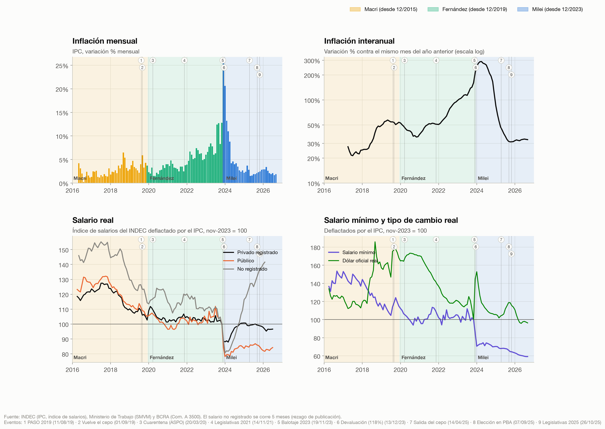

**Figura 2.1.** La inflación mensual tiene tres tramos nítidos: un nivel de 1% a 4% con Macri (con saltos en 2018 y después de las PASO de 2019), una aceleración casi continua con Fernández hasta 12,8% en octubre de 2023, y con Milei un pico de 25,5% en diciembre de 2023 seguido de una desinflación muy rápida que se detiene en torno a 2% mensual desde mediados de 2025. La interanual, en escala logarítmica, muestra lo mismo sin el ruido mensual: 289% en abril de 2024 y alrededor de 31-33% desde entonces. Los salarios reales del panel inferior cuentan otra historia: la caída es de larga data (el privado registrado venía de 120-127 en 2017), con un escalón abrupto en diciembre de 2023 que el sector privado recuperó a lo largo de 2024 y el sector público no. El salario no registrado es la serie más volátil y la única que con Milei supera su nivel de 2023. El salario mínimo real cae en cada gobierno y se desploma en el actual; el tipo de cambio real salta con la devaluación y vuelve a la zona de 100 en 2025-2026: la apreciación real borró la devaluación.

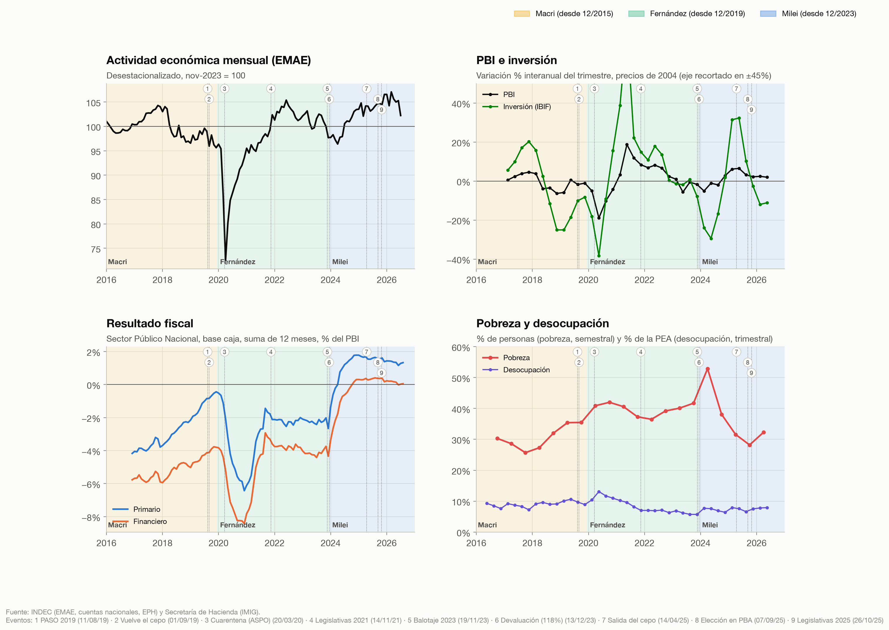

**Figura 2.2.** La actividad mensual (EMAE) no tiene tendencia de largo plazo: oscila alrededor de 100 durante diez años, con la caída de la cuarentena (marzo-abril de 2020) como único valor extremo. La inversión amplifica los ciclos del PBI: cae y sube entre dos y cuatro veces más que el producto en cada episodio. El resultado fiscal es la serie con el cambio de nivel más claro de todo el estudio: del rango −2% a −6% del PBI a un superávit primario de 1% a 2% sostenido desde 2024. La pobreza tiene un pico en el primer semestre de 2024 y cae a mínimos de la serie en el segundo de 2025; la desocupación se mueve en un rango más estrecho.

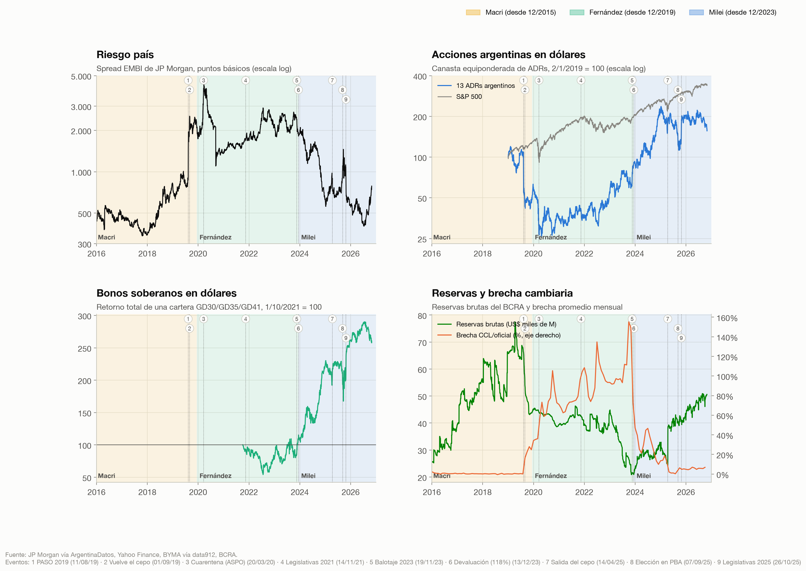

**Figura 2.3.** Las variables de mercado reaccionan a los eventos políticos con más claridad que las macroeconómicas: el riesgo país salta con las PASO de 2019 (evento 1) y vuelve a subir antes de la elección de Buenos Aires de septiembre de 2025 (evento 8); la canasta de ADRs pierde la mitad de su valor en un día después de esas PASO y se multiplica por cuatro entre fines de 2023 y enero de 2025. La brecha cambiaria, cero mientras no hay cepo, llega a 150% en 2023 y se cierra con la salida del cepo (evento 7), el mismo mes del salto de reservas por el desembolso del FMI.

## 2.4 Estadística descriptiva por variable

Cada tabla resume la variable para cada gobierno y para toda la muestra. Las columnas son: número de observaciones (N), media, mediana, desvío estándar, mínimo, máximo, coeficiente de variación, asimetría y curtosis en exceso.

### 2.4.1 Inflación

**Tabla 2.1. Inflación mensual (%)**

{{desc_infl_m}}

La media de la inflación mensual con Milei ({{infl_m_Milei_media}}%) es casi igual a la de Fernández ({{infl_m_Fernández_media}}%), pero la comparación de medias es engañosa: la **mediana** de Milei ({{infl_m_Milei_mediana}}%) está mucho más cerca de la de Macri ({{infl_m_Macri_mediana}}%) que de la de Fernández ({{infl_m_Fernández_mediana}}%). La diferencia entre media y mediana, la asimetría de {{infl_m_Milei_asim}} y la curtosis de {{infl_m_Milei_curt}} dicen lo mismo: la distribución de Milei es una masa de meses de 1,5% a 4% más una cola de muy pocos meses extremos (diciembre de 2023 a marzo de 2024). Es el caso típico en el que la mediana describe mejor el "mes típico" que la media. El CV de Milei ({{infl_m_Milei_cv}}%) duplica el de los gobiernos anteriores: es el período con la inflación menos estable, aunque esa inestabilidad se concentra al principio. Para toda la muestra la curtosis de 14,8 indica colas mucho más pesadas que una normal, algo a tener en cuenta en el modelo (errores no normales).

**Tabla 2.2. Inflación interanual (%)**

{{desc_infl_a}}

La interanual "arrastra" doce meses, así que el gobierno de Milei hereda en sus primeros meses la inflación acumulada de 2023 y su media ({{infl_a_Milei_media}}%) es la más alta de los tres. De nuevo, la mediana ({{infl_a_Milei_mediana}}%) es menor que la de Fernández. La curtosis negativa de Macri y Milei (distribuciones "achatadas" o bimodales) refleja que en ambos períodos la inflación interanual pasó por dos niveles distintos: la media resume mal una serie con tendencia.

**Distribución de frecuencias de la inflación mensual.** Para comparar la forma de la distribución se agrupan los meses en intervalos comunes a los tres gobiernos, cerrados a izquierda y abiertos a derecha. Por la regla de Sturges (k = 1 + 3,322 log₁₀ N) corresponderían unos 6 intervalos por gobierno ({{sturges}}); se usan 9 porque la cola de Milei recorre un rango diez veces mayor que el cuerpo de la distribución y con intervalos de igual ancho todo el gobierno de Macri caería en uno o dos. Por eso los intervalos se ensanchan en la cola (de 1 punto hasta 5%, luego 2,5, 5 y 15 puntos).

**Tabla 2.3. Macri (may-16 a nov-19)**

{{frec_Macri}}

**Tabla 2.4. Fernández (dic-19 a nov-23)**

{{frec_Fernández}}

**Tabla 2.5. Milei (dic-23 en adelante)**

{{frec_Milei}}

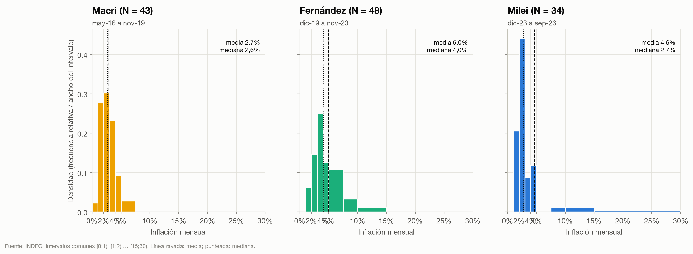

**Figura 2.4.** Como los intervalos tienen anchos distintos, el histograma grafica la **densidad** (frecuencia relativa dividida por el ancho del intervalo): así el área de cada barra, y no su altura, es proporcional a la cantidad de meses. Las tablas de frecuencias acumuladas permiten leer los percentiles directamente: con Macri el {{menos2_Macri}}% de los meses tuvo una inflación menor a 2%; con Fernández, el {{menos2_Fernández}}%; con Milei, el {{menos2_Milei}}%. En el otro extremo, los meses con 5% o más fueron {{mas5_Macri}}% del total con Macri, {{mas5_Fernández}}% con Fernández y {{mas5_Milei}}% con Milei. La distribución de Fernández es la más "corrida a la derecha" y la más dispersa en el cuerpo; la de Milei es la más concentrada en el centro (el 44% de los meses entre 2% y 3%) y a la vez la única con valores por encima de 15%. Una media sola no puede describir esa forma.

### 2.4.2 Salarios

**Tabla 2.6. Salario real privado registrado (nov-23 = 100)**

{{desc_sal_priv_reg}}

**Tabla 2.7. Variación mensual del salario real privado registrado (%)**

{{desc_d_sal_priv_reg}}

En niveles, cada gobierno tuvo un salario real privado más bajo que el anterior: {{sal_priv_reg_Macri_media}} con Macri, {{sal_priv_reg_Fernández_media}} con Fernández y {{sal_priv_reg_Milei_media}} con Milei (nov-23 = 100). La tabla de variaciones mensuales muestra que la media de los tres gobiernos es negativa o casi cero; lo que distingue a Milei es la forma: asimetría de {{d_sal_priv_reg_Milei_asim}} y curtosis de {{d_sal_priv_reg_Milei_curt}}, por un único mes de caída extrema (−11,5% en diciembre de 2023) seguido de muchos meses de recuperación (la mediana, {{d_sal_priv_reg_Milei_mediana}}%, es la única positiva). Es un patrón de "shock y recomposición", distinto de la erosión gradual de los dos gobiernos anteriores.

**Tabla 2.8. Salario real público (nov-23 = 100)**

{{desc_sal_publico}}

**Tabla 2.9. Variación mensual del salario real público (%)**

{{desc_d_sal_publico}}

El salario público tuvo el mismo shock inicial que el privado (−15,9% en un mes) pero sin la recuperación posterior: su nivel promedio con Milei ({{sal_publico_Milei_media}}) es el más bajo de la serie y su desvío ({{sal_publico_Milei_desvio}}) es chico, es decir, quedó estable en un nivel bajo. Es la variable que mejor muestra que el ajuste fiscal pasó en parte por la masa salarial del Estado.

**Tabla 2.10. Salario real no registrado (nov-23 = 100)**

{{desc_sal_no_reg}}

**Tabla 2.11. Variación mensual del salario real no registrado (%)**

{{desc_d_sal_no_reg}}

El salario no registrado es la excepción: con Milei su variación mensual media es positiva ({{d_sal_no_reg_Milei_media}}% por mes, mediana {{d_sal_no_reg_Milei_mediana}}%), contra caídas promedio en los dos gobiernos anteriores. Es también la serie más volátil (desvío de {{d_sal_no_reg_Milei_desvio}} puntos con Milei) y su CV en niveles ({{sal_no_reg_Milei_cv}}%) cuadruplica el de los gobiernos previos, porque recorre todo el camino de 81 a 142 dentro del mismo período. La lectura económica es que el salario informal, sin paritarias, es el que más cae con la inflación alta y el que más rápido se recompone con la desinflación; la estadística, de muestra chica, pide cautela con cada dato aislado.

**Tabla 2.12. Salario mínimo real (nov-23 = 100)**

{{desc_smvm}}

El salario mínimo real promedio con Milei ({{smvm_Milei_media}}) es la mitad del de Macri ({{smvm_Macri_media}}). A diferencia de los salarios de mercado, el mínimo no se recuperó después del shock de diciembre de 2023: cae de manera casi monótona hasta su mínimo de la serie ({{smvm_Milei_min}}) en el último dato.

### 2.4.3 Salario nominal contra salario real

El salario real es un cociente: lo que se cobra en pesos (salario nominal) dividido por lo que cuestan las cosas (IPC). Mirar el numerador por separado muestra *cómo* se llegó a cada resultado real: si el salario real cae porque los aumentos fueron chicos o porque la inflación fue grande. La relación exacta es

  (1 + variación real) = (1 + variación nominal) / (1 + inflación),

y por eso con inflación alta las dos tasas pueden ser enormes y el resultado real, chico: un aumento nominal de 300% puede ser una pérdida real si la inflación fue de 330%. Las series nominales son los mismos índices de la sección anterior sin deflactar, en la misma ventana de tiempo.

**Tabla 2.13. Variación mensual del salario nominal privado registrado (%)**

{{desc_dn_sal_priv_reg}}

**Tabla 2.14. Variación mensual del salario nominal público (%)**

{{desc_dn_sal_publico}}

**Tabla 2.15. Variación mensual del salario nominal no registrado (%)**

{{desc_dn_sal_no_reg}}

**Tabla 2.16. Variación mensual del salario mínimo nominal (%)**

{{desc_dn_smvm}}

Los aumentos nominales mensuales siguen de cerca a la inflación de cada gobierno: el salario privado registrado subió en promedio {{dn_sal_priv_reg_Macri_media}}% por mes con Macri, {{dn_sal_priv_reg_Fernández_media}}% con Fernández y {{dn_sal_priv_reg_Milei_media}}% con Milei, contra una inflación media de {{infl_m_Macri_media}}%, {{infl_m_Fernández_media}}% y {{infl_m_Milei_media}}%. Con Milei la media y la mediana ({{dn_sal_priv_reg_Milei_mediana}}%) se separan mucho, igual que en la inflación: los aumentos nominales más grandes de toda la serie (hasta {{dn_sal_priv_reg_Milei_max}}% en un mes) llegaron en los meses posteriores a la devaluación, para recomponer lo perdido, y después se desaceleraron junto con los precios. El salario no registrado es el único con aumentos nominales mensuales mayores con Milei ({{dn_sal_no_reg_Milei_media}}%) que con Fernández ({{dn_sal_no_reg_Fernández_media}}%), aun con menos inflación: es la contracara nominal de su recuperación real. El salario mínimo tiene una distribución particular: su mediana es baja (0% con Macri) porque se ajusta por decreto pocas veces al año y la mayoría de los meses no cambia; desde mediados de 2024 se ajusta casi todos los meses, pero por debajo de la inflación.

**Tabla 2.17. Descomposición de la variación de cada salario: nominal, inflación y real**

{{tabla_nominal_real}}

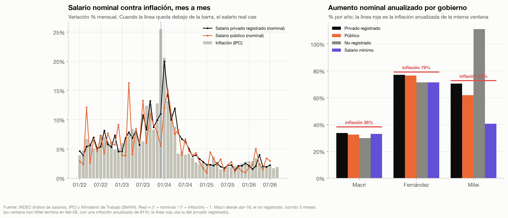

**Figura 2.5.** El panel izquierdo compara mes a mes los aumentos nominales con la inflación desde 2022: cuando la línea del salario queda debajo de la barra de inflación, el salario real cae ese mes. En diciembre de 2023 la brecha es máxima: precios +25,5% contra aumentos de 11,0% en el privado registrado y 5,5% en el público. Desde febrero de 2024 la relación se invierte y el salario privado supera a la inflación en 18 de los 31 meses siguientes, lo que explica su recuperación real a lo largo de 2024. El público también le gana a la inflación en la mitad de esos meses, pero por márgenes más chicos, y nunca recupera el escalón inicial. (El salario mínimo no se grafica en este panel porque se ajusta por escalones y tiene muchos meses con 0%.) El panel derecho resume cada gobierno en términos anualizados. Con Fernández los cuatro salarios subieron entre 71% y 77% nominal por año contra una inflación de 79%: perdieron poco por año pero de manera constante. Con Milei la dispersión entre salarios es mucho mayor que en los gobiernos anteriores: con una inflación de alrededor de 70-80% anual en la ventana de cada serie, el privado registrado subió {{nr_sal_priv_reg_Milei_nom}}% nominal por año (real {{nr_sal_priv_reg_Milei_real}}%), el público {{nr_sal_publico_Milei_nom}}% (real {{nr_sal_publico_Milei_real}}%), el no registrado {{nr_sal_no_reg_Milei_nom}}% (real +{{nr_sal_no_reg_Milei_real}}%) y el mínimo solo {{nr_smvm_Milei_nom}}% (real {{nr_smvm_Milei_real}}%). Que el salario mínimo y el público, los dos que fija o negocia directamente el Estado, sean los que más quedaron atrás de la inflación es consistente con que la política salarial del sector público fue parte del ancla antiinflacionaria y del ajuste fiscal. La lección metodológica es que en una economía con inflación de tres dígitos una suba nominal "récord" no dice nada por sí sola: hay que compararla siempre con la inflación de la misma ventana.

### 2.4.4 Actividad e inversión

**Tabla 2.18. EMAE desestacionalizado (nov-23 = 100)**

{{desc_emae}}

**Tabla 2.19. Variación mensual del EMAE (%)**

{{desc_d_emae}}

El nivel medio de actividad con Milei ({{emae_Milei_media}}) es el más alto de los tres gobiernos, aunque la diferencia es de pocos puntos: en diez años el EMAE se movió casi siempre entre 95 y 107. La variación mensual promedio es prácticamente cero en los tres casos (entre −0,1% y +0,1%); lo que cambia es la volatilidad, dominada en el gobierno de Fernández por la cuarentena de 2020 (mínimo de −15,6% y curtosis de 11,4). Sin la cuarentena, la actividad con Milei es tan volátil como con Macri: desvíos de {{d_emae_Milei_desvio}} y {{d_emae_Macri_desvio}} puntos.

**Tabla 2.20. PBI real, variación interanual del trimestre (%)**

{{desc_g_pib}}

**Tabla 2.21. Inversión (IBIF) real, variación interanual del trimestre (%)**

{{desc_g_ibif}}

**Tabla 2.22. Tasa de inversión (IBIF / PBI, precios corrientes, 4 trimestres, %)**

{{desc_tasa_inv}}

La media del crecimiento interanual del PBI con Milei ({{g_pib_Milei_media}}%) es la más alta, pero con 10 trimestres y un desvío de {{g_pib_Milei_desvio}} puntos la diferencia con Fernández ({{g_pib_Fernández_media}}%, con el rebote de la pandemia adentro) no es estadísticamente distinguible. La inversión es entre tres y seis veces más volátil que el PBI en todos los gobiernos y con Milei su crecimiento interanual mediano es negativo ({{g_ibif_Milei_mediana}}%). La tasa de inversión a precios corrientes es parecida con Fernández y con Milei (alrededor de 16,4%), mientras que a precios de 2004 cae de 20,8% a 18,1% (ver `estudio/results.md`): la diferencia es el precio relativo de los bienes de inversión, que con el dólar apreciado y la apertura importadora se abarataron frente al resto de la economía. La misma inversión física cuesta menos pesos, y la tasa nominal sube aunque la cantidad baje.

### 2.4.5 Cuentas fiscales

**Tabla 2.23. Gasto primario (% del PBI, 12 meses)**

{{desc_gasto_pib}}

**Tabla 2.24. Gasto primario real, variación interanual (%)**

{{desc_d_gasto_real}}

**Tabla 2.25. Resultado primario (% del PBI, 12 meses)**

{{desc_res_primario}}

**Tabla 2.26. Resultado financiero (% del PBI, 12 meses)**

{{desc_res_financiero}}

**Tabla 2.27. Subsidios a la energía (% del PBI del trimestre)**

{{desc_sub_energia_pib}}

Estas son las tablas con diferencias más grandes entre gobiernos. El gasto primario promedio pasa de alrededor de 20% del PBI con Macri y Fernández a {{gasto_pib_Milei_media}}% con Milei: más de cinco puntos del producto. El resultado primario medio cambia de signo ({{res_primario_Macri_media}}% con Macri, {{res_primario_Fernández_media}}% con Fernández, {{res_primario_Milei_media}}% con Milei) y la mediana de Milei ({{res_primario_Milei_mediana}}%) es más representativa que la media, porque el mínimo ({{res_primario_Milei_min}}%, en diciembre de 2023) es una suma de 12 meses que contiene once meses del gobierno anterior; eso explica también su asimetría negativa ({{res_primario_Milei_asim}}). El resultado financiero promedio de Milei es levemente negativo por el mismo motivo, pero su mediana ({{res_financiero_Milei_mediana}}%) es positiva: es el único gobierno de la muestra con superávit financiero. Los subsidios energéticos son el rubro con la caída más clara: de {{sub_energia_pib_Fernández_media}}% del PBI por trimestre con Fernández a {{sub_energia_pib_Milei_media}}% con Milei.

**Estructura del gasto (tortas).** Para ver la composición se usa el gasto de cada año completo en pesos corrientes: las participaciones no necesitan deflactarse, porque numerador y denominador están en la misma moneda del mismo año.

**Tabla 2.28. Estructura del gasto primario, 2023 y 2025 (% del total)**

{{tabla_gasto}}

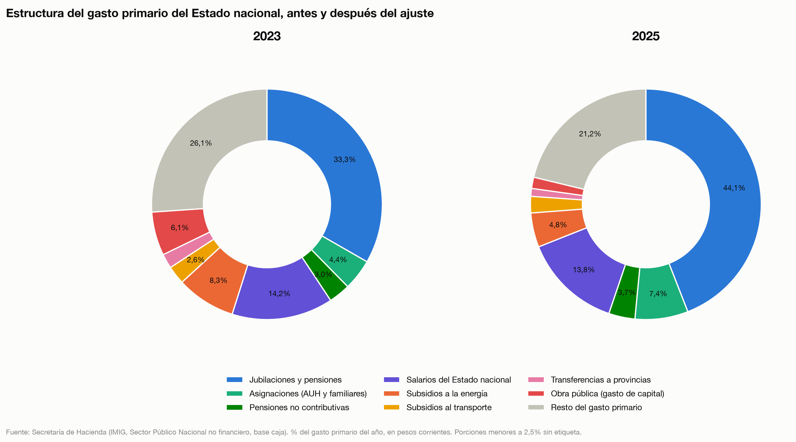

**Figura 2.6.** La composición del gasto cambió más que en cualquier otro momento de la serie. Las jubilaciones pasaron de un tercio a 44% del gasto primario y las asignaciones (AUH y familiares) de 4,4% a 7,4%. Esto **no** significa que se gastara más en jubilaciones: su gasto real cayó 4% entre 2023 y 2025 (ver `estudio/results.md`), pero el total cayó 26% y los rubros que más se recortaron (obra pública, de 6,1% a 1,6% del gasto; subsidios a la energía, de 8,3% a 4,8%) dejaron más espacio relativo a las prestaciones sociales. Es un buen ejemplo de por qué una torta debe leerse junto con el tamaño del total: una porción más grande de una torta más chica puede ser un monto menor.

**Composición de la demanda.** Para el PBI por componente se usan las cuentas nacionales a precios corrientes. Una torta necesita partes positivas que sumen el total, y el PBI no cumple eso por el lado de la demanda (las importaciones restan); por eso se grafica la composición de la demanda final, C + G + I + X, y las importaciones se informan aparte. Las exportaciones a precios corrientes se obtienen por identidad (demanda global menos el resto de sus componentes), porque esa serie viene vacía en la API.

**Tabla 2.29. Componentes de la demanda (% del PBI, precios corrientes)**

{{tabla_demanda}}

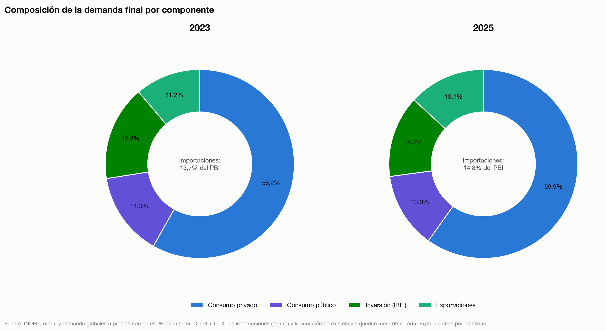

**Figura 2.7.** Entre 2023 y 2025 crece el peso del consumo privado (de 65,8% a 70,8% del PBI) y de las exportaciones (de 12,7% a 15,5%, por la normalización de la cosecha después de la sequía de 2023 y por Vaca Muerta), y bajan el consumo público (de 16,2% a 15,3%) y la inversión (de 18,4% a 16,6%). Las importaciones también suben (de 13,7% a 14,8%), en línea con la apertura comercial. La caída del consumo público en el PBI es la contraparte, en las cuentas nacionales, del ajuste fiscal de la Tabla 2.23.

### 2.4.6 Tipo de cambio

**Tabla 2.30. Depreciación mensual del dólar oficial (%, promedio mensual)**

{{desc_dep_oficial}}

**Tabla 2.31. Tipo de cambio real oficial (nov-23 = 100)**

{{desc_tcr}}

La depreciación mensual mediana es casi igual con Macri y con Milei (alrededor de 2%) y más alta con Fernández (3%), pero Milei tiene la distribución más extrema de todo el capítulo: asimetría de {{dep_oficial_Milei_asim}} y curtosis de {{dep_oficial_Milei_curt}}, por un único salto (la devaluación del 13/12/2023) seguido del "crawling peg" de 2% mensual y de la flotación entre bandas desde abril de 2025. Es el tipo de variable donde la media y el desvío describen mal el proceso: lo que hay es un régimen con un salto discreto. El tipo de cambio real promedio con Milei ({{tcr_Milei_media}}) es el más bajo de los tres gobiernos, es decir, el peso más apreciado en términos reales.

### 2.4.7 Mercados

**Tabla 2.32. Riesgo país (puntos básicos, diario)**

{{desc_riesgo_pais}}

**Tabla 2.33. Retorno diario de la canasta de ADRs argentinos (%, logarítmico)**

{{desc_r_adr}}

**Tabla 2.34. Retorno diario total de la cartera GD30/GD35/GD41 (%, logarítmico)**

{{desc_r_bonos}}

El riesgo país promedio con Milei ({{riesgo_pais_Milei_media}} pb) es menos de la mitad del de Fernández ({{riesgo_pais_Fernández_media}} pb) y más alto que el de Macri ({{riesgo_pais_Macri_media}} pb), cuya media está inflada por los meses posteriores a las PASO de 2019 (la mediana de Macri es {{riesgo_pais_Macri_mediana}} pb). Los retornos diarios tienen las colas más pesadas del capítulo: la curtosis de 128 de los ADRs en 2019 la produce un solo día, el 12/8/2019 (−68% logarítmico, la reacción a las PASO), y aun sin él las curtosis de 5 a 25 están lejos de la normal (0). Es la evidencia descriptiva de por qué los modelos de riesgo de mercado para activos argentinos usan distribuciones t de Student o volatilidad condicional (GARCH) en lugar de la normal. El retorno medio diario de los bonos con Milei ({{r_bonos_Milei_media}}% por día) es el más alto, con un desvío menor que con Fernández.

### 2.4.8 Indicadores sociales

**Tabla 2.35. Pobreza (% de personas, semestral)**

{{desc_pobreza}}

**Tabla 2.36. Desocupación (% de la PEA, trimestral)**

{{desc_desocupacion}}

La pobreza media con Milei ({{pobreza_Milei_media}}%) está entre la de Macri y la de Fernández, pero con solo 5 semestres y un recorrido de 52,9% a 28,2% la media no es un buen resumen: la mediana ({{pobreza_Milei_mediana}}%) y el CV de {{pobreza_Milei_cv}}%, el más alto de los tres, dicen que es el período con la pobreza más cambiante, con el pico y el mínimo de la década dentro del mismo gobierno. La desocupación media con Milei ({{desocupacion_Milei_media}}%) es la más baja de los tres gobiernos, pero conviene leerla con cuidado: la de Fernández incluye el pico de la pandemia (13,1% en el segundo trimestre de 2020), la serie es estacional y la comparación de medias no corrige cambios en la tasa de actividad ni en la calidad del empleo. Comparando trimestres iguales, la desocupación subió de 6,2% (T2-23) a 7,9% (T2-26).

## 2.5 Comparación entre gobiernos

### 2.5.1 Promedios por gobierno

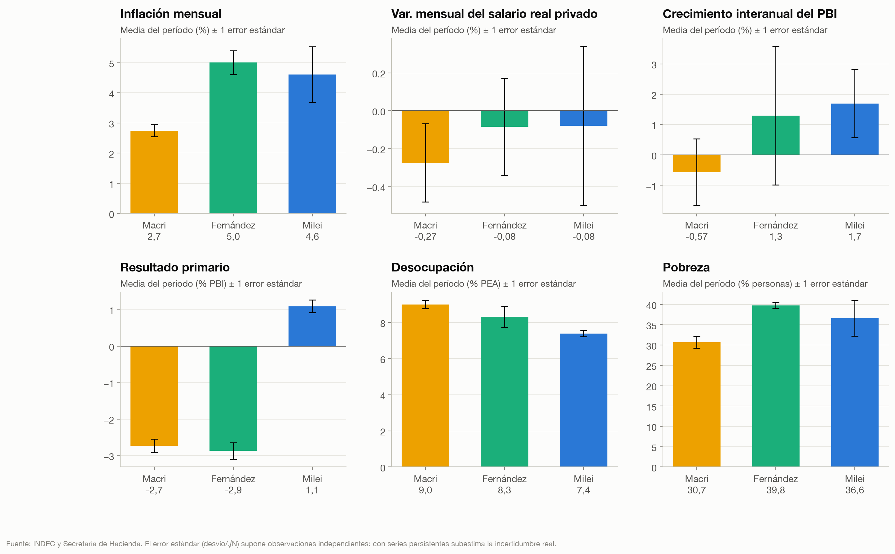

**Figura 2.8.** Cada barra es la media del período y el segmento vertical, ± un error estándar (desvío / √N). Las barras resumen lo que ya mostraron las tablas: la mayor diferencia entre gobiernos está en el resultado fiscal; en la variación mensual del salario real privado los intervalos se superponen por completo; en el crecimiento del PBI los intervalos también se superponen. **Advertencia metodológica:** el error estándar así calculado supone observaciones independientes, y estas series son muy persistentes (ver la sección 2.6): los intervalos verdaderos son más anchos. Un test formal de diferencia de medias debería usar errores estándar robustos a autocorrelación (Newey-West), lo que se deja para el capítulo econométrico.

### 2.5.2 Variación acumulada y anualizada

La variación acumulada compara el último dato del gobierno anterior con el último dato del propio. Como los períodos tienen distinto largo (Milei lleva menos de tres años), se anualiza: (1 + variación acumulada)^(1/años) − 1. Las filas con asterisco no empiezan en el último dato del gobierno anterior porque la serie no existe antes (Macri).

**Tabla 2.37. Variación acumulada y anualizada por gobierno**

{{tabla_variacion}}

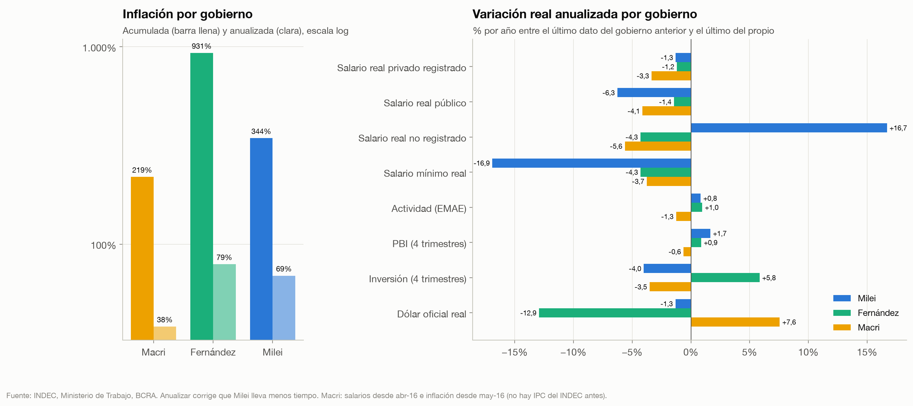

**Figura 2.9.** La inflación anualizada de Milei (69%) es menor que la de Fernández (79%) y mayor que la de Macri (38%, con sus primeros cinco meses fuera de la muestra), y está dominada por los primeros cuatro meses: anualizada, la inflación fue de 62% entre abril y diciembre de 2024, 31,5% en 2025 y 33% en los nueve meses de 2026. En términos reales, el patrón de Milei es el más heterogéneo: el salario no registrado sube 16,7% por año y el mínimo cae 16,9% por año; el salario público cae 6,3% anual, el privado registrado 1,3% (igual que con Fernández); el PBI crece 1,7% por año (el mejor de los tres) y la inversión cae 4% por año. El tipo de cambio real termina casi donde empezó (−1,3% anual) después de recorrer un salto de 50% y su reversión.

### 2.5.3 Boxplots

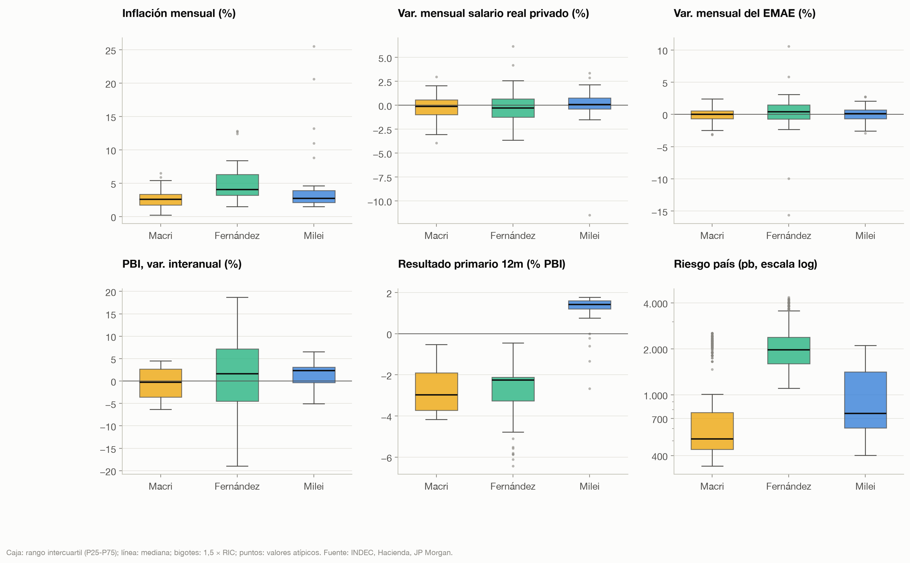

**Figura 2.10.** Los diagramas de caja permiten comparar posición, dispersión y valores atípicos al mismo tiempo. En la inflación, la caja de Milei (rango intercuartil) es la más angosta y está a la altura de la de Macri, y los meses de diciembre de 2023 a marzo de 2024 aparecen como **atípicos** (más de 1,5 rangos intercuartiles por encima del tercer cuartil). En el resultado primario la caja de Milei no se superpone con ninguna de las anteriores: es la única variable donde el cambio de régimen es visible incluso en la distribución completa. El riesgo país de Macri tiene una caja baja con muchos atípicos (los meses posteriores a las PASO); el de Milei tiene una caja muy alta, porque en su período el riesgo país bajó de 2.000 a 400 puntos y volvió a subir: una distribución con tendencia, no un nivel estable.

## 2.6 Preparación para el modelo econométrico

Esta sección no estima el modelo: describe las propiedades de las series que van a condicionar su especificación.

### 2.6.1 Estacionariedad: pruebas ADF y KPSS

Se usan dos pruebas con hipótesis nulas opuestas. La de Dickey-Fuller aumentada (ADF) tiene como nula que la serie tiene **raíz unitaria** (no es estacionaria); la KPSS tiene como nula que la serie **es estacionaria**. Usarlas juntas evita leer la falta de rechazo de una sola como prueba de lo contrario: una serie es I(0) si el ADF rechaza (p < 0,05) y el KPSS no rechaza (p > 0,05); tiene raíz unitaria si pasa lo inverso; y el resultado es ambiguo si ambas rechazan o ninguna. Los rezagos del ADF se eligen por el criterio de Akaike. "Det." indica los componentes deterministas (c: constante; ct: constante y tendencia). El p-valor del KPSS que informa statsmodels está acotado entre 0,01 y 0,10 porque se interpola en la tabla de Kwiatkowski et al. (1992).

**Tabla 2.38. Pruebas de raíz unitaria, niveles y primeras diferencias**

{{tabla_raiz}}

- **Los niveles de las variables reales son no estacionarios.** El logaritmo del salario real (los tres), del tipo de cambio real y del riesgo país, y el resultado primario como % del PBI tienen raíz unitaria en niveles y son estacionarios en primeras diferencias: son I(1). Cualquier regresión entre ellas en niveles corre riesgo de ser espuria salvo que estén cointegradas.
- **La inflación mensual está en el límite.** El ADF casi rechaza (p = 0,056) y el KPSS casi rechaza (p = 0,09): es el resultado "ambiguo" típico de una serie estacionaria con cambios de nivel. Perron (1989) mostró que un quiebre estructural no modelado sesga el ADF hacia no rechazar la raíz unitaria, así que la evidencia es compatible con una inflación I(0) alrededor de una media que cambió de régimen (ver 2.6.4). En primera diferencia es claramente I(0).
- **El log del IPC** tiene raíz unitaria en niveles y su diferencia (la inflación) es ambigua: con inflación alta y persistente el nivel de precios puede comportarse como I(2). Modelar la inflación y no el nivel de precios evita ese problema.
- **La depreciación mensual es I(0)** en niveles: es una tasa de variación sin tendencia.
- **Las series trimestrales (PBI e IBIF)** dan resultados débiles: con 42 observaciones y estacionalidad, las pruebas tienen poca potencia. El logaritmo del PBI es I(1); para el modelo conviene usar su variación interanual o la serie desestacionalizada.

### 2.6.2 Autocorrelación de la inflación mensual: ACF y PACF

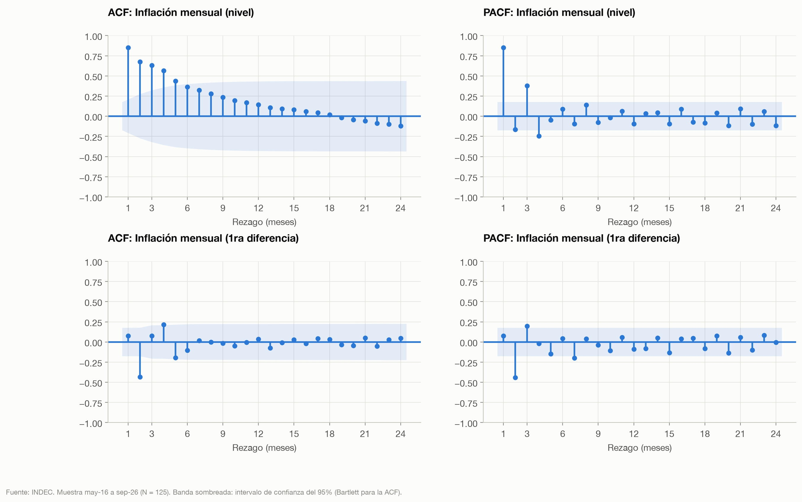

**Tabla 2.39. Prueba de Ljung-Box de la inflación mensual (H0: no hay autocorrelación hasta el rezago indicado)**

{{tabla_ljungbox}}

**Figura 2.11.** En niveles, la función de autocorrelación (ACF) decae lentamente y en forma monótona (0,85 en el primer rezago, significativa hasta el quinto), mientras que la autocorrelación parcial (PACF) se corta después de pocos rezagos: es significativa en los rezagos 1 (0,85), 2 (−0,17), 3 (0,38) y 4 (−0,25) y luego queda dentro de la banda. Ese patrón (ACF que decae, PACF que se corta) es la firma de un **proceso autorregresivo de orden bajo, AR(3) o AR(4)**. La Ljung-Box rechaza con holgura la ausencia de autocorrelación: la inflación de un mes predice la del siguiente (inercia inflacionaria). En primera diferencia aparece una autocorrelación negativa grande en el rezago 2 (−0,43), señal de que diferenciar una serie que es casi estacionaria introduce estructura artificial (sobrediferenciación): es otro argumento para modelar la inflación en niveles con quiebres, y no en diferencias.

### 2.6.3 Estacionalidad

Se estima un factor estacional por mes (o trimestre) como el promedio de la serie sin tendencia (la tendencia es una media móvil centrada de 12 meses o 4 trimestres), y se prueba con Kruskal-Wallis si todos los meses tienen la misma distribución. Kruskal-Wallis es la versión no paramétrica del ANOVA: compara rangos y no medias, lo que lo hace robusto a los valores extremos. Para la inflación se excluye la ventana de noviembre de 2023 a marzo de 2024: con ella adentro, diciembre aparece como el mes más inflacionario del año solo por la devaluación.

**Tabla 2.40. Estacionalidad**

{{tabla_estacionalidad}}

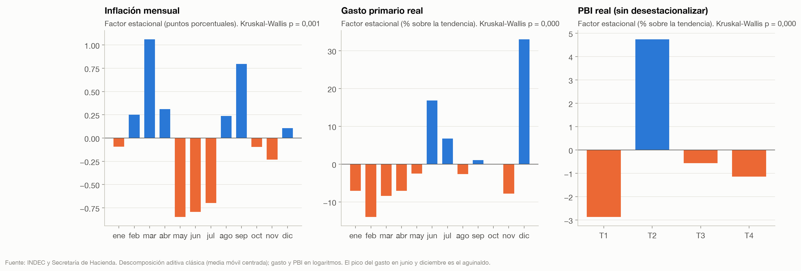

**Figura 2.12.** La inflación mensual tiene una estacionalidad moderada pero estadísticamente significativa (p = {{est_infl_p}}): marzo (inicio de clases, cambio de temporada de ropa) está {{est_infl_max}} puntos por encima de la tendencia y mayo a julio entre 0,7 y 0,85 por debajo. El gasto primario real tiene una estacionalidad enorme (+{{est_gasto_max}}% en diciembre y +17% en junio por el aguinaldo), que justifica trabajar con sumas de 12 meses o variaciones interanuales como en este capítulo. El PBI sin desestacionalizar sube {{est_pib_max}}% en el segundo trimestre (cosecha gruesa) y cae {{est_pib_min}}% en el primero. Como control, el EMAE desestacionalizado no muestra estacionalidad residual (p = 0,22): la desestacionalización del INDEC funciona. Consecuencia para el modelo: la inflación mensual necesita dummies estacionales (al menos para marzo y el bloque mayo-julio) o un componente SARIMA.

### 2.6.4 Quiebres estructurales

Se usan tres pruebas complementarias.

1. **Test de Quandt-Andrews (QLR o sup-F).** Para cada fecha candidata, entre el 15% y el 85% de la muestra, se calcula el estadístico F de Chow de un cambio en los dos coeficientes de un AR(1) de la inflación (constante y persistencia). Como la fecha se elige donde el F es máximo, los valores críticos no son los de la F habitual sino los de Andrews (1993): 5,00 (10%), 5,86 (5%) y 7,78 (1%) para q = 2.
2. **Test de Chow en fechas elegidas a priori** (diciembre de 2023, devaluación y cambio de gobierno; abril de 2025, salida del cepo). Como las fechas no se eligen mirando los datos, valen los valores críticos F habituales.
3. **Test de Zivot-Andrews**: raíz unitaria con un quiebre en la constante en una fecha desconocida, que corrige el sesgo de Perron del ADF.

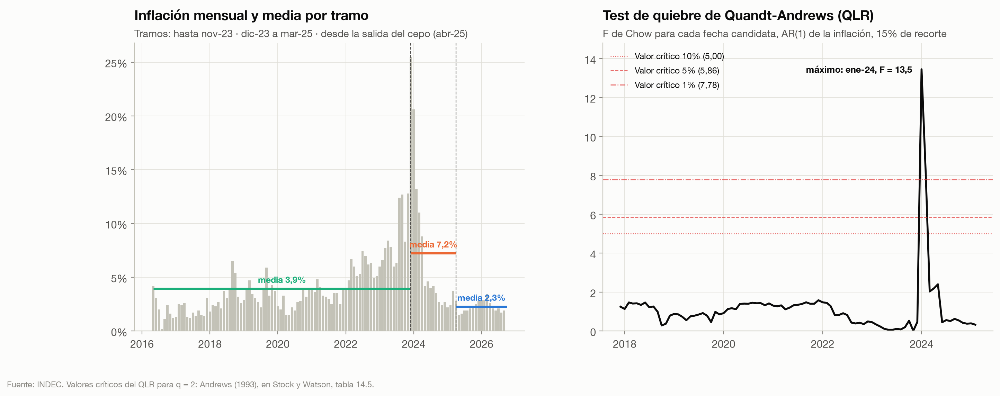

**Tabla 2.41. Test de Chow en fechas conocidas**

{{tabla_chow}}

**Tabla 2.42. Test de Zivot-Andrews (H0: raíz unitaria sin quiebre)**

{{tabla_za}}

**Figura 2.13 y lectura de las pruebas.**

- El QLR encuentra un quiebre muy significativo en la dinámica de la inflación con máximo en **{{qlr_fecha}}** (F = {{qlr}}, por encima del valor crítico de 1%). La fecha es la que separa el shock de la devaluación (diciembre de 2023, que queda en el primer tramo) del proceso de desinflación (desde enero de 2024): el cambio de régimen no es tanto el salto de precios como la velocidad de convergencia posterior.
- El test de Chow **en diciembre de 2023 no rechaza** (p = 0,63) para el AR(1) de la inflación. No contradice al QLR: si diciembre de 2023 se asigna al segundo tramo, ese dato extremo (25,5% después de 12,8%) queda como un residuo enorme dentro del tramo nuevo y los coeficientes estimados de ambos tramos se parecen. Un mes desplazado cambia por completo la conclusión, lo que indica que el quiebre debe modelarse con una **dummy de impulso** para los meses de la devaluación más una **dummy de régimen** desde enero de 2024, y no solo con un corte de muestra.
- La salida del cepo (abril de 2025) no produce un quiebre detectable en la inflación ni en la depreciación mensual: en el gráfico se ve como un cambio de media (de {{infl_m_Milei_media}}% promedio de todo el gobierno a alrededor de 2,3% desde abril de 2025), pero esa baja ya venía ocurriendo antes.
- Las **medias** de la variación mensual del EMAE y del salario real privado no cambian en ninguna de las dos fechas (p > 0,8): lo que cambió con Milei en esas variables es su volatilidad y la forma de la distribución (un shock inicial y una recuperación), no su tendencia de largo plazo.
- Zivot-Andrews no rechaza la raíz unitaria para la inflación, el salario real ni el EMAE aun permitiendo un quiebre, y la rechaza en el límite (p = 0,049) para el tipo de cambio real con quiebre en la crisis de abril de 2018.

### 2.6.5 Qué modelo sugieren los datos

Resumiendo la evidencia de este capítulo:

| Hallazgo descriptivo | Implicancia para el modelo |
|:---|:---|
| Inflación mensual persistente (PACF significativa en los rezagos 1 a 4), ADF/KPSS en el límite, quiebre en ene-24 | Modelo autorregresivo en niveles, AR(3)-AR(4), con dummy de impulso (dic-23 a feb-24) y dummy de régimen (desde ene-24) |
| Estacionalidad significativa de la inflación (marzo, mayo-julio) | Dummies mensuales o componente SARIMA(p,0,q)(1,0,0)₁₂ |
| Salarios reales, tipo de cambio real, riesgo país y resultado fiscal son I(1) | Trabajar en diferencias, o probar cointegración (Johansen) antes de usar niveles |
| Depreciación mensual I(0) con un salto discreto | Puede entrar como regresor de la inflación (traspaso a precios) |
| Colas pesadas (curtosis de 5 a 128) en inflación, depreciación y retornos | Errores robustos; en mercados, distribución t o GARCH |
| Errores estándar ingenuos subestiman la incertidumbre de las diferencias entre gobiernos | Regresiones con dummies de gobierno y errores Newey-West (HAC) |

**Propuesta para el capítulo econométrico.** El modelo más adecuado a los datos es un **ARIMAX para la inflación mensual**: un AR(3) o AR(4) en niveles con dummies estacionales, una dummy de impulso para la devaluación y una dummy de régimen desde enero de 2024, más la depreciación mensual del oficial (contemporánea y rezagada) como regresor exógeno. Permite responder dos preguntas concretas: cuánto bajó la "inflación inercial" con el cambio de régimen y cuánto del salto de 2023-2024 fue traspaso del tipo de cambio. Como extensión, un **VAR en tasas de variación** (depreciación, inflación, variación del salario nominal y del EMAE, todas I(0)), identificado con un orden de Cholesky que va de lo más exógeno (tipo de cambio) a lo más endógeno (actividad), permitiría estimar el traspaso a precios y a salarios con funciones de impulso-respuesta. Con 125 observaciones mensuales un VAR de cuatro variables y dos o tres rezagos es estimable, pero no uno más grande. Para las comparaciones simples entre gobiernos alcanza una **regresión de cada variable sobre dummies de gobierno con errores HAC**, que formaliza las diferencias de medias de las tablas de este capítulo. Un modelo de cambio de régimen de Markov (Hamilton, 1989) sería la alternativa si se quisiera que los datos fechen los regímenes en lugar de imponerlos.

## 2.7 Limitaciones del análisis descriptivo

- **Períodos desiguales.** Milei lleva menos de tres años, contra cuatro de sus antecesores, y su período incluye a la vez el costo de la estabilización (2024) y el rebote (2025). Las estadísticas de cada gobierno resumen ciclos distintos.
- **Herencia y contexto.** La asignación por gobierno es contable, no causal: la inflación de diciembre de 2023 se registra en el período de Milei aunque refleje precios reprimidos heredados, y la sequía de 2023 y la pandemia de 2020 no son decisiones de política. Separar efecto gobierno de efecto contexto es tarea del modelo, no de la estadística descriptiva.
- **Macri incompleto.** Faltan los primeros meses del gobierno de Macri en las series de precios y salarios, que fueron de inflación alta.
- **Pocas observaciones en las series trimestrales y semestrales.** Con 10 trimestres o 5 semestres por gobierno, asimetría y curtosis son muy inestables y deben leerse solo como descripción.
- **Revisiones.** El INDEC revisa el EMAE y las cuentas nacionales con cada publicación; los datos están congelados a octubre de 2026.

## Referencias

- Andrews, D. W. K. (1993). Tests for parameter instability and structural change with unknown change point. *Econometrica*, 61(4), 821-856.
- Dickey, D. A. y Fuller, W. A. (1979). Distribution of the estimators for autoregressive time series with a unit root. *Journal of the American Statistical Association*, 74(366), 427-431.
- Hamilton, J. D. (1989). A new approach to the economic analysis of nonstationary time series and the business cycle. *Econometrica*, 57(2), 357-384.
- Kwiatkowski, D., Phillips, P. C. B., Schmidt, P. y Shin, Y. (1992). Testing the null hypothesis of stationarity against the alternative of a unit root. *Journal of Econometrics*, 54(1-3), 159-178.
- Ljung, G. M. y Box, G. E. P. (1978). On a measure of lack of fit in time series models. *Biometrika*, 65(2), 297-303.
- Perron, P. (1989). The great crash, the oil price shock, and the unit root hypothesis. *Econometrica*, 57(6), 1361-1401.
- Stock, J. H. y Watson, M. W. (2019). *Introduction to Econometrics* (4.ª ed.). Pearson. Tabla 14.5 (valores críticos del QLR).
- Zivot, E. y Andrews, D. W. K. (1992). Further evidence on the great crash, the oil-price shock, and the unit-root hypothesis. *Journal of Business & Economic Statistics*, 10(3), 251-270.
- INDEC: Índice de Precios al Consumidor, Índice de Salarios, EMAE, Informe de Avance del Nivel de Actividad, Encuesta Permanente de Hogares (informes de pobreza y de mercado de trabajo).
- Secretaría de Hacienda: Informe Mensual de Ingresos y Gastos (IMIG) del Sector Público Nacional no financiero, base caja.
- BCRA: API de Estadísticas Monetarias v4.0. Datos abiertos: [datos.gob.ar](https://datos.gob.ar), [ArgentinaDatos](https://argentinadatos.com), [data912](https://data912.com).
